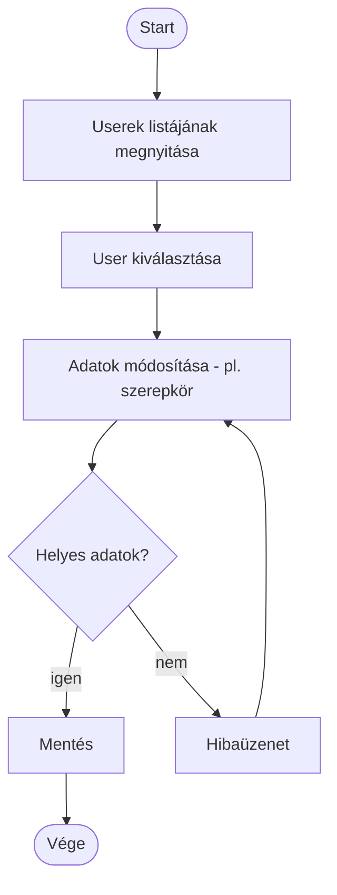
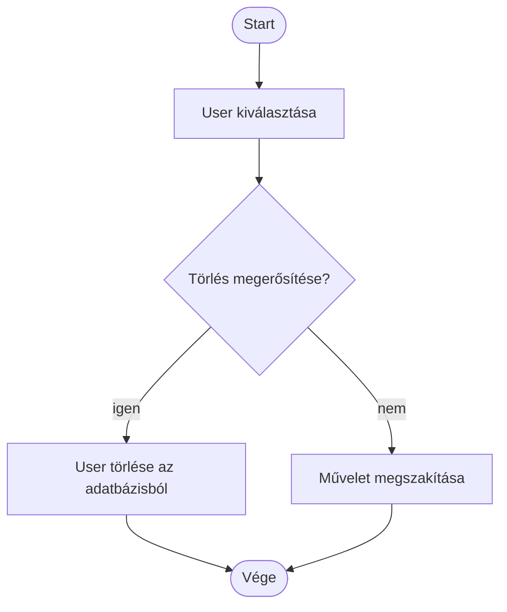

# Activity diagramok — Adminisztráció (Admin)

Az alábbi diagramok a [`UseCase.md`](UseCase.md) "Adminisztráció (Admin)" csomagjának use case-eihez tartozó tevékenységfolyamatot mutatják be. A "Mindent tud amit a többi rang rendelkezik" use case nem önálló tevékenység, hanem azt jelenti, hogy az Admin a [Common](ActivityCommon.md), [Leader](ActivityLeader.md) és [Member](ActivityMember.md) csomagok összes tevékenységéhez is hozzáfér — ezekhez külön activity diagram nem szükséges, a hivatkozott diagramok érvényesek rá is.

## Userek kezelése

## Userek törlése

