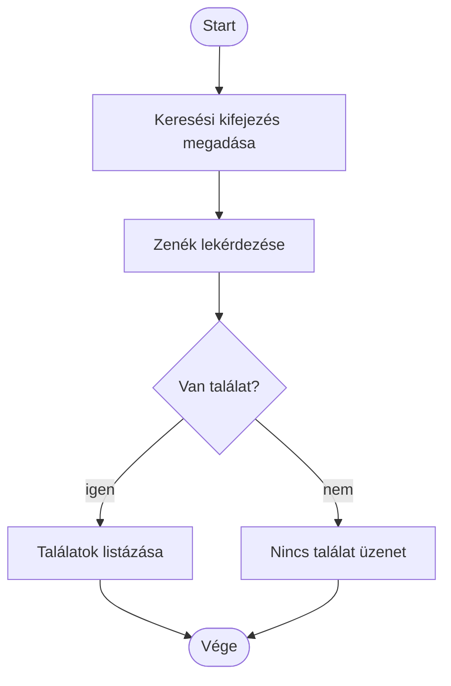
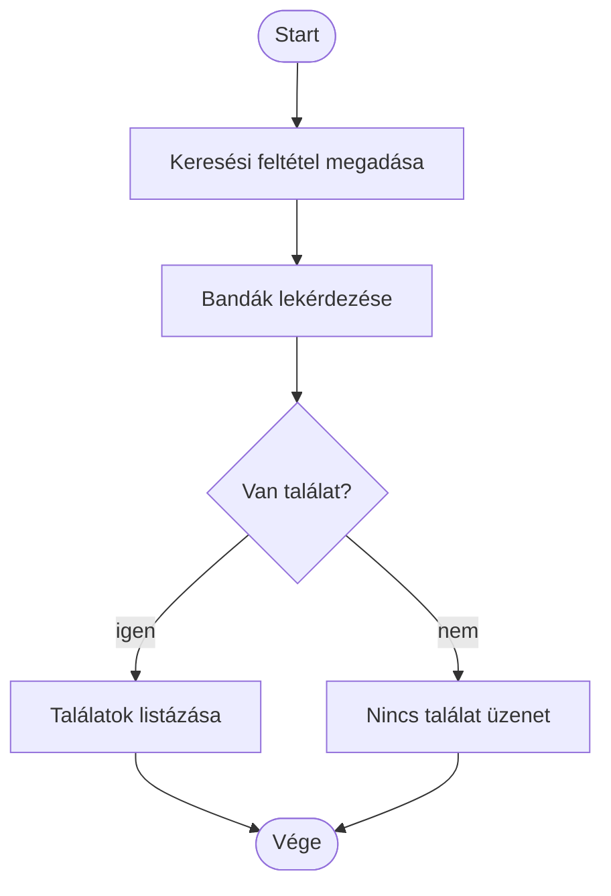
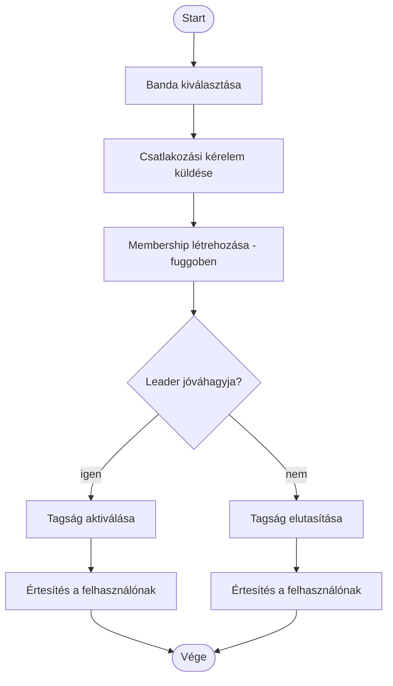
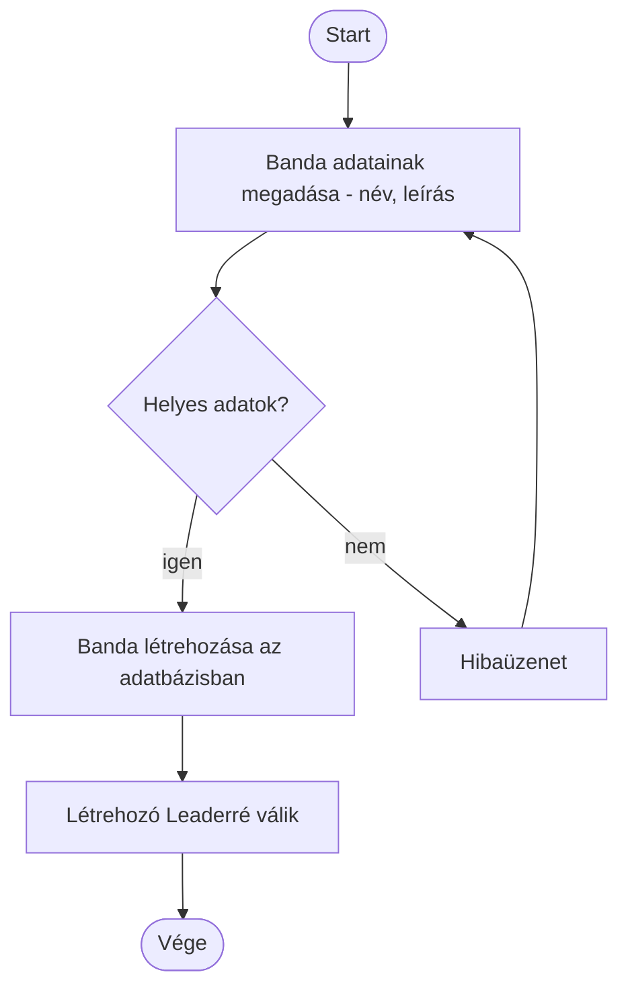
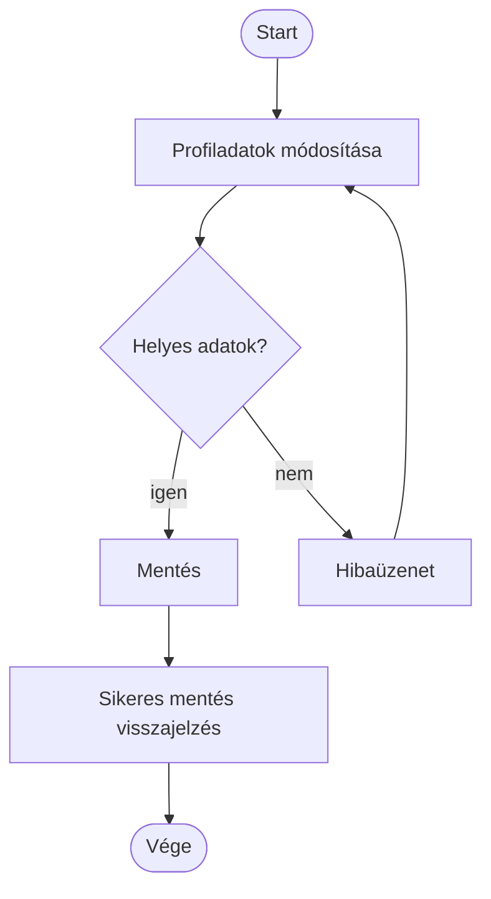
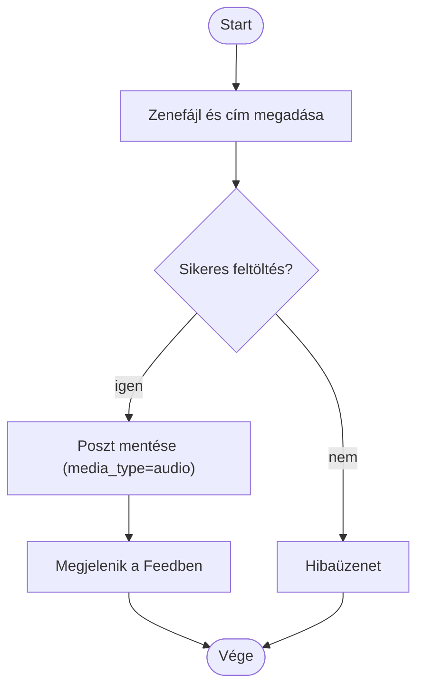
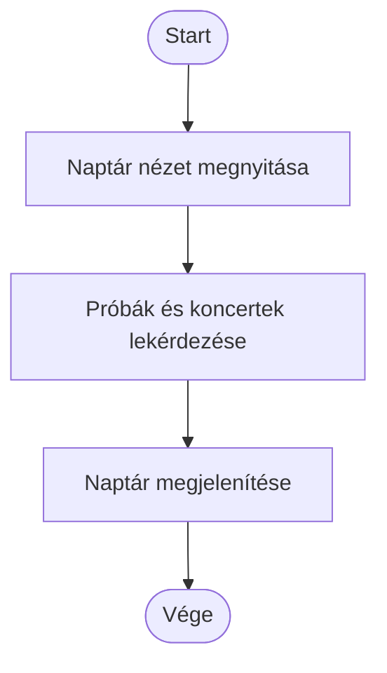
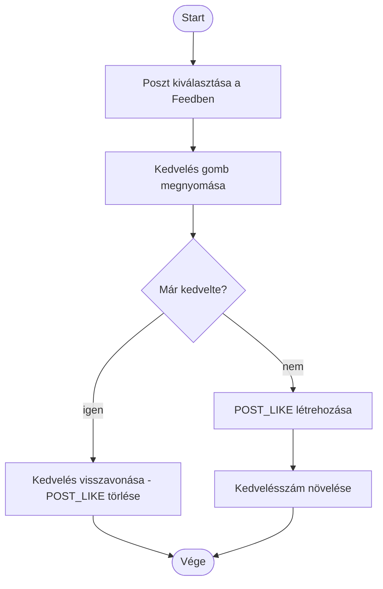
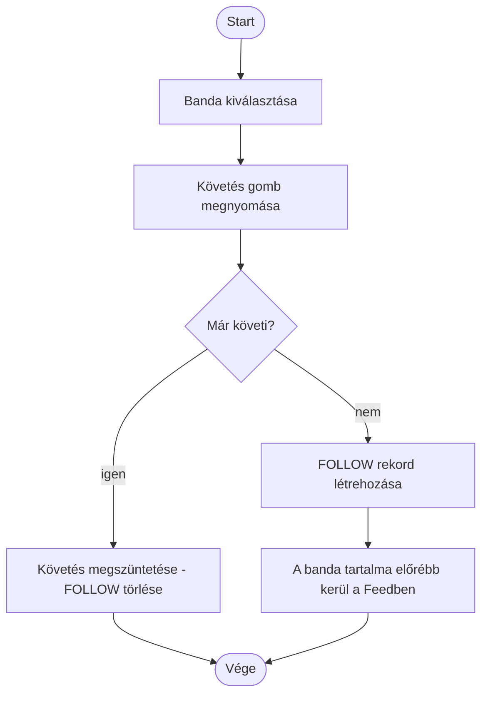
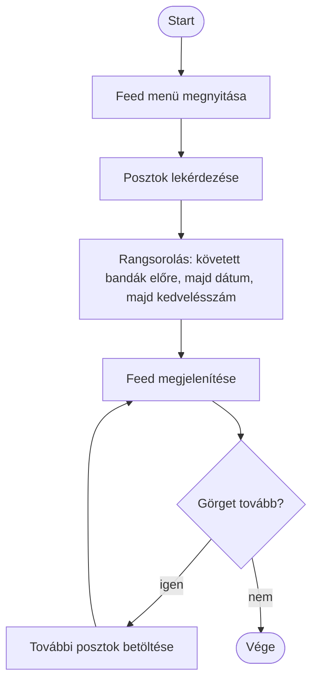

# Activity diagramok — Alap funkciók és Tartalom-feed (minden felhasználó)

Az alábbi diagramok a [`UseCase.md`](UseCase.md) "Alap funkciók" és "Tartalom-feed" csomagjának minden use case-éhez tartozó tevékenységfolyamatot mutatják be, a meglévő [`Activity.md`](Activity.md) stílusával összhangban.

## Zene keresése

## Bandák keresése

## Bandához csatlakozás

## Banda létrehozása

## Profil szerkesztése

## Zene posztolása

## Eseménynaptár megtekintése

## Videó posztolása

## Tartalom kedvelése

## Banda követése

## Feed megtekintése

