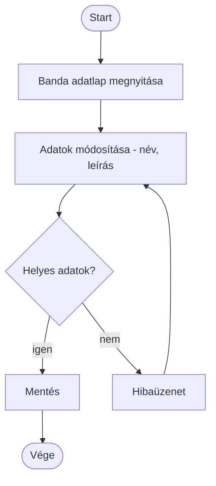
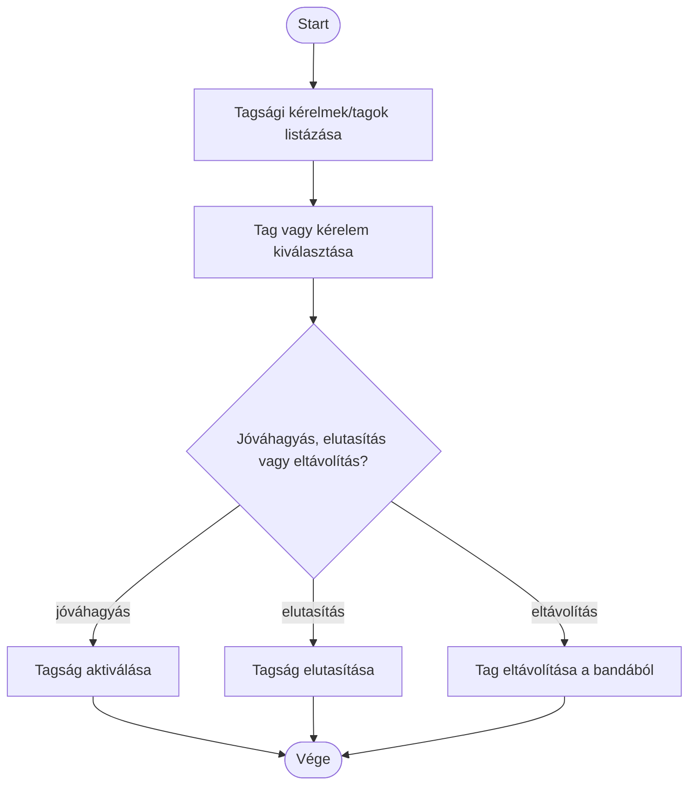
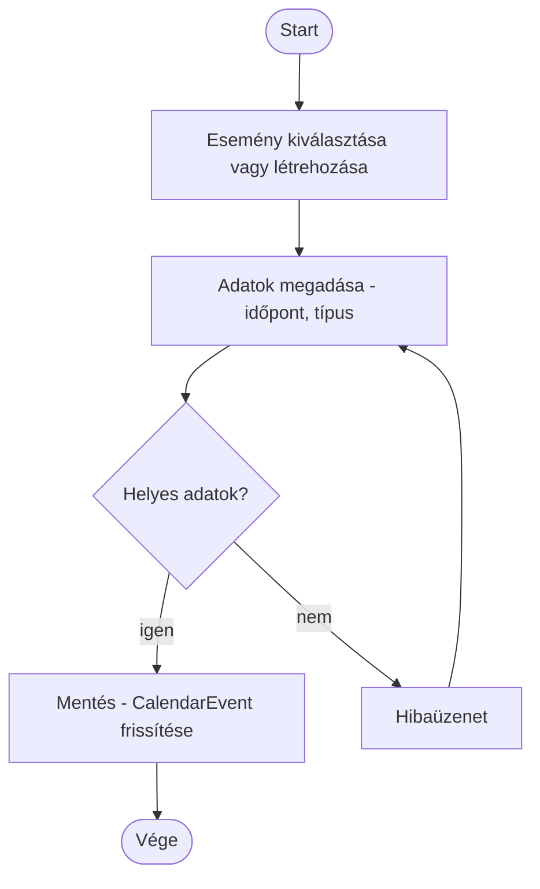
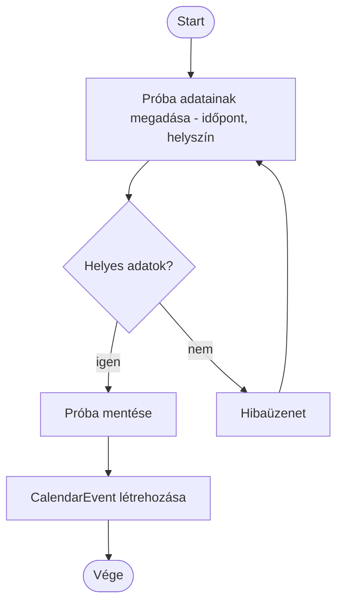
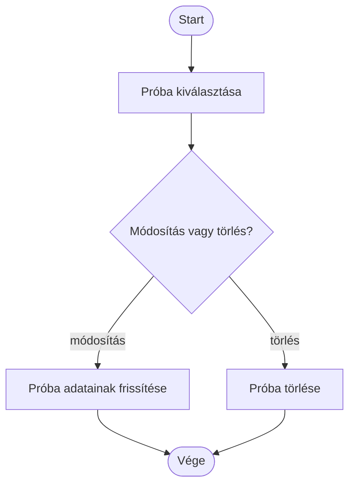

# Activity diagramok — Banda- és próbakezelés (Leader)

Az alábbi diagramok a [`UseCase.md`](UseCase.md) "Banda- és próbakezelés (Leader)" csomagjának minden use case-éhez tartozó tevékenységfolyamatot mutatják be.

## Banda kezelése

## Tagok kezelése

## Eseménynaptár kezelése

## Próba létrehozása

## Próba kezelése

## Koncert létrehozása

