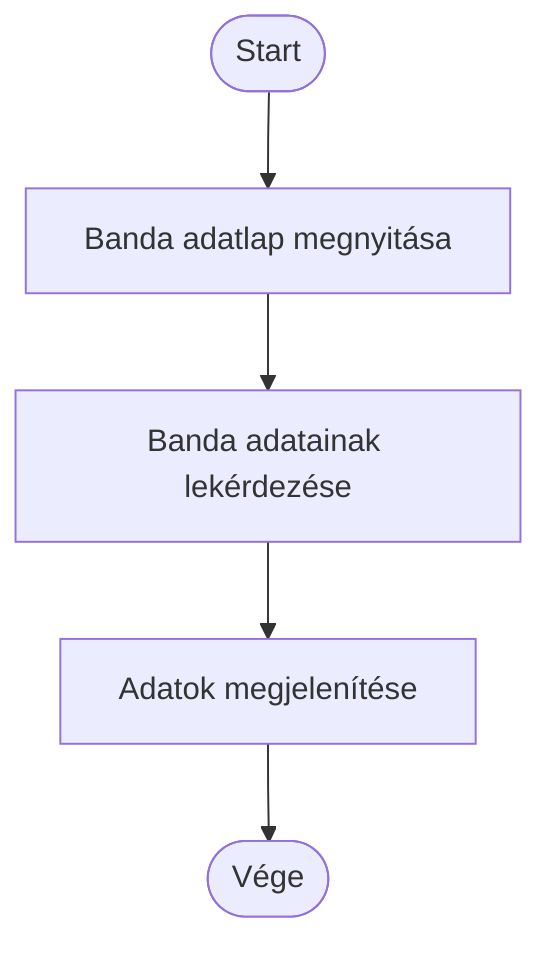
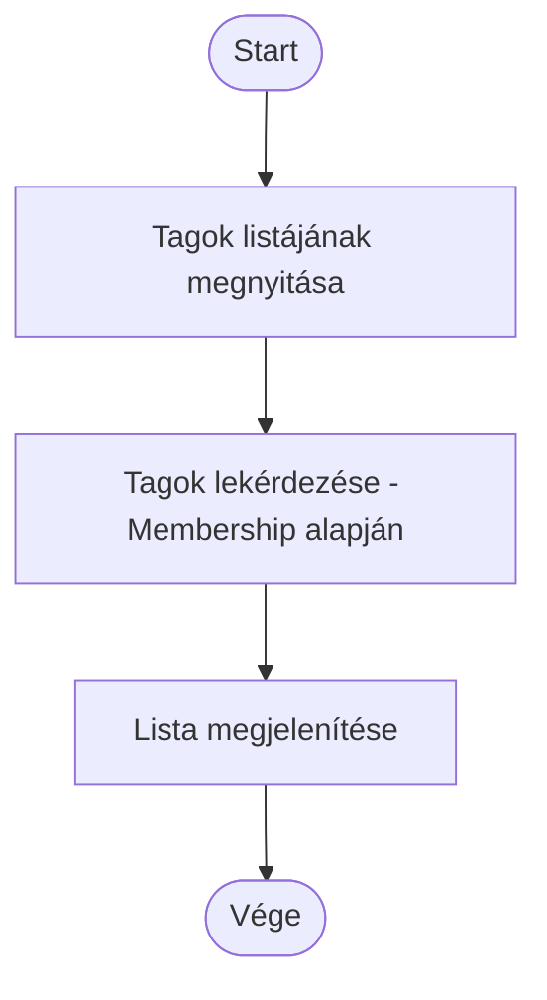
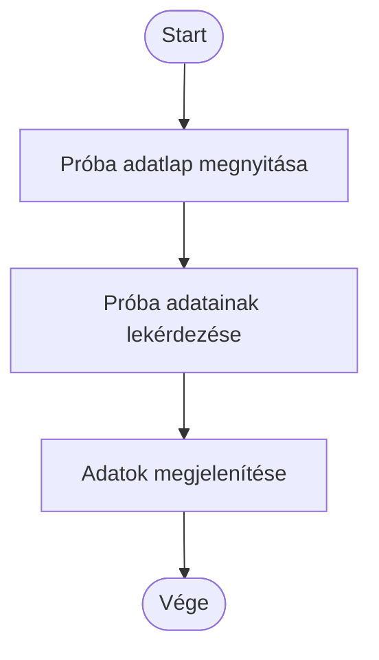
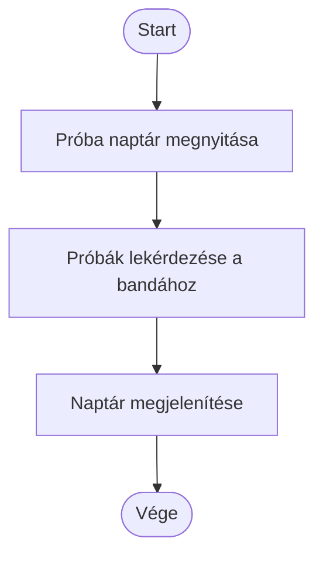
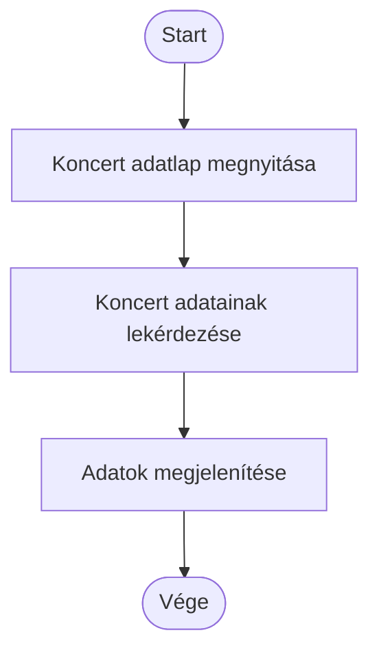
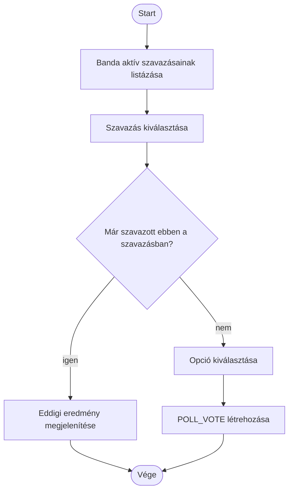
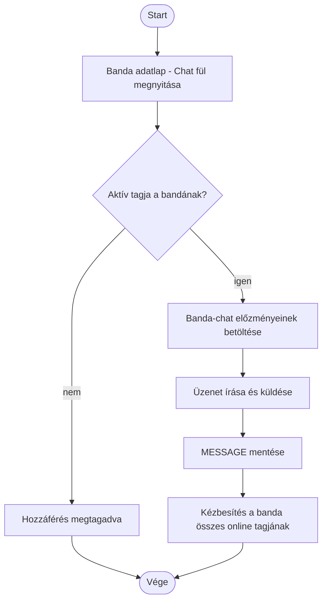

# Activity diagramok — Csapat áttekintése (BandMember)

Az alábbi diagramok a [`UseCase.md`](UseCase.md) "Csapat áttekintése (BandMember)" csomagjának minden use case-éhez tartozó tevékenységfolyamatot mutatják be. Ezek többnyire egyszerű, olvasás jellegű (megtekintés) folyamatok; a Szavazásban részvétel és a Banda-chat használata írási műveletet is tartalmaz.

## Banda megtekintése

## Tagok megtekintése

## Próba megtekintése

## Próba naptár megtekintése

## Koncert megtekintése

## Szavazásban részvétel

## Banda-chat használata

