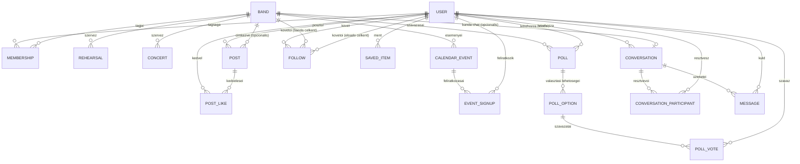

# Adatmodell

> **Megjegyzés:** az entitások mezőit a diagram helyett az alábbi táblázat sorolja fel, mert a mezőlistát is tartalmazó `erDiagram` sok Markdown-előnézőben (pl. régebbi mermaid-verziót használó szerkesztő-bővítményekben) nem jelenik meg — a kapcsolatokat mutató diagram viszont így minden renderelőben megjelenik.

A `POST`, `FOLLOW` és `POST_LIKE` entitások a Tartalom-feed (Instagram-szerű videó-/zenefeed) funkciót szolgálják ki — ld. [Rendszerdokumentacio.md 3.2](../../docs/Rendszerdokumentacio.md#sec-3-2) "Tartalom-feed" csomag és [6.1](../../docs/Rendszerdokumentacio.md#sec-6-1). A `SAVED_ITEM`, `EVENT_SIGNUP`, `POLL`/`POLL_OPTION`/`POLL_VOTE` entitások a v0.10-ben bevezetett Tartalom mentése, Eseményre feliratkozás és Banda-belüli szavazás funkciókat szolgálják ki — ld. ugyanott. A `CONVERSATION`, `CONVERSATION_PARTICIPANT` és `MESSAGE` entitások a v0.16-ban bevezetett Privát chat és Banda-chat funkciókat szolgálják ki — ld. lent a „Chat” szakaszt. A tényleges PostgreSQL DDL az implementációs fázis feladata; ez a dokumentum a tervezési szintű entitás-/mezőlistát rögzíti.

## Entitások mezői

| Entitás | Mező | Típus | Megjegyzés |
|---|---|---|---|
| USER | id | uuid | |
| USER | email | string | |
| USER | password_hash | string | |
| USER | display_name | string | |
| USER | role | string | User / Leader / BandMember / Admin |
| BAND | id | uuid | |
| BAND | name | string | |
| BAND | description | string | |
| BAND | leader_id | uuid | |
| MEMBERSHIP | id | uuid | |
| MEMBERSHIP | user_id | uuid | |
| MEMBERSHIP | band_id | uuid | |
| MEMBERSHIP | status | string | fuggoben / aktiv / elutasitva / eltavolitva |
| REHEARSAL | id | uuid | |
| REHEARSAL | band_id | uuid | |
| REHEARSAL | starts_at | datetime | |
| REHEARSAL | location | string | |
| CONCERT | id | uuid | |
| CONCERT | band_id | uuid | |
| CONCERT | starts_at | datetime | |
| CONCERT | venue | string | |
| CALENDAR_EVENT | id | uuid | |
| CALENDAR_EVENT | band_id | uuid | |
| CALENDAR_EVENT | type | string | proba / koncert / egyeb |
| CALENDAR_EVENT | starts_at | datetime | |
| POST | id | uuid | |
| POST | user_id | uuid | |
| POST | band_id | uuid | opcionális — banda nevében posztolva |
| POST | media_type | string | audio / video |
| POST | title | string | |
| POST | media_url | string | |
| POST | thumbnail_url | string | opcionális |
| FOLLOW | id | uuid | |
| FOLLOW | follower_id | uuid | a követő USER |
| FOLLOW | target_type | string | banda / eloado — melyik entitást követi |
| FOLLOW | target_id | uuid | a követett BAND.id vagy USER.id (előadóként) — a `target_type` szerint |
| POST_LIKE | id | uuid | |
| POST_LIKE | user_id | uuid | |
| POST_LIKE | post_id | uuid | |
| SAVED_ITEM | id | uuid | |
| SAVED_ITEM | user_id | uuid | a mentő USER (bármely szerepkör) |
| SAVED_ITEM | target_type | string | poszt / banda / eloado / esemeny |
| SAVED_ITEM | target_id | uuid | a mentett elem azonosítója, a `target_type` szerint |
| SAVED_ITEM | category | string | opcionális, felhasználó által megadott kategória/címke (pl. "Kedvencek") a mentett elemek rendszerezéséhez |
| SAVED_ITEM | created_at | datetime | |
| EVENT_SIGNUP | id | uuid | |
| EVENT_SIGNUP | user_id | uuid | a feliratkozó USER |
| EVENT_SIGNUP | event_id | uuid | a `CALENDAR_EVENT` (próba/koncert), amelyre a feliratkozás vonatkozik |
| EVENT_SIGNUP | status | string | feliratkozva / lemondva |
| EVENT_SIGNUP | created_at | datetime | |
| POLL | id | uuid | |
| POLL | band_id | uuid | a banda, amelyen belül a szavazás létrejött |
| POLL | created_by | uuid | a szavazást létrehozó USER (Leader) |
| POLL | question | string | a szavazás kérdése/tárgya |
| POLL | created_at | datetime | |
| POLL | closes_at | datetime | opcionális, a szavazás lezárási időpontja |
| POLL_OPTION | id | uuid | |
| POLL_OPTION | poll_id | uuid | |
| POLL_OPTION | option_text | string | egy választható opció szövege |
| POLL_VOTE | id | uuid | |
| POLL_VOTE | poll_id | uuid | |
| POLL_VOTE | option_id | uuid | a leadott szavazat szerinti `POLL_OPTION` |
| POLL_VOTE | user_id | uuid | a szavazó USER (a banda tagja) |
| POLL_VOTE | voted_at | datetime | |
| CONVERSATION | id | uuid | |
| CONVERSATION | type | string | privat / banda |
| CONVERSATION | band_id | uuid | opcionális — csak `type = banda` esetén, bandánként egyedi |
| CONVERSATION | created_by | uuid | a létrehozó USER (privát chatnél az indító fél, banda-chatnél a banda Leadere) |
| CONVERSATION | created_at | datetime | |
| CONVERSATION_PARTICIPANT | id | uuid | |
| CONVERSATION_PARTICIPANT | conversation_id | uuid | |
| CONVERSATION_PARTICIPANT | user_id | uuid | |
| CONVERSATION_PARTICIPANT | joined_at | datetime | |
| CONVERSATION_PARTICIPANT | last_read_at | datetime | az utoljára olvasott időpont — az olvasatlan-számláló alapja |
| CONVERSATION_PARTICIPANT | left_at | datetime | opcionális — kilépés/eltávolítás időpontja (a korábbi üzenetek megmaradnak) |
| MESSAGE | id | uuid | |
| MESSAGE | conversation_id | uuid | |
| MESSAGE | sender_id | uuid | a küldő USER |
| MESSAGE | body | text | az üzenet szövege (az MVP-ben csak szöveg) |
| MESSAGE | created_at | datetime | |
| MESSAGE | edited_at | datetime | opcionális |
| MESSAGE | deleted_at | datetime | opcionális — soft delete (a küldő, banda-chatben a Leader is törölhet) |

## Feed-personalizáció (tervezési javaslat)

A "Feed megtekintése" use case a `POST` entitást adja vissza, felhasználónként eltérő sorrendben:
1. A `FOLLOW` táblában szereplő, a userhez kötött bandák posztjai kerülnek előre.
2. Ezen belül és az összes további poszt között létrehozás szerint csökkenő (legújabb elöl) sorrend érvényesül.
3. A `POST_LIKE` alapján számított kedvelésszám másodlagos rendezési szempont (népszerűbb tartalom előrébb).

Ez a personalizáció csak a *sorrendet* befolyásolja — minden felhasználó ugyanazt a tartalomkészletet láthatja, csak más sorrendben (nincs tartalom-kizárás/szűrés az MVP-ben).

## Mentés, követés, feliratkozás és szavazás — kiegészítő megjegyzések (tervezési javaslat)

- **Mentés (`SAVED_ITEM`):** a mentés minden szerepkör (User/Leader/BandMember/Admin) számára elérhető, és tetszőleges célentitásra (poszt, banda, előadó, esemény) vonatkozhat. A `category` mező szabad szöveges, felhasználónkénti csoportosítást tesz lehetővé (pl. "Kedvenc dalok", "Meghívandó zenészek") — nincs előre definiált, rendszerszintű kategórialista.
- **Követés (`FOLLOW`) kiterjesztése:** a korábbi, kizárólag bandákra vonatkozó követés kiegészült előadók (egyéni USER-ek) követésével; a `target_type`/`target_id` páros teszi lehetővé mindkét célentitást ugyanabban a táblában. A Feed-personalizáció (fent) logikáját a jövőben az előadó-követésre is ki kell terjeszteni (jelenleg csak a banda-követés hat a sorrendre — ld. [Rendszerdokumentacio.md 6.1](../../docs/Rendszerdokumentacio.md#sec-6-1) HELYŐRZŐ).
- **Eseményre feliratkozás (`EVENT_SIGNUP`):** bármely `CALENDAR_EVENT`-re (próba vagy koncert) vonatkozhat; egy felhasználó és egy esemény között legfeljebb egy aktív (`feliratkozva`) rekord értelmezett.
- **Szavazás (`POLL`/`POLL_OPTION`/`POLL_VOTE`):** kizárólag egy adott bandán belül értelmezett — a szavazást csak az adott banda Leadere hozhatja létre (`POLL.created_by`), és csak az adott banda tagjai (BandMember és a Leader) szavazhatnak. Egy felhasználó pollonként egy szavazatot adhat le (egyediségi kényszer, implementáció során rögzítendő).

> **HELYŐRZŐ:** a fenti négy új entitás (`SAVED_ITEM`, kiterjesztett `FOLLOW`, `EVENT_SIGNUP`, `POLL`/`POLL_OPTION`/`POLL_VOTE`) jóváhagyása/pontosítása a tényleges adatbázis-tervezéskor; mezőnevek, típusok, megszorítások (pl. `POLL_VOTE` egyediségi kényszer felhasználónként/pollonként) még nem véglegesek.

## Chat — kiegészítő megjegyzések (tervezési javaslat, v0.16)
- **Egy közös modell, két típus:** a privát és a banda-chat ugyanaz a `CONVERSATION` entitás, a `type` mező különbözteti meg őket — így az üzenetküldés, a kézbesítés és az olvasottság logikája egyetlen helyen valósul meg.
- **Privát (`type = privat`):** pontosan 2 résztvevő; egy felhasználópár között legfeljebb egy privát beszélgetés létezhet (egyediségi kényszer, implementáció során rögzítendő) — ismételt indításkor a meglévő nyílik meg.
- **Banda-chat (`type = banda`):** ez az egyetlen csoportos beszélgetés-típus (tetszőleges felhasználókból álló csoport nem hozható létre); bandánként pontosan egy, a banda létrehozásakor jön létre, neve a banda neve; résztvevői a banda `MEMBERSHIP`-jeiből szinkronizálódnak (a tagság `Aktiv` állapotba lépésekor bekerül, `Eltavolitva` állapotba lépésekor a `left_at` kitöltődik — ld. [TagsagAllapota.md](TagsagAllapota.md)).
- **Olvasatlan üzenetek:** egy résztvevő olvasatlan üzenetei a `MESSAGE.created_at > CONVERSATION_PARTICIPANT.last_read_at` feltétellel számolhatók — üzenetenkénti „olvasta” tábla az MVP-ben nem szükséges.

> **HELYŐRZŐ:** fájl-/képküldés a chatben (a meglévő Objektumtár újrahasznosításával), üzenetkeresés, „gépel…” jelzés és üzenetenkénti olvasási visszaigazolás — ezek nem részei a jelenlegi javaslatnak, bevezetésük külön döntést igényel.
