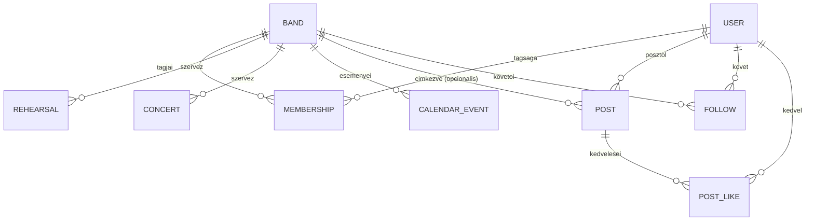

# Adatmodell

> **Megjegyzés:** az entitások mezőit a diagram helyett az alábbi táblázat sorolja fel, mert a mezőlistát is tartalmazó `erDiagram` sok Markdown-előnézőben (pl. régebbi mermaid-verziót használó szerkesztő-bővítményekben) nem jelenik meg — a kapcsolatokat mutató diagram viszont így minden renderelőben megjelenik.

A `POST`, `FOLLOW` és `POST_LIKE` entitások a Tartalom-feed (Instagram-szerű videó-/zenefeed) funkciót szolgálják ki — ld. [Rendszerdokumentacio.md 3.2](../../docs/Rendszerdokumentacio.md#sec-3-2) "Tartalom-feed" csomag és [6.1](../../docs/Rendszerdokumentacio.md#sec-6-1). A tényleges PostgreSQL DDL az implementációs fázis feladata; ez a dokumentum a tervezési szintű entitás-/mezőlistát rögzíti.

## Entitások mezői

| Entitás | Mező | Típus | Megjegyzés |
|---|---|---|---|
| USER | id | uuid | |
| USER | email | string | |
| USER | password_hash | string | |
| USER | display_name | string | |
| USER | role | string | User / Leader / BandMember / Admin |
| BAND | id | uuid | |
| BAND | name | string | |
| BAND | description | string | |
| BAND | leader_id | uuid | |
| MEMBERSHIP | id | uuid | |
| MEMBERSHIP | user_id | uuid | |
| MEMBERSHIP | band_id | uuid | |
| MEMBERSHIP | status | string | fuggoben / aktiv / elutasitva / eltavolitva |
| REHEARSAL | id | uuid | |
| REHEARSAL | band_id | uuid | |
| REHEARSAL | starts_at | datetime | |
| REHEARSAL | location | string | |
| CONCERT | id | uuid | |
| CONCERT | band_id | uuid | |
| CONCERT | starts_at | datetime | |
| CONCERT | venue | string | |
| CALENDAR_EVENT | id | uuid | |
| CALENDAR_EVENT | band_id | uuid | |
| CALENDAR_EVENT | type | string | proba / koncert / egyeb |
| CALENDAR_EVENT | starts_at | datetime | |
| POST | id | uuid | |
| POST | user_id | uuid | |
| POST | band_id | uuid | opcionális — banda nevében posztolva |
| POST | media_type | string | audio / video |
| POST | title | string | |
| POST | media_url | string | |
| POST | thumbnail_url | string | opcionális |
| FOLLOW | id | uuid | |
| FOLLOW | follower_id | uuid | a követő USER |
| FOLLOW | band_id | uuid | a követett BAND |
| POST_LIKE | id | uuid | |
| POST_LIKE | user_id | uuid | |
| POST_LIKE | post_id | uuid | |

## Feed-personalizáció (tervezési javaslat)

A "Feed megtekintése" use case a `POST` entitást adja vissza, felhasználónként eltérő sorrendben:
1. A `FOLLOW` táblában szereplő, a userhez kötött bandák posztjai kerülnek előre.
2. Ezen belül és az összes további poszt között létrehozás szerint csökkenő (legújabb elöl) sorrend érvényesül.
3. A `POST_LIKE` alapján számított kedvelésszám másodlagos rendezési szempont (népszerűbb tartalom előrébb).

Ez a personalizáció csak a *sorrendet* befolyásolja — minden felhasználó ugyanazt a tartalomkészletet láthatja, csak más sorrendben (nincs tartalom-kizárás/szűrés az MVP-ben).
