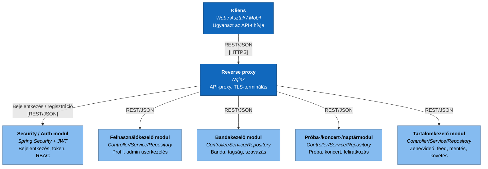
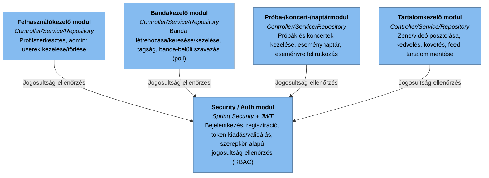
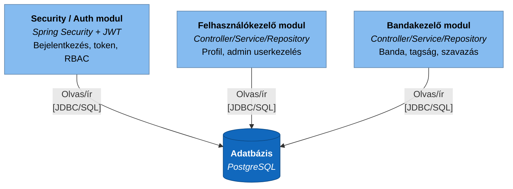
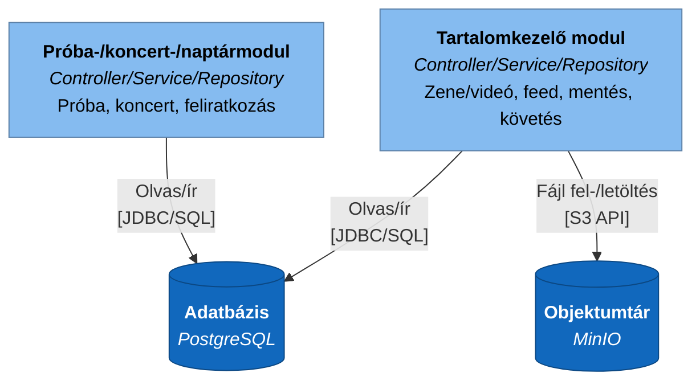
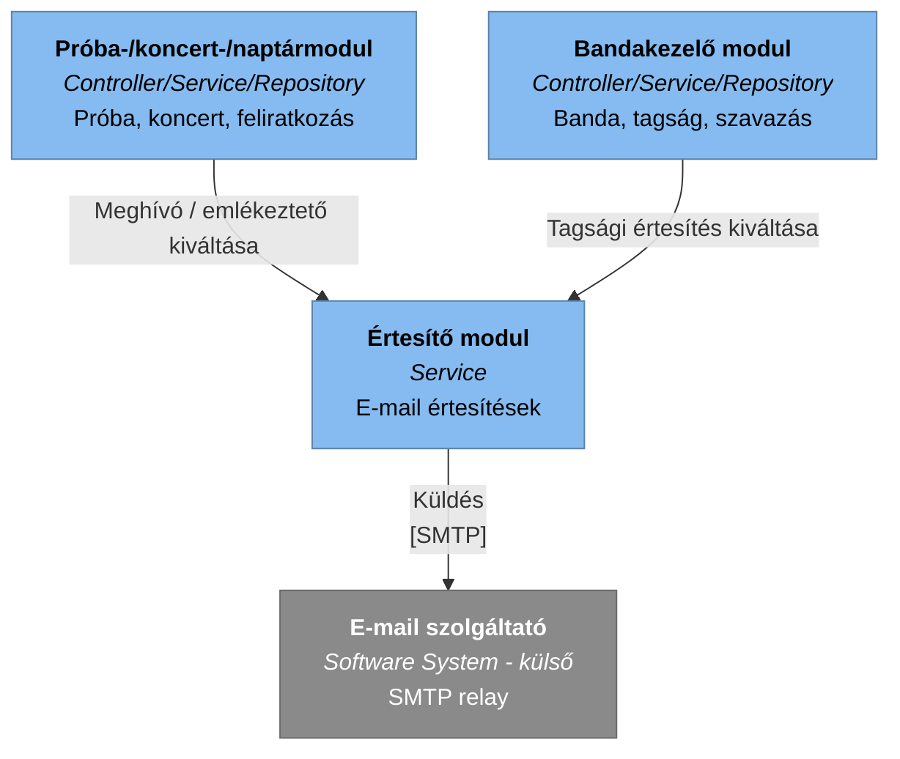

# Component

> **Ajánlott architektúra (C4 szint 3).** A Backend API belső moduljai. Mindhárom kliens (Web/Asztali/Mobil, ld. [Container.md](Container.md)) ugyanazt a REST API-t hívja, platformspecifikus különbség nélkül — a [Container.md](Container.md)-ben leírtaknak megfelelően a hívások ténylegesen a Reverse proxyn (Nginx) keresztül érkeznek, ezért az szerepel a diagramon a kliensek és a Backend API modulok között (a diagram belső pontossága érdekében ez itt nem hagyható el). A korábbi tervezetben külön szereplő Próba-/koncert- és Naptár modult, illetve a Zenei tartalom- és Tartalom-feed modult itt egy-egy komponensbe vontam össze (Próba-/koncert-/naptármodul, Tartalomkezelő modul) — a kettéválasztás nem indokolt méretű felelősségi kört jelentett volna, és feleslegesen bonyolította a kapcsolatrendszert. Kanonikus forrás (hivatalos C4-PlantUML), **egyetlen, teljes diagramként**: [`../c4.puml`](../c4.puml) `C4_Component` blokk — ld. [c4.md](c4.md).
>
> **Megjegyzés (v0.15) — miért `flowchart`, nem `C4Component`:** ld. [Context.md](Context.md) azonos megjegyzését a Mermaid C4-diagramtípus keskeny-nézeti hibájáról. A `flowchart`-ra váltás — amellett, hogy szélességtől függetlenül stabil — azt is lehetővé tette, hogy a korábbi, erősen felbontott résznézeteket kicsit összevonjuk: a `flowchart` motorja egy célba (pl. Security modul) futó 4 forrás-nyilat még átfedés nélkül el tud rendezni (ellentétben a Mermaid C4-motorjával, amely ennél már 2-3 forrásnál is összefolyt), ezért a **Jogosultság-ellenőrzés** most egyetlen diagram (a korábbi 2 rész helyett). Az 5 forrásból egy célba (Adatbázis) futó eset viszont `flowchart`-tal is enyhe átfedést produkált teszteléskor, ezért az **Adatbázis-elérés** továbbra is 2 résznézetre van bontva. Összesen **5 résznézet** a korábbi 4/6 helyett. A teljes, egyben látható diagram a kanonikus [`../c4.puml`](../c4.puml) `C4_Component` blokkjában, illetve a [Rendszerdokumentacio.md 5.1](../../docs/Rendszerdokumentacio.md#sec-5-1) táblázatában érhető el.

## 1. Kérés-útvonal (Nginx → modulok)

## 2. Jogosultság-ellenőrzés (RBAC)

## 3. Adatbázis-elérés — 1/2

## 4. Adatbázis- és objektumtár-elérés — 2/2

## 5. Értesítések kiváltása

