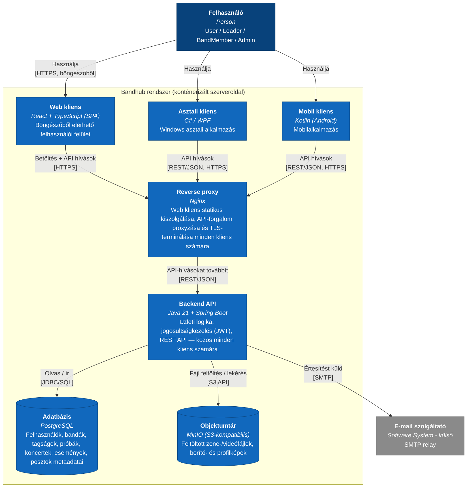

# Container

> **Ajánlott architektúra (C4 szint 2).** Mindhárom felvetett kliens platform (Web, Asztali, Mobil) megvalósul, egy közös backend REST API-ra támaszkodva. A zenei/videó tartalmakhoz önálló objektumtár-konténer tartozik, mert ezek mérete/jellege nem az adatbázisba való (ld. [Adatmodell.md](Adatmodell.md) `POST.media_url`). Kanonikus forrás (hivatalos C4-PlantUML): [`../c4.puml`](../c4.puml) `C4_Container` blokk — ld. [c4.md](c4.md).
>
> **Megjegyzés (v0.15) — miért `flowchart`, nem `C4Container`:** ld. [Context.md](Context.md) azonos megjegyzését — a Mermaid `C4Container` diagramtípus keskeny megjelenítésnél (pl. VS Code osztott Markdown-előnézet) újraszámolja (nem csak kicsinyíti) a belső elrendezést, ami egymásra futó feliratokat eredményezett. Az alábbi diagram ezért sima `flowchart`-ra van átírva, C4-stílusú színezéssel és a `System_Boundary`-t egy `subgraph`-fal helyettesítve — ez szélességtől függetlenül stabil marad, mert a `flowchart` mindig a tartalom természetes méretében számol, és csak a megjelenítő kicsinyíti egységesen. A kanonikus [`../c4.puml`](../c4.puml) változatlan (a PlantUML-motor nem szenved ettől a hibától).

**Komponensszint:** a Backend API belső felépítése — ld. [Component.md](Component.md).
