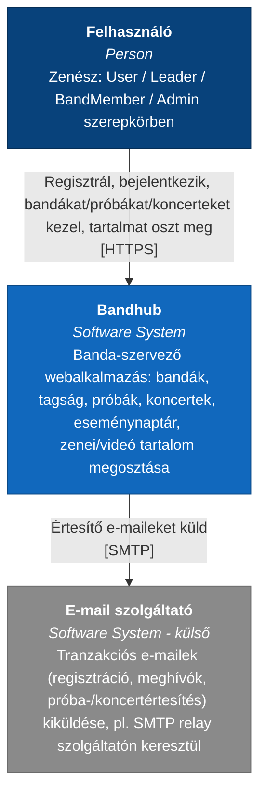

# Context

> **Ajánlott architektúra (C4 szint 1).** A Bandhub rendszer és környezete: ki használja, és milyen külső rendszerrel érintkezik. Kanonikus forrás (hivatalos C4-PlantUML): [`../c4.puml`](../c4.puml) `C4_Context` blokk — ld. [c4.md](c4.md).
>
> **Megjegyzés (v0.15) — miért `flowchart`, nem `C4Context`:** a Mermaid `C4Context`/`C4Container`/`C4Component` diagramtípus a megjelenítés szélességétől függően **újraszámolja a belső elrendezést** (nem csak egységesen kicsinyíti a képet) — keskeny nézetben (pl. VS Code osztott Markdown-előnézet-panel) ez rendszeresen egymásra futó, olvashatatlan feliratokat eredményezett, amit helyi `mermaid-cli` teszteléssel (különböző szélességeken renderelve) diagnosztizáltam. A sima `flowchart` diagramtípus — amit a dokumentum összes többi Mermaid-ábrája (Use Case, Activity, ER stb.) is használ, hiba nélkül — mindig a tartalom természetes méretében számolja ki az elrendezést, és a megjelenítő csak egységesen kicsinyíti; ez szélességtől függetlenül stabil. Ezért az alábbi diagram `flowchart`-ra van átírva, C4-stílusú színezéssel (Person/System/External). A kanonikus [`../c4.puml`](../c4.puml) `C4_Context` blokkja változatlan marad (a PlantUML-motor nem szenved ettől a hibától).

