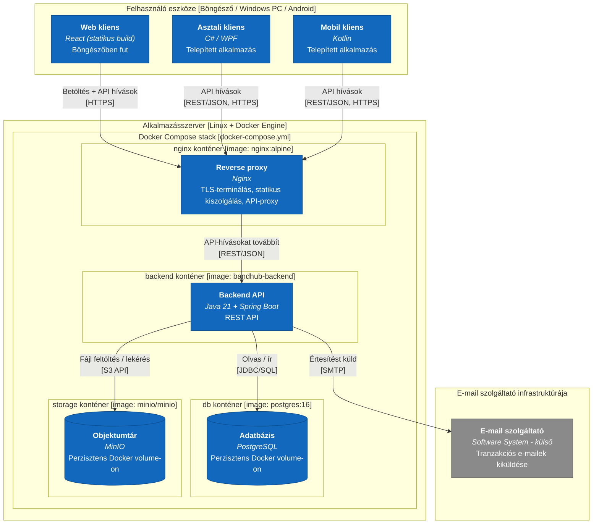

# Deployment

> **Ajánlott architektúra — kiegészítő C4 diagram (telepítés).** A hivatalos C4 modell a Context/Container/Component hármas mellett egy negyedik, kiegészítő diagramtípusként a **Deployment diagramot** ajánlja, amely azt mutatja, a [Container.md](Container.md)-ben leírt konténerek fizikailag milyen infrastruktúrán (gépen, futtatási környezeten) futnak éles üzemben — ld. [`../../docs/Rendszerdokumentacio.md`](../../docs/Rendszerdokumentacio.md#sec-9-1) 9. fejezet. Kanonikus forrás (hivatalos C4-PlantUML): [`../c4.puml`](../c4.puml) `C4_Deployment` blokk — ld. [c4.md](c4.md).
>
> **Megjegyzés (v0.15) — miért `flowchart`, nem `C4Deployment`:** ld. [Context.md](Context.md) azonos megjegyzését a Mermaid C4-diagramtípus keskeny-nézeti hibájáról. Az alábbi diagram sima `flowchart`-ra van átírva, beágyazott `subgraph`-okkal a `Deployment_Node` beágyazások helyett — ez szélességtől függetlenül stabil marad. A kanonikus [`../c4.puml`](../c4.puml) változatlan (a PlantUML-motor nem szenved ettől a hibától).

**Fejlesztői környezet:** ugyanez a topológia, egyetlen gépen (fejlesztői laptop), `docker compose up`-pal indítva — ld. [`../../docs/Rendszerdokumentacio.md`](../../docs/Rendszerdokumentacio.md#sec-9-2) 9.2 fejezet.

> **HELYŐRZŐ:** a konkrét szerver/hoszting-szolgáltató, valamint a redundancia/skálázás kérdése (ld. [9.3](../../docs/Rendszerdokumentacio.md#sec-9-3)) — ez a projekt növekedésével döntendő el.
