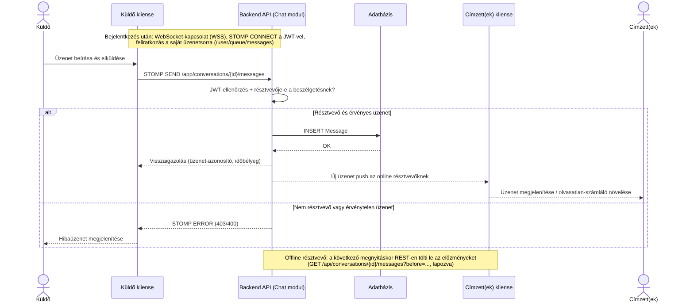

# UzenetKuldes

> **Tervezési javaslat (v0.16).** Üzenet küldése privát vagy banda-chatben — mindkét típus ugyanezt a folyamatot követi (ld. [Adatmodell.md](Adatmodell.md) „Chat” szakasz, [`../../docs/Rendszerdokumentacio.md`](../../docs/Rendszerdokumentacio.md#sec-7-3) 7.3).

