# Bandhub — Rendszerdokumentáció

> **Státusz:** Munkaanyag (v0.9). A dokumentum a projekt jelenlegi, korai fázisú állapotára épül (lásd [`../diagrams/Cont.md`](../diagrams/Cont.md) és a [`../diagrams/`](../diagrams/) mappa tartalma). Mivel a repóban jelenleg nincs implementált backend/frontend kód, a dokumentum kétféle tartalmat különböztet meg:
> - **Tény** — közvetlenül a meglévő diagramokból vagy a `Cont.md`-ből levezethető állítás.
> - **Ajánlott architektúra / tervezési javaslat** — a projekt ismert kontextusa (Java backend, konténerizált futtatás, a csapat által felvetett kliens platform-opciók — Web/React, Asztali/C#-WPF, Mobil/Kotlin —, a use case- és tevékenységdiagramok funkciói) és iparági bevált gyakorlat (a [C4 modell](https://c4model.com) hivatalos konvenciói, hivatalos [C4-PlantUML](https://github.com/plantuml-stdlib/C4-PlantUML) könyvtár) alapján megfogalmazott, konkrét, jóváhagyást igénylő javaslat (ld. [16.3](#sec-16-3) v0.7–v0.9). Ezek **nem véglegesített döntések**, és nem tartalmaznak kitalált projektadatot (pl. konkrét cégnevet, valós számadatot) — ahol ilyen adat szükséges lenne, ott továbbra is **HELYŐRZŐ** jelölés szerepel.
>
> **Verzió:** 0.16 (Privát és banda-chat) &nbsp;|&nbsp; **Dátum:** 2026-10-01 &nbsp;|&nbsp; **Szerző:** HELYŐRZŐ (dokumentum gazdája)

---

## Tartalomjegyzék

- [1. Dokumentum célja és hatóköre](#sec-1)
- [2. Rendszer áttekintése](#sec-2)
  - [2.1 A rendszer célja](#sec-2-1)
  - [2.2 Célközönség és felhasználói szerepkörök](#sec-2-2)
  - [2.3 Fő jellemzők](#sec-2-3)
- [3. Üzleti és funkcionális leírás](#sec-3)
  - [3.1 Üzleti célok](#sec-3-1)
  - [3.2 Funkcionális követelmények — Use Case diagram](#sec-3-2)
  - [3.3 Szerepkör – funkció mátrix](#sec-3-3)
- [4. Rendszerarchitektúra](#sec-4)
  - [4.1 Architektúra-áttekintés (C4)](#sec-4-1)
  - [4.2 Technológiai stack](#sec-4-2)
  - [4.3 Architekturális elvek és minták](#sec-4-3)
- [5. Komponensek és modulok](#sec-5)
  - [5.1 Backend komponensek](#sec-5-1)
  - [5.2 Kliens komponensek](#sec-5-2)
  - [5.3 Komponensek közötti kapcsolatok](#sec-5-3)
- [6. Adatmodell és adatkezelés](#sec-6)
  - [6.1 Entitások és kapcsolatok (ER diagram)](#sec-6-1)
  - [6.2 Adatkezelési elvek, adatvédelem](#sec-6-2)
  - [6.3 Adatmegőrzés és biztonsági mentés](#sec-6-3)
- [7. Folyamatok és szekvenciák](#sec-7)
  - [7.1 Belépés / regisztráció / szerepkör-alapú főfolyamat](#sec-7-1)
  - [7.2 Use case-enkénti tevékenységdiagramok](#sec-7-2)
  - [7.3 További folyamatok](#sec-7-3)
- [8. Integrációk és külső rendszerek](#sec-8)
- [9. Telepítési és üzemeltetési architektúra](#sec-9)
  - [9.1 Konténerizáció](#sec-9-1)
  - [9.2 Környezetek](#sec-9-2)
  - [9.3 Skálázás és rendelkezésre állás](#sec-9-3)
- [10. Biztonság és jogosultságkezelés](#sec-10)
  - [10.1 Hitelesítés (Authentication)](#sec-10-1)
  - [10.2 Jogosultságkezelés (Authorization)](#sec-10-2)
  - [10.3 Adatbiztonság](#sec-10-3)
- [11. Konfiguráció és környezeti változók](#sec-11)
- [12. Hibakezelés és naplózás](#sec-12)
  - [12.1 Hibakezelési stratégia](#sec-12-1)
  - [12.2 Naplózás (logging) és monitorozás](#sec-12-2)
- [13. Tesztelési stratégia](#sec-13)
- [14. Telepítés és kiadáskezelés](#sec-14)
- [15. Ismert problémák és továbbfejlesztési lehetőségek](#sec-15)
- [16. Mellékletek](#sec-16)
  - [16.1 Diagramjegyzék](#sec-16-1)
  - [16.2 Fogalomtár](#sec-16-2)
  - [16.3 Verziótörténet](#sec-16-3)

---

## 1. Dokumentum célja és hatóköre

Jelen dokumentum célja a **Bandhub** alkalmazás rendszerszintű dokumentálása: az üzleti és funkcionális háttér, a rendszerarchitektúra, az adatmodell, a folyamatok, az üzemeltetési és biztonsági szempontok egységes, magyar nyelvű, karbantartható leírása.

A dokumentum hatóköre a teljes Bandhub rendszerre terjed ki (backend, kliensek — Web/Asztali/Mobil, ld. [4.2](#sec-4-2) —, adattárolás, telepítési környezet), a jelenleg rendelkezésre álló tervezési anyagok (use case diagram, tevékenységdiagram, architektúra-diagram helyőrzője, illetve a projekt rövid leírása) alapján.

**Célközönség:** a rendszeren dolgozó backend- és kliensfejlesztők (Web/Asztali/Mobil), az üzemeltetést végzők, valamint a terméktulajdonos/döntéshozó, akiknek a rendszer felépítését és működését át kell látniuk.

**Érvényességi kör:** a dokumentum a v0.2 kiadástól érvényes; a "Tervezési javaslat" jelölésű tartalmakat a tényleges implementáció megkezdése előtt jóvá kell hagyni vagy pontosítani kell, és a dokumentumot a kódbázis elkészültével felül kell vizsgálni.

> **HELYŐRZŐ:** kapcsolódó dokumentumok listája (pl. külön követelményspecifikáció, API-dokumentáció, UI-terv) — jelenleg a repóban ezeken kívül nincs más dokumentáció.

**Kapcsolódó források a repóban:**
- [`diagrams/Cont.md`](../diagrams/Cont.md) — a projekt rövid, kezdeti leírása
- [`diagrams/UseCase.puml`](../diagrams/UseCase.puml) / [`diagrams/mermaid/UseCase.md`](../diagrams/mermaid/UseCase.md)
- [`diagrams/Activity.puml`](../diagrams/Activity.puml) / [`diagrams/mermaid/Activity.md`](../diagrams/mermaid/Activity.md)
- [`diagrams/c4.puml`](../diagrams/c4.puml) *(üres forrás)* / [`diagrams/mermaid/Context.md`](../diagrams/mermaid/Context.md), [`diagrams/mermaid/Container.md`](../diagrams/mermaid/Container.md) *(tervezési javaslatok, index: [`diagrams/mermaid/c4.md`](../diagrams/mermaid/c4.md))*
- [`diagrams/mermaid/Adatmodell.md`](../diagrams/mermaid/Adatmodell.md), [`diagrams/mermaid/TagsagAllapota.md`](../diagrams/mermaid/TagsagAllapota.md), [`diagrams/mermaid/BandaLetrehozasa.md`](../diagrams/mermaid/BandaLetrehozasa.md), [`diagrams/mermaid/ProbaLetrehozasa.md`](../diagrams/mermaid/ProbaLetrehozasa.md), [`diagrams/mermaid/UzenetKuldes.md`](../diagrams/mermaid/UzenetKuldes.md) *(új, tervezési javaslat diagramok, nincs PlantUML forrásuk)*
- [`diagrams/mermaid/ActivityCommon.md`](../diagrams/mermaid/ActivityCommon.md), [`diagrams/mermaid/ActivityLeader.md`](../diagrams/mermaid/ActivityLeader.md), [`diagrams/mermaid/ActivityMember.md`](../diagrams/mermaid/ActivityMember.md), [`diagrams/mermaid/ActivityAdmin.md`](../diagrams/mermaid/ActivityAdmin.md) — use case-enkénti tevékenységdiagramok (ld. [7.2](#sec-7-2))

---

## 2. Rendszer áttekintése

### 2.1 A rendszer célja

A Bandhub egy zenekarok (bandák) szervezését, működését és a kapcsolódó eseményeket (próbák, koncertek) támogató alkalmazás, amely lehetővé teszi zenészek számára bandák létrehozását/megtalálását, a tagság kezelését, valamint a zenei tartalmak és események megosztását. *(Tény — a use case diagram funkciói alapján.)*

**Tervezési javaslat (a funkciókészletből levezetve):** a rendszer azt a problémát célozza megoldani, hogy egy zenekar szervezése ma jellemzően szét van szórva (üzenetküldő alkalmazások, papíralapú/naptáras egyeztetés, külön zenei megosztó felületek) — a Bandhub egy helyen fogja össze a banda tagságát, a belső kommunikációt (privát és banda-chat), a próba-/koncertütemezést és a zenei tartalom megosztását, egyetlen szerepkör-alapú platformon.

> **HELYŐRZŐ:** a pontos, terméktulajdonos által megfogalmazott célmeghatározás és piaci kontextus a [`diagrams/Cont.md`](../diagrams/Cont.md) fájlban jelenleg csak vázlatosan szerepel ("oylan alkalmazása") — a fenti javaslatot egyeztetni kell a terméktulajdonossal.

### 2.2 Célközönség és felhasználói szerepkörök

A use case diagram alapján a rendszer négy szerepkört különböztet meg:

| Szerepkör | Leírás |
|---|---|
| **User** | Alapfelhasználó — zenét kereshet, bandákat/előadókat kereshet, követhet és bandához csatlakozhat, bandát hozhat létre, szerkesztheti a profilját, zenét posztolhat, megtekintheti az eseménynaptárat, feliratkozhat eseményekre, és tartalmat (posztot, bandát, előadót, eseményt) menthet, opcionálisan kategóriákba rendezve, valamint privát (1:1) chatben üzenhet más felhasználóknak. |
| **Leader** | Banda vezetője — a banda és a tagok kezelése, próbák és koncertek létrehozása/kezelése, eseménynaptár kezelése, a banda tagjai számára szavazás létrehozása (pl. dalválasztás, időpont-egyeztetés), a banda-chat moderálása (üzenetek törlése), valamint a User és BandMember jogosultságok egy részének öröklése. |
| **BandMember** | Banda tagja — a saját banda, a tagok, a próbák és koncertek megtekintése, próba naptár megtekintése, részvétel a Leader által létrehozott szavazásokon, valamint a banda közös chatjének (Banda-chat) használata. |
| **Admin** | Rendszergazda — felhasználók kezelése/törlése, valamint minden más szerepkör jogosultságával rendelkezik. |

### 2.3 Fő jellemzők

- Banda- és tagságkezelés (létrehozás, csatlakozás, tagok kezelése)
- Próba- és koncertszervezés, eseménynaptár
- Zenei tartalom keresése és posztolása
- **Tartalom-feed** — Instagram-szerű, személyre szabott videó-/zenefolyam külön menüben, ahol a megjelenő tartalom sorrendje felhasználónként eltér (a követett bandák és a kedvelések alapján — ld. [3.2](#sec-3-2), [6.1](#sec-6-1))
- **Bandák és előadók követése** — a Feed személyre szabásának alapja (ld. [3.2](#sec-3-2))
- **Tartalom mentése kategóriákkal** — bármely szerepkör elmenthet posztot, bandát, előadót vagy eseményt egy saját, opcionálisan kategorizált mentési listába (ld. [3.2](#sec-3-2))
- **Eseményre feliratkozás** — részvételi szándék jelzése egy próbára/koncertre (ld. [3.2](#sec-3-2))
- **Banda-belüli szavazás** — a Leader szavazást hozhat létre a banda tagjainak (pl. dalválasztás, időpont-egyeztetés), a tagok szavazhatnak (ld. [3.2](#sec-3-2))
- **Privát és banda-chat** — valós idejű (WebSocket) üzenetküldés két felhasználó között, valamint a csoportos beszélgetés egyetlen formájaként minden bandához automatikusan létrejövő, a tagsággal szinkronizált Banda-chatben (ld. [3.2](#sec-3-2), [6.1](#sec-6-1))
- Szerepkör-alapú hozzáférés (User / Leader / BandMember / Admin)

> **HELYŐRZŐ:** további tervezett funkciók (pl. fájlmegosztás — a chatben is —, push-/e-mail-értesítések, fizetés/jegyértékesítés stb.) — a jelenlegi diagramok ezekről nem tartalmaznak információt, bevezetésük esetén itt és a use case diagramon is dokumentálandó.

---

## 3. Üzleti és funkcionális leírás

### 3.1 Üzleti célok

**Tervezési javaslat (a funkciókészletből levezetve):**
- Egyszerűsíteni a bandák megalakulását és a tagok toborzását (banda keresése/létrehozása/csatlakozás funkciók).
- Csökkenteni a próbák és koncertek szervezésével járó egyeztetési terhet egy közös eseménynaptárral.
- Egy helyre gyűjteni a banda zenei tartalmait (zene posztolása/keresése).
- Kiváltani a banda külső üzenetküldő alkalmazásokban (pl. csoportos chatekben) zajló kommunikációját egy, a tagsággal automatikusan szinkronizált Banda-chattel, valamint privát (1:1) beszélgetésekkel.
- Egyértelmű, szerepkör szerinti felelősségi köröket biztosítani (User / Leader / BandMember / Admin), hogy a banda vezetője és tagjai csak a rájuk vonatkozó funkciókat lássák.

> **HELYŐRZŐ:** konkrét üzleti KPI-ok és sikerkritériumok (pl. célzott felhasználó-/bandaszám, aktivitási mutatók, bevételi modell) — ezek a jelenlegi forrásanyagokból nem vezethetők le, egyeztetés szükséges az érdekeltekkel/terméktulajdonossal.

### 3.2 Funkcionális követelmények — Use Case diagram

A use case-eket az áttekinthetőség érdekében egy funkciócsoport-katalógus, majd — mivel egyetlen közös ábrán a sok szereplő/funkció kapcsolat átláthatatlan lenne — szereplőnkénti (User / Leader / BandMember / Admin) diagramok mutatják be, a [`diagrams/mermaid/UseCase.md`](../diagrams/mermaid/UseCase.md) forrással megegyezően.

**Use case katalógus (funkcionális csoportok):**

```mermaid
flowchart TB
    subgraph PKG_Common["Alap funkciók (minden felhasználó)"]
        direction TB
        C1(["Zene keresése"])
        C2(["Bandák keresése"])
        C3(["Bandához csatlakozás"])
        C4(["Banda létrehozása"])
        C5(["Profil szerkesztése"])
        C6(["Zene posztolása"])
        C7(["Eseménynaptár megtekintése"])
        C8(["Tartalom mentése"])
        C9(["Eseményre feliratkozás"])
    end

    subgraph PKG_Feed["Tartalom-feed (minden felhasználó)"]
        direction TB
        F1(["Videó posztolása"])
        F2(["Tartalom kedvelése"])
        F3(["Banda követése"])
        F4(["Feed megtekintése"])
        F5(["Előadó követése"])
    end

    subgraph PKG_Chat["Üzenetküldés (minden felhasználó)"]
        direction TB
        CH1(["Privát chat"])
    end

    subgraph PKG_Leader["Banda- és próbakezelés (Leader)"]
        direction TB
        L1(["Banda kezelése"])
        L2(["Tagok kezelése"])
        L3(["Eseménynaptár kezelése"])
        L4(["Próba létrehozása"])
        L5(["Próba kezelése"])
        L6(["Koncert létrehozása"])
        L7(["Szavazás létrehozása"])
    end

    subgraph PKG_Member["Csapat áttekintése (BandMember)"]
        direction TB
        M1(["Banda megtekintése"])
        M2(["Tagok megtekintése"])
        M3(["Próba megtekintése"])
        M4(["Próba naptár megtekintése"])
        M5(["Koncert megtekintése"])
        M6(["Szavazásban részvétel"])
        M7(["Banda-chat használata"])
    end

    subgraph PKG_Admin["Adminisztráció (Admin)"]
        direction TB
        A1(["Userek kezelése"])
        A2(["Userek törlése"])
        A3(["Mindent tud amit a többi rang rendelkezik"])
    end

    classDef common fill:#EFF6FF,stroke:#666666,color:#1e3a5f
    classDef leaderUC fill:#FEF3C7,stroke:#666666,color:#7c4a03
    classDef memberUC fill:#DCFCE7,stroke:#666666,color:#14532d
    classDef adminUC fill:#FEE2E2,stroke:#666666,color:#7f1d1d

    class C1,C2,C3,C4,C5,C6,C7,C8,C9,F1,F2,F3,F4,F5,CH1 common
    class L1,L2,L3,L4,L5,L6,L7 leaderUC
    class M1,M2,M3,M4,M5,M6,M7 memberUC
    class A1,A2,A3 adminUC
```

**User use case-ei:**

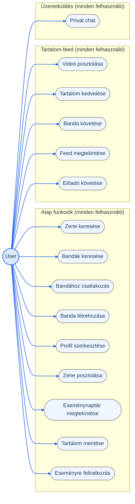

**Leader use case-ei:**

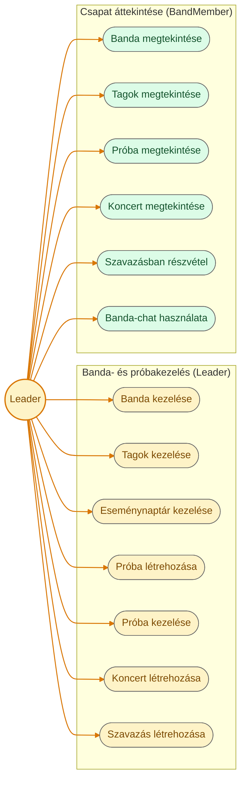

**BandMember use case-ei:**

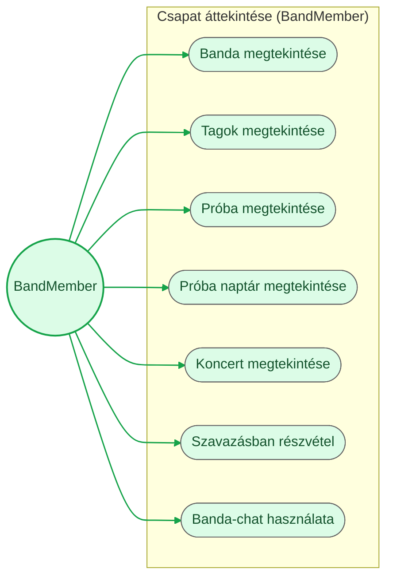

**Admin use case-ei:**

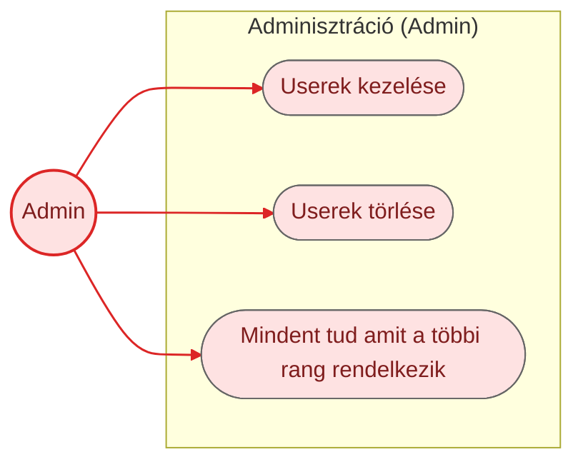

> **Megjegyzés — szerepkör-öröklés:** a Leader, BandMember és Admin szereplőnkénti diagramja csak a szerepkörhöz *közvetlenül* tartozó use case-eket mutatja (a katalógusban is jelölt csomagja szerint); a "minden felhasználó" szintű funkciókat (Alap funkciók, Tartalom-feed, Üzenetküldés) — a kanonikus [`diagrams/UseCase.puml`](../diagrams/UseCase.puml) forrással megegyezően — nem ismétlik meg, hanem a BandMember ⊳ User, Leader ⊳ BandMember, Admin ⊳ Leader szerepkör-öröklés biztosítja azokat (ld. [3.3](#sec-3-3) mátrix, ahol ez explicit ✔-ként szerepel). A User diagramja emiatt kivétel: mivel nincs "őse", minden hozzá tartozó use case explicit szerepel rajta.

> **Tervezési javaslat — Tartalom-feed:** az Instagram-szerű "Feed megtekintése" funkció a felhasználó által követett bandák videó-/zenetartalmait (és minden más posztot) jeleníti meg, felhasználónként eltérő sorrendben (ld. [`diagrams/mermaid/Adatmodell.md`](../diagrams/mermaid/Adatmodell.md) "Feed-personalizáció" szakasz és [6.1](#sec-6-1)). A tartalom posztolása, kedvelése és a bandák követése egyelőre — a többi tartalom-létrehozó funkcióhoz (pl. Zene posztolása) hasonlóan — User-szintű funkció; a Feed megtekintése ugyanakkor minden szerepkör számára elérhető, az Eseménynaptár megtekintéséhez hasonlóan.

> **Tervezési javaslat — új funkciók (v0.10):**
> - **Tartalom mentése:** minden szerepkör (User/Leader/BandMember/Admin) elmenthet tetszőleges tartalmat (poszt, banda, előadó, esemény) saját, opcionálisan kategóriákba (pl. "Kedvencek", "Inspiráció") rendezett mentési listájába — ld. [`diagrams/mermaid/Adatmodell.md`](../diagrams/mermaid/Adatmodell.md) `SAVED_ITEM` entitás és [6.1](#sec-6-1). A Feed megtekintéséhez és az Eseménynaptár megtekintéséhez hasonlóan univerzális funkció, mivel nem tartalom-*létrehozás*, hanem meglévő tartalom személyes rendszerezése.
> - **Előadó követése:** a Banda követése ([F3](#sec-3-2)) mintájára a User (és az Admin) egyes felhasználókat (előadókat/zenészeket), nem csak bandákat is követhet; a `FOLLOW` entitás emiatt mindkét célentitást (Banda vagy Előadó/User) kezelni tudja (ld. [6.1](#sec-6-1)).
> - **Eseményre feliratkozás:** bármely szerepkör jelezheti részvételi szándékát egy próbán/koncerten (`CALENDAR_EVENT`) — új `EVENT_SIGNUP` entitás (ld. [6.1](#sec-6-1)), az Eseménynaptár megtekintéséhez hasonlóan minden szerepkör számára elérhető.
> - **Szavazás (banda-belüli):** a Leader szavazást hozhat létre a saját bandáján belül (pl. dalválasztás, próbaidőpont-egyeztetés); a banda tagjai (BandMember, és a Leader is) szavazatot adhatnak le — új `POLL` / `POLL_OPTION` / `POLL_VOTE` entitások (ld. [6.1](#sec-6-1)).

> **Tervezési javaslat — Chat (v0.16):**
> - **Privát chat:** bármely két felhasználó között (szerepkörtől függetlenül) 1:1 beszélgetés indítható, pl. egy banda vagy egy előadó megkeresésére. Két felhasználó között legfeljebb egy privát beszélgetés létezik — ismételt indításkor a meglévő nyílik meg.
> - **Banda-chat használata:** a rendszer egyetlen csoportos chat-formája — tetszőleges felhasználókból álló csoport nem hozható létre. Minden bandához a létrehozásakor automatikusan egy közös beszélgetés jön létre, amelynek résztvevői mindig a banda aktív tagjai (`MEMBERSHIP.status = aktiv`) — csatlakozáskor automatikusan bekerülnek, eltávolításkor/kilépéskor kikerülnek, így a Leadernek nem kell külön kezelnie. A Leader moderálhatja (üzeneteket törölhet). A BandMember csomag része (M7), a Leader a szerepkör-öröklés révén szintén eléri.
> - Mindkettő ugyanarra az adatmodellre (`CONVERSATION` / `CONVERSATION_PARTICIPANT` / `MESSAGE`, ld. [6.1](#sec-6-1)) és ugyanarra a valós idejű csatornára (WebSocket + STOMP, ld. [4.2](#sec-4-2)) épül. A Privát chat — a Feed megtekintéséhez hasonlóan — minden szerepkör számára elérhető, ezért új, „Üzenetküldés (minden felhasználó)” csomagba került (CH1).

### 3.3 Szerepkör – funkció mátrix

| Funkció | User | Leader | BandMember | Admin |
|---|:---:|:---:|:---:|:---:|
| Zene keresése | ✔ | — | — | ✔ |
| Bandák keresése | ✔ | — | — | ✔ |
| Bandához csatlakozás | ✔ | — | — | ✔ |
| Banda létrehozása | ✔ | — | — | ✔ |
| Profil szerkesztése | ✔ | — | — | ✔ |
| Zene posztolása | ✔ | — | — | ✔ |
| Eseménynaptár megtekintése | ✔ | ✔ | ✔ | ✔ |
| Tartalom mentése | ✔ | ✔ | ✔ | ✔ |
| Eseményre feliratkozás | ✔ | ✔ | ✔ | ✔ |
| Videó posztolása | ✔ | — | — | ✔ |
| Tartalom kedvelése | ✔ | — | — | ✔ |
| Banda követése | ✔ | — | — | ✔ |
| Előadó követése | ✔ | — | — | ✔ |
| Feed megtekintése | ✔ | ✔ | ✔ | ✔ |
| Privát chat | ✔ | ✔ | ✔ | ✔ |
| Banda kezelése | — | ✔ | — | ✔ |
| Tagok kezelése | — | ✔ | — | ✔ |
| Eseménynaptár kezelése | — | ✔ | — | ✔ |
| Próba létrehozása | — | ✔ | — | ✔ |
| Próba kezelése | — | ✔ | — | ✔ |
| Koncert létrehozása | — | ✔ | — | ✔ |
| Szavazás létrehozása | — | ✔ | — | ✔ |
| Banda megtekintése | — | ✔ | ✔ | ✔ |
| Tagok megtekintése | — | ✔ | ✔ | ✔ |
| Próba megtekintése | — | ✔ | ✔ | ✔ |
| Próba naptár megtekintése | — | — | ✔ | ✔ |
| Koncert megtekintése | — | ✔ | ✔ | ✔ |
| Szavazásban részvétel | — | ✔ | ✔ | ✔ |
| Banda-chat használata | — | ✔ | ✔ | ✔ |
| Userek kezelése | — | — | — | ✔ |
| Userek törlése | — | — | — | ✔ |

*A táblázat az eredeti use case diagram kapcsolatait tükrözi 1:1-ben (lásd 3.2).*

---

## 4. Rendszerarchitektúra

### 4.1 Architektúra-áttekintés (C4)

A C4 modell kanonikus forrása a [`diagrams/c4.puml`](../diagrams/c4.puml) fájl, amely a hivatalos [C4-PlantUML](https://github.com/plantuml-stdlib/C4-PlantUML) sablonkönyvtárral (PlantUML standard library, `<C4/...>` include) készült — ez az iparágban elterjedt, szabványos módja a C4 diagramok PlantUML-ben történő elkészítésének, hivatalos elem-jelöléssel és jelmagyarázattal (`SHOW_LEGEND()`). Az alábbi Context-, Container- és Component-szintű diagramok ugyanezt a tartalmat Mermaid-be átírva mutatják (GitHub/szerkesztő inline-előnézethez, ld. [`diagrams/mermaid/c4.md`](../diagrams/mermaid/c4.md)) — a diagramok **ajánlott architektúraként** épülnek fel: a `Cont.md` ismert tényeire (Java backend, konténerizált futtatás) és a use case diagram funkcióira támaszkodva. A csapat által felvetett mindhárom kliens platform (Web/React, Asztali/C#-WPF, Mobil/Kotlin) megvalósul, egy közös backend REST API-ra támaszkodva — indoklás a [4.2](#sec-4-2) fejezetben.

> **Megjegyzés (v0.15) — a Mermaid-diagramok `flowchart`-ra átírva:** a Mermaid `C4Context`/`C4Container`/`C4Component` diagramtípus a megjelenítés szélességétől függően újraszámolja (nem csak egységesen kicsinyíti) a belső elrendezést — keskeny nézetben (pl. VS Code osztott Markdown-előnézet-panel) ez rendszeresen egymásra futó, olvashatatlan feliratokat eredményezett, amit helyi `mermaid-cli` teszteléssel (különböző szélességeken renderelve) diagnosztizáltam. Az alábbi diagramok ezért sima `flowchart`-ra vannak átírva, C4-stílusú színezéssel — mindig a tartalom természetes méretében számolnak, a megjelenítő csak egységesen kicsinyíti, így szélességtől függetlenül stabilak (ugyanezt a diagramtípust használja hiba nélkül a dokumentum összes többi Mermaid-ábrája is, pl. Use Case, Activity). A kanonikus [`diagrams/c4.puml`](../diagrams/c4.puml) változatlan marad (a PlantUML-motor nem szenved ettől a hibától).

**Context szint:**

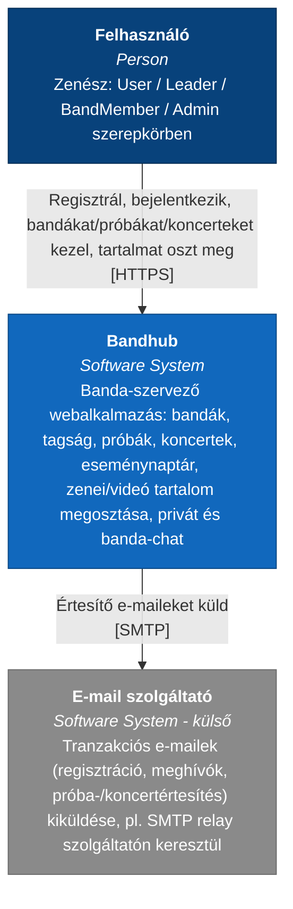

**Container szint:**

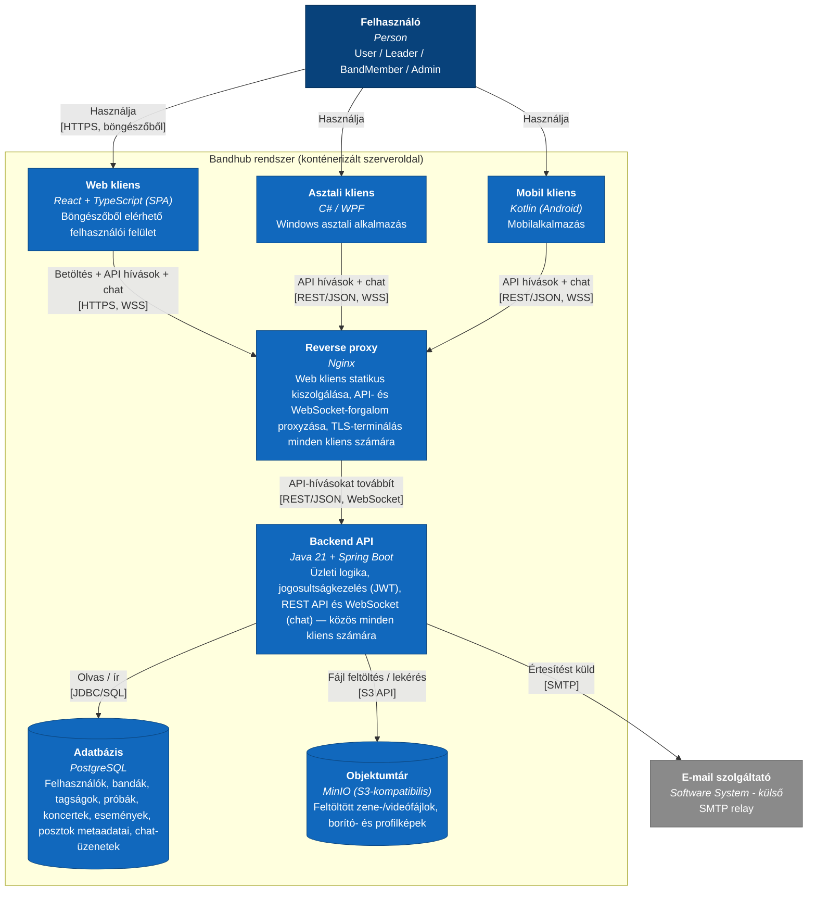

**Component szint:** a Backend API belső, moduláris felépítését az alábbi 6 diagram mutatja, egy-egy felelősségi körre bontva (ld. még [5. fejezet](#sec-5) és [`diagrams/mermaid/Component.md`](../diagrams/mermaid/Component.md)). A teljes komponensdiagram (a Chat modullal együtt 12 elem, 23 kapcsolat) egyetlen ábrán olvashatatlanul egymásra futó feliratokat eredményezett; a `flowchart`-motor egy célba (pl. Security modul) futó 4 forrás-nyilat még átfedés nélkül el tud rendezni, de az 5 forrásból egy célba (Adatbázis) futó eset enyhe átfedést produkált, ezért a **Jogosultság-ellenőrzés** egyetlen diagram, az **Adatbázis-elérés** viszont 2 résznézetre van bontva. A teljes, egyben látható komponensdiagram a kanonikus [`diagrams/c4.puml`](../diagrams/c4.puml) `C4_Component` blokkjában érhető el. A Container-diagramnak megfelelően a kliensek hívásai ténylegesen a Reverse proxyn (Nginx) keresztül érkeznek a modulokhoz — a pontosság kedvéért ez az 1. résznézeten is szerepel. A v0.16-ban bevezetett **Üzenetkezelő (Chat) modul** az 1. résznézetben (kérés-útvonal) szerepel, többi kapcsolata viszont egy külön, **6. résznézetben** — így a Jogosultság-ellenőrzés és az Adatbázis-elérés résznézetek fan-in-je nem nő az átfedést okozó szint fölé.

*1. Kérés-útvonal (Nginx → modulok):*

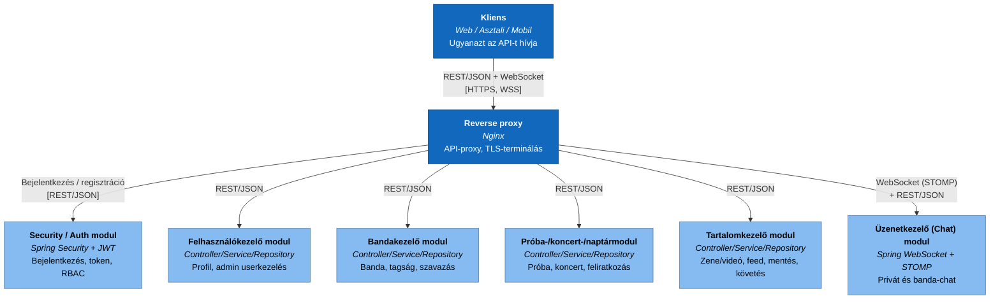

*2. Jogosultság-ellenőrzés (RBAC):*

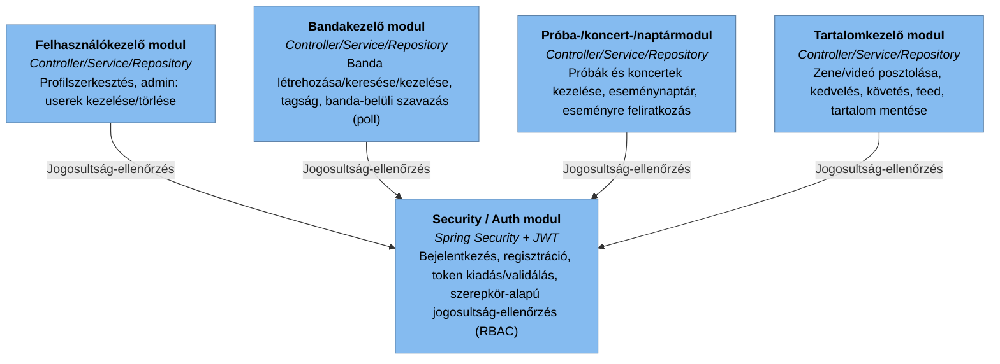

*3. Adatbázis-elérés — 1/2:*

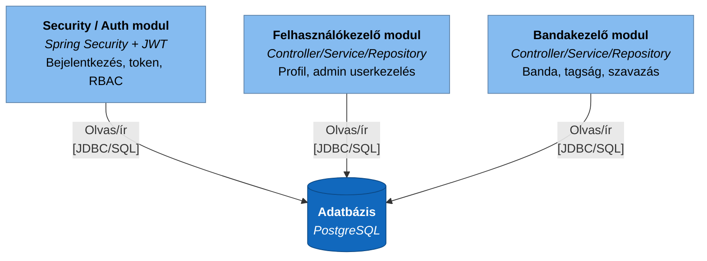

*4. Adatbázis- és objektumtár-elérés — 2/2:*

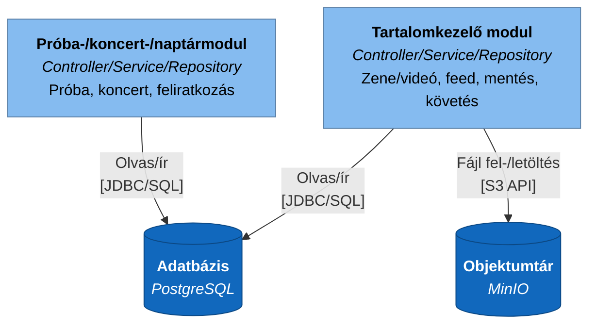

*5. Értesítések kiváltása:*

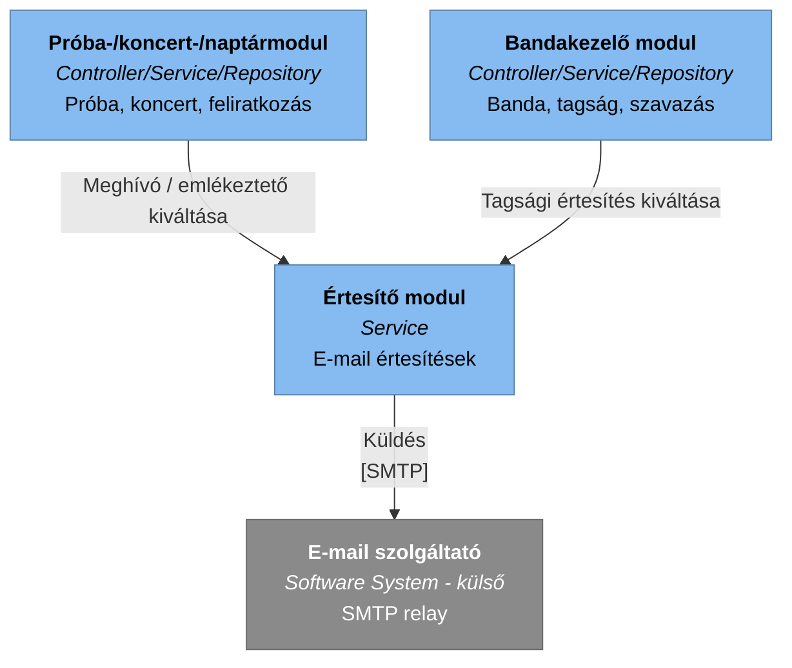

*6. Valós idejű üzenetküldés (Chat):*

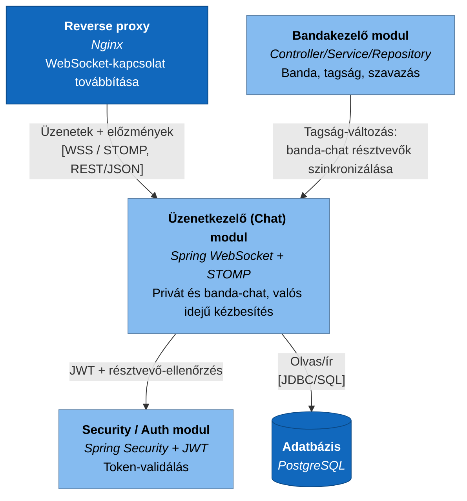

> **HELYŐRZŐ:** hogy az önálló objektumtár (MinIO) konténer szükséges-e, vagy a média MVP-ben felhő tárhelyen (pl. S3) kezelendő, illetve hogy egyáltalán szükséges-e fájltárolás az MVP-ben — ez jóváhagyást igényel a terméktulajdonostól/csapattól.

### 4.2 Technológiai stack

A [`diagrams/Cont.md`](../diagrams/Cont.md) alapján **ténylegesen ismert**: Java backend, konténerizált futtatás. A csapat korábban felvetett kliens platform-opciói (Web/React, Asztali/C#-WPF, Mobil/Kotlin) mindegyike megvalósul, egy közös backend REST API-ra támaszkodva. Az alábbi táblázat az ehhez ajánlott technológiaválasztást rögzíti:

| Réteg | Technológia | Indoklás |
|---|---|---|
| Backend | Java 21 | Tény (`Cont.md`) |
| Backend keretrendszer | Spring Boot (REST API-hoz, DI-hez, biztonsághoz) | Az egyik legelterjedtebb, jól dokumentált Java keretrendszer moduláris monolithoz. |
| Web kliens | React + TypeScript (SPA), Vite build-eszközzel | A csapat által felvetett opció; gyors fejlesztői kör, jól illeszkedik a Java backend REST API-jához. |
| Asztali kliens | C# / WPF, .NET SDK build | A csapat által felvetett opció; natív Windows asztali élmény. |
| Mobil kliens | Kotlin, Gradle build (Android) | A csapat által felvetett opció; natív Android élmény, push notification/offline képességgel bővíthető. |
| Futtatási/telepítési környezet | Konténerizált (szerveroldal) | Tény (`Cont.md`) |
| Konténer-orchestráció | Docker Compose (kis léptékű, egy szerveres üzemeltetéshez) | A jelenlegi projektméret nem indokolja Kubernetes bevezetését. |
| Adatbázis | PostgreSQL | Relációs, jól illeszkedik a bandák/tagságok/események kapcsolati modelljéhez (ld. [6.1](#sec-6-1)). |
| Objektumtár | MinIO (S3-kompatibilis, önhosztolt) | A posztolt zene-/videófájlok (ld. [6.1](#sec-6-1) `POST.media_url`) mérete/jellege miatt nem az adatbázisba valók; a konténerizált, önhosztolt megoldás konzisztens a `Cont.md` elvárásával, és elkerüli a felhő tárhely korai bevonását. |
| Autentikáció | JWT alapú, session nélküli API-hitelesítés | Egyszerű, jól skálázható, platformfüggetlen — minden kliens típussal kompatibilis. |
| Reverse proxy / statikus kiszolgálás | Nginx (Web kliens build kiszolgálása, API proxyzás minden kliens felé, TLS) | Bevált, könnyűsúlyú megoldás egy közös belépési pont biztosítására. |
| Valós idejű kommunikáció (chat) | Spring WebSocket + STOMP, a Spring beépített (in-memory) simple brokerével; kliensoldalon STOMP-kliens (Web: `@stomp/stompjs`, Asztali/Mobil: platformspecifikus STOMP-/WebSocket-kliens) | A chat valós idejű kézbesítést igényel, amit REST-lekérdezéssel (polling) csak pazarlóan lehetne megoldani; a Spring Boot natívan támogatja, nem igényel új konténert, és egyetlen backend-példány mellett a beépített broker elegendő. Az Nginx-ben a WebSocket `Upgrade` fejlécének továbbítását be kell állítani. |

> **HELYŐRZŐ:** az objektumtár (MinIO) bevezetése jóváhagyást igénylő döntés, ld. [4.1](#sec-4-1) HELYŐRZŐ. A chat (v0.16) miatt a rendszer már tartalmaz valós idejű (WebSocket) funkciót, de egyetlen backend-példány mellett a Spring beépített simple brokere elegendő; külső üzenetközvetítő (pl. RabbitMQ STOMP broker relay vagy Redis pub/sub) csak a backend horizontális skálázásakor (több példány) válik szükségessé, ld. [9.3](#sec-9-3). Az Asztali/Mobil kliens tényleges ütemezése (mely fázisban készül el a Webhez képest) csapatdöntést igényel.

### 4.3 Architekturális elvek és minták

**Ajánlott elvek:**
- **Architekturális stílus:** rétegezett, moduláris monolit (controller/service/repository rétegek, funkció szerint elkülönített modulokkal — ld. [5.1](#sec-5-1)). Indoklás: a jelenleg ismert funkciókészlet (banda-, próba-, koncertkezelés) mérete nem indokolja a mikroszolgáltatás-architektúra üzemeltetési többletköltségét egy korai fázisú projektnél.
- **API-stílus:** REST/JSON, erőforrás-alapú végpontokkal (pl. `/api/bands`, `/api/bands/{id}/rehearsals`). Kivétel a chat valós idejű forgalma: az üzenetek WebSocket-kapcsolaton, STOMP protokollal közlekednek (küldés: `/app/conversations/{id}/messages`, fogadás: `/user/queue/messages`), az üzenet-előzmények lapozott lekérése viszont REST-en történik (`GET /api/conversations/{id}/messages`).
- **Kliens-szerver szétválasztás:** mindhárom kliens — Web (React), Asztali (C#/WPF) és Mobil (Kotlin) — kizárólag a közös backend REST API-n keresztül kommunikál, önálló build/deploy egységként. Ez a szétválasztás teszi lehetővé, hogy egy platform fejlesztése/kiadása a másik kettőt ne érintse.
- **Szerepkör-alapú hozzáférés-vezérlés (RBAC):** a use case diagramon (3.2) definiált négy szerepkör (User, Leader, BandMember, Admin) a backendben végpont-/műveletszintű jogosultság-ellenőrzésként valósul meg (ld. [10.2](#sec-10-2)).

> **HELYŐRZŐ:** a fenti architekturális döntések formális jóváhagyása a fejlesztőcsapat/architekt részéről, mielőtt az implementáció megkezdődne.

---

## 5. Komponensek és modulok

### 5.1 Backend komponensek

A use case diagram (3.2) funkciói alapján az alábbi hét domain modul ajánlott, mindegyik a 4.3-ban leírt controller/service/repository rétegződéssel (ld. [`diagrams/mermaid/Component.md`](../diagrams/mermaid/Component.md)). A korábbi tervezetben külön szereplő Próba-/koncert- és Naptár modult, illetve a Zenei tartalom- és Tartalom-feed modult itt egy-egy komponensbe vontam össze — a szétválasztás nem indokolt méretű felelősségi kört jelentett volna:

| Modul | Felelősség | Kapcsolódó use case-ek |
|---|---|---|
| Security / Auth modul | Bejelentkezés, regisztráció, token kiadás/validálás (JWT), szerepkör-/jogosultság-ellenőrzés (RBAC) | belépés/regisztráció (7.1) |
| Felhasználókezelő modul | Profilszerkesztés, admin: userek kezelése/törlése | Profil szerkesztése, Userek kezelése, Userek törlése |
| Bandakezelő modul | Banda létrehozása/keresése/kezelése, tagság (csatlakozás, tagok kezelése), banda-belüli szavazás (poll) létrehozása és kezelése | Banda létrehozása, Bandák keresése, Bandához csatlakozás, Banda kezelése, Tagok kezelése, Szavazás létrehozása, Szavazásban részvétel |
| Próba-/koncert-/naptármodul | Próbák és koncertek létrehozása/kezelése/megtekintése, eseménynaptár összesített megjelenítése és kezelése, eseményre feliratkozás | Próba létrehozása, Próba kezelése, Koncert létrehozása, Próba/Koncert megtekintése, Eseménynaptár megtekintése/kezelése, Próba naptár megtekintése, Eseményre feliratkozás |
| Tartalomkezelő modul | Zene/videó posztolása, keresése, kedvelés, banda- és előadókövetés, személyre szabott feed összeállítása, tartalom mentése kategóriákkal | Zene posztolása, Zene keresése, Videó posztolása, Tartalom kedvelése, Banda követése, Előadó követése, Feed megtekintése, Tartalom mentése |
| Értesítő modul | E-mail értesítések összeállítása és küldése (csatlakozási kérelem, meghívó, emlékeztető) | — (a többi modulból kiváltott mellékhatás) |
| Üzenetkezelő (Chat) modul | Privát és banda-chat beszélgetések kezelése (létrehozás, résztvevők), üzenetek tárolása és valós idejű kézbesítése WebSocket/STOMP-on, olvasatlan üzenetek nyilvántartása (`last_read_at`), előzmények lapozott lekérése; a banda-chat résztvevőit a Bandakezelő modul tagság-változásai alapján szinkronizálja | Privát chat, Banda-chat használata |

> **HELYŐRZŐ:** a fenti modulok tényleges kódstruktúrával (csomag-/package-elrendezés) való megfeleltetése az implementáció megkezdésekor válik ellenőrizhetővé.

### 5.2 Kliens komponensek

Mivel mindhárom kliens (Web/React, Asztali/C#-WPF, Mobil/Kotlin — ld. [4.2](#sec-4-2)) megvalósul, az alábbi fő nézetek/képernyők platformfüggetlenül, a 7.1 fejezet tevékenységdiagramjának képernyőfolyama alapján valószínűsíthetők; a tényleges komponens-/nézetfa platformonként külön dokumentálandó (Web: React komponensfa, Asztali: WPF View/ViewModel struktúra, Mobil: Kotlin/Android komponensek):

- **Belépés/Regisztráció nézet** — a 7.1 folyamatábra "Bejelentkezés" és "Regisztráció" lépéseinek megfelelően, hibaüzenet-megjelenítéssel.
- **Főmenü nézet** — a bejelentkezett felhasználó szerepköre szerint eltérő navigációval (User / Leader / BandMember / Admin).
- **Banda nézetek** — banda keresése, banda létrehozása, banda/tagok megtekintése és kezelése (Leader esetén).
- **Naptár nézet** — próbák/koncertek megtekintése, Leader esetén kezelése.
- **Zenei tartalom nézet** — zene keresése és posztolása.
- **Profil nézet** — profil szerkesztése.
- **Chat nézet** — beszélgetéslista (privát és banda-chatek) olvasatlan-jelzéssel, beszélgetésablak valós idejű üzenetekkel; a banda-chat a banda adatlapjáról is elérhető.
- **Adminisztrációs nézet** — felhasználók kezelése/törlése (Admin).

> **HELYŐRZŐ:** az egyes platformok komponensfa/mappastruktúrája a tényleges implementáció alapján bővítendő, valamint hogy melyik platform készül el elsőként (ütemezési kérdés, ld. [4.2](#sec-4-2) HELYŐRZŐ).

### 5.3 Komponensek közötti kapcsolatok

A kliensek és a backend a 4.1-ben leírt Container-diagramnak megfelelően, az Nginx reverse proxyn keresztül, REST/JSON API-n és HTTPS-en kommunikálnak (ld. [4.3](#sec-4-3)) — a Web/Asztali/Mobil kliens mindegyike ugyanazt a közös backend API-t használja, platformspecifikus különbség nélkül. A Tartalomkezelő modul emellett az Objektumtárral (MinIO) is közvetlenül kommunikál, a médiafájlok feltöltéséhez/letöltéséhez (S3 API). A chathez a kliensek a REST-hívások mellett egy tartós WebSocket-kapcsolatot (WSS) is nyitnak, amelyet az Nginx a Backend API Üzenetkezelő (Chat) moduljához továbbít.

> **HELYŐRZŐ:** részletes API-szerződés (végpontlista, kérés-/válaszformátumok) — ez a backend implementáció során, pl. OpenAPI/Swagger specifikációként dokumentálandó.

---

## 6. Adatmodell és adatkezelés

### 6.1 Entitások és kapcsolatok (ER diagram)

A jelenlegi diagramkészletben nincs adatbázis-/ER-diagram; az alábbi **tervezési javaslat** a use case- és tevékenységdiagramok alapján levezetett entitásokat és mezőket mutatja be. A mezőlistát — a kapcsolatokat mutató diagram helyett, mert az egyben, mezőlistával nem minden Markdown-előnézőben (pl. régebbi mermaid-verziót futtató szerkesztő-bővítményben) jelenik meg — az azt követő táblázat sorolja fel; ld. [`diagrams/mermaid/Adatmodell.md`](../diagrams/mermaid/Adatmodell.md).

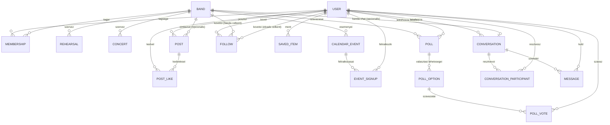

A `POST`, `FOLLOW` és `POST_LIKE` entitások a [3.2](#sec-3-2)-ben bevezetett **Tartalom-feed** funkciót (Instagram-szerű, személyre szabott videó-/zenefolyam) szolgálják ki. A `SAVED_ITEM`, `EVENT_SIGNUP` és `POLL`/`POLL_OPTION`/`POLL_VOTE` entitások a [3.2](#sec-3-2)-ben bevezetett **Tartalom mentése**, **Eseményre feliratkozás**, illetve **Banda-belüli szavazás** funkciókat szolgálják ki (v0.10, ld. [`diagrams/mermaid/Adatmodell.md`](../diagrams/mermaid/Adatmodell.md) "Mentés, követés, feliratkozás és szavazás" szakasza). A `CONVERSATION`, `CONVERSATION_PARTICIPANT` és `MESSAGE` entitások a v0.16-ban bevezetett **Privát chat** és **Banda-chat** funkciókat szolgálják ki (ld. lent a „Chat” bekezdést és [3.2](#sec-3-2)).

| Entitás | Mező | Típus | Megjegyzés |
|---|---|---|---|
| USER | id | uuid | |
| USER | email | string | |
| USER | password_hash | string | |
| USER | display_name | string | |
| USER | role | string | User / Leader / BandMember / Admin |
| BAND | id | uuid | |
| BAND | name | string | |
| BAND | description | string | |
| BAND | leader_id | uuid | |
| MEMBERSHIP | id | uuid | |
| MEMBERSHIP | user_id | uuid | |
| MEMBERSHIP | band_id | uuid | |
| MEMBERSHIP | status | string | fuggoben / aktiv / elutasitva / eltavolitva |
| REHEARSAL | id | uuid | |
| REHEARSAL | band_id | uuid | |
| REHEARSAL | starts_at | datetime | |
| REHEARSAL | location | string | |
| CONCERT | id | uuid | |
| CONCERT | band_id | uuid | |
| CONCERT | starts_at | datetime | |
| CONCERT | venue | string | |
| CALENDAR_EVENT | id | uuid | |
| CALENDAR_EVENT | band_id | uuid | |
| CALENDAR_EVENT | type | string | proba / koncert / egyeb |
| CALENDAR_EVENT | starts_at | datetime | |
| POST | id | uuid | |
| POST | user_id | uuid | |
| POST | band_id | uuid | opcionális — banda nevében posztolva |
| POST | media_type | string | audio / video |
| POST | title | string | |
| POST | media_url | string | |
| POST | thumbnail_url | string | opcionális |
| FOLLOW | id | uuid | |
| FOLLOW | follower_id | uuid | a követő USER |
| FOLLOW | target_type | string | banda / eloado — melyik entitást követi |
| FOLLOW | target_id | uuid | a követett BAND.id vagy USER.id (előadóként) — a `target_type` szerint |
| POST_LIKE | id | uuid | |
| POST_LIKE | user_id | uuid | |
| POST_LIKE | post_id | uuid | |
| SAVED_ITEM | id | uuid | |
| SAVED_ITEM | user_id | uuid | a mentő USER (bármely szerepkör) |
| SAVED_ITEM | target_type | string | poszt / banda / eloado / esemeny |
| SAVED_ITEM | target_id | uuid | a mentett elem azonosítója, a `target_type` szerint |
| SAVED_ITEM | category | string | opcionális, felhasználó által megadott kategória/címke (pl. "Kedvencek") |
| SAVED_ITEM | created_at | datetime | |
| EVENT_SIGNUP | id | uuid | |
| EVENT_SIGNUP | user_id | uuid | a feliratkozó USER |
| EVENT_SIGNUP | event_id | uuid | a `CALENDAR_EVENT` (próba/koncert), amelyre a feliratkozás vonatkozik |
| EVENT_SIGNUP | status | string | feliratkozva / lemondva |
| EVENT_SIGNUP | created_at | datetime | |
| POLL | id | uuid | |
| POLL | band_id | uuid | a banda, amelyen belül a szavazás létrejött |
| POLL | created_by | uuid | a szavazást létrehozó USER (Leader) |
| POLL | question | string | a szavazás kérdése/tárgya |
| POLL | created_at | datetime | |
| POLL | closes_at | datetime | opcionális, a szavazás lezárási időpontja |
| POLL_OPTION | id | uuid | |
| POLL_OPTION | poll_id | uuid | |
| POLL_OPTION | option_text | string | egy választható opció szövege |
| POLL_VOTE | id | uuid | |
| POLL_VOTE | poll_id | uuid | |
| POLL_VOTE | option_id | uuid | a leadott szavazat szerinti `POLL_OPTION` |
| POLL_VOTE | user_id | uuid | a szavazó USER (a banda tagja) |
| POLL_VOTE | voted_at | datetime | |
| CONVERSATION | id | uuid | |
| CONVERSATION | type | string | privat / banda |
| CONVERSATION | band_id | uuid | opcionális — csak `type = banda` esetén, bandánként egyedi |
| CONVERSATION | created_by | uuid | a létrehozó USER (privát chatnél az indító fél, banda-chatnél a banda Leadere) |
| CONVERSATION | created_at | datetime | |
| CONVERSATION_PARTICIPANT | id | uuid | |
| CONVERSATION_PARTICIPANT | conversation_id | uuid | |
| CONVERSATION_PARTICIPANT | user_id | uuid | |
| CONVERSATION_PARTICIPANT | joined_at | datetime | |
| CONVERSATION_PARTICIPANT | last_read_at | datetime | az utoljára olvasott időpont — az olvasatlan-számláló alapja |
| CONVERSATION_PARTICIPANT | left_at | datetime | opcionális — kilépés/eltávolítás időpontja (a korábbi üzenetek megmaradnak) |
| MESSAGE | id | uuid | |
| MESSAGE | conversation_id | uuid | |
| MESSAGE | sender_id | uuid | a küldő USER |
| MESSAGE | body | text | az üzenet szövege (az MVP-ben csak szöveg) |
| MESSAGE | created_at | datetime | |
| MESSAGE | edited_at | datetime | opcionális |
| MESSAGE | deleted_at | datetime | opcionális — soft delete (a küldő, banda-chatben a Leader is törölhet) |

**Mentés, követés, feliratkozás és szavazás (tervezési javaslat, v0.10):**
- **Mentés (`SAVED_ITEM`):** minden szerepkör számára elérhető, tetszőleges célentitásra (poszt, banda, előadó, esemény) vonatkozhat; a `category` mező szabad szöveges, felhasználónkénti csoportosítást tesz lehetővé, nincs előre definiált, rendszerszintű kategórialista.
- **Követés (`FOLLOW`) kiterjesztése:** a korábbi, kizárólag bandákra vonatkozó követés kiegészült előadók (egyéni USER-ek) követésével, a `target_type`/`target_id` páron keresztül.
- **Eseményre feliratkozás (`EVENT_SIGNUP`):** bármely `CALENDAR_EVENT`-re (próba vagy koncert) vonatkozhat.
- **Szavazás (`POLL`/`POLL_OPTION`/`POLL_VOTE`):** kizárólag egy adott bandán belül értelmezett — a szavazást csak az adott banda Leadere hozhatja létre, és csak az adott banda tagjai (BandMember és a Leader) szavazhatnak.

> **HELYŐRZŐ:** az előadó-követés jelenleg még nem hat a Feed-personalizációra (alább) — csak a banda-követés; ennek kiterjesztése (vagy tudatos elhagyása) jóváhagyást igényel.

**Chat (tervezési javaslat, v0.16):**
- **Egy közös modell, két típus:** a privát és a banda-chat ugyanaz a `CONVERSATION` entitás, a `type` mező különbözteti meg őket — így az üzenetküldés, a kézbesítés és az olvasottság logikája egyetlen helyen valósul meg.
- **Privát (`type = privat`):** pontosan 2 résztvevő; egy felhasználópár között legfeljebb egy privát beszélgetés létezhet (egyediségi kényszer, implementáció során rögzítendő) — ismételt indításkor a meglévő nyílik meg.
- **Banda-chat (`type = banda`):** ez az egyetlen csoportos beszélgetés-típus (tetszőleges felhasználókból álló csoport nem hozható létre); bandánként pontosan egy, a banda létrehozásakor jön létre, neve a banda neve; résztvevői a banda `MEMBERSHIP`-jeiből szinkronizálódnak (a tagság `Aktiv` állapotba lépésekor bekerül, `Eltavolitva` állapotba lépésekor a `left_at` kitöltődik — ld. a tagság állapotgépét).
- **Olvasatlan üzenetek:** egy résztvevő olvasatlan üzenetei a `MESSAGE.created_at > CONVERSATION_PARTICIPANT.last_read_at` feltétellel számolhatók — üzenetenkénti „olvasta” tábla az MVP-ben nem szükséges.

> **HELYŐRZŐ:** fájl-/képküldés a chatben (a meglévő Objektumtár újrahasznosításával), üzenetkeresés, „gépel…” jelzés és üzenetenkénti olvasási visszaigazolás — ezek nem részei a jelenlegi javaslatnak, bevezetésük külön döntést igényel.

**Feed-personalizáció (tervezési javaslat):** a "Feed megtekintése" mindenkinek ugyanazt a tartalomkészletet (POST) mutatja, de eltérő sorrendben — a `FOLLOW` alapján a követett bandák posztjai kerülnek előre, ezen belül létrehozás szerint csökkenő sorrend, a `POST_LIKE`-ból számított kedvelésszám pedig másodlagos rendezési szempont. A konkrét PostgreSQL DDL az implementációs fázis feladata; a séma tervezési szinten a fenti entitás-/mezőtáblázatban van rögzítve (a tervezés során egy próba-DDL-lel helyi PostgreSQL-en leellenőrizve, hogy a modell futtatható).

A `MEMBERSHIP.status` mező lehetséges átmeneteit az alábbi állapotgép-javaslat mutatja:

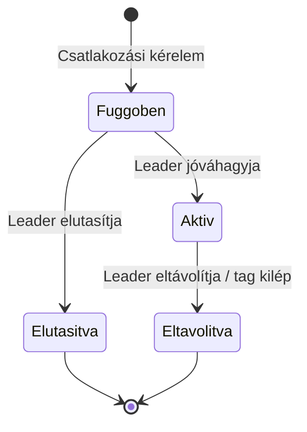

> **HELYŐRZŐ:** a fenti adatmodell és állapotgép jóváhagyása/pontosítása a tényleges adatbázis-tervezéskor; mezőnevek, típusok és megszorítások (pl. egyediségi kényszerek) még nem véglegesek.

### 6.2 Adatkezelési elvek, adatvédelem

A 6.1-ben javasolt adatmodell alapján a rendszer az alábbi személyes adatokat kezelné: e-mail cím, jelszó (hash formában), megjelenítendő név, valamint a felhasználó által posztolt tartalom. **Tervezési javaslat:**
- A jelszavakat kizárólag hash formában (pl. bcrypt/Argon2) szabad tárolni, soha nem plain textben.
- A chat-üzenetek (`MESSAGE.body`) személyes adatnak minősülnek: csak a beszélgetés résztvevői érhetik el (ld. [10.2](#sec-10-2)), naplóba nem kerülhetnek (ld. [12.2](#sec-12-2)), felhasználó törlésekor (Userek törlése) a küldött üzenetek anonimizálandók vagy törlendők. Végpontok közötti titkosítás (E2EE) nem része a javaslatnak — ezt az adatkezelési tájékoztatóban jelezni kell.
- A rendszernek — mivel uniós felhasználók személyes adatait kezelheti — meg kell felelnie a GDPR alapelveinek (adattakarékosság, célhoz kötöttség, hozzáférési/törlési jog biztosítása).

> **HELYŐRZŐ:** a jogalap (pl. szerződés teljesítése vagy hozzájárulás), az adatkezelési tájékoztató szövege és a tényleges GDPR-megfelelőségi audit — ezek jogi/szervezeti döntést igényelnek, a jelenlegi forrásanyagokból nem vezethetők le.

### 6.3 Adatmegőrzés és biztonsági mentés

> **HELYŐRZŐ:** mentési (backup) gyakoriság, megőrzési idő, helyreállítási terv (RPO/RTO) — ezek az üzemeltetési környezet (ld. [9. fejezet](#sec-9)) kialakításakor, az adatbázis-választással (jelenleg tervezési javaslat: PostgreSQL, ld. [4.2](#sec-4-2)) összhangban döntendők el.

> **HELYŐRZŐ:** a chat-üzenetek megőrzési ideje (korlátlan, vagy egy meghatározott idő után automatikus törlés) — adatvédelmi és tárhely-kapacitási döntés.

---

## 7. Folyamatok és szekvenciák

### 7.1 Belépés / regisztráció / szerepkör-alapú főfolyamat

Az alábbi folyamatábra a felhasználó belépési/regisztrációs folyamatát, majd a szerepkör szerinti főmenü-ciklust mutatja be.

> **Megjegyzés:** az eredeti PlantUML-forrásban hibás bejelentkezés/regisztráció esetén a folyamat nem tér vissza explicit módon a belépési döntési ponthoz, hanem — az `if`-blokk lezárása után — továbblép a rang lekérdezéséhez. Ezt a konverzió szándékosan megtartotta; ha ez a rendszer tervezett viselkedésétől eltér, a forrás `Activity.puml` és a Mermaid-átirat egyaránt javítandó.

### 7.2 Use case-enkénti tevékenységdiagramok

A [3.2](#sec-3-2) fejezetben felsorolt **minden egyes use case-hez** tartozik egy önálló, kompakt activity (tevékenység-) diagram, amely az adott funkció lépéseit mutatja be. Ezeket — a use case diagramhoz hasonlóan — csomagonként (Common/Tartalom-feed/Üzenetküldés, Leader, BandMember, Admin) külön fájlokba szerveztük az áttekinthetőség miatt:

- [`diagrams/mermaid/ActivityCommon.md`](../diagrams/mermaid/ActivityCommon.md) — Alap funkciók, Tartalom-feed és Üzenetküldés (15 diagram: Zene keresése, Bandák keresése, Bandához csatlakozás, Banda létrehozása, Profil szerkesztése, Zene posztolása, Eseménynaptár megtekintése, Tartalom mentése, Eseményre feliratkozás, Videó posztolása, Tartalom kedvelése, Banda követése, Feed megtekintése, Előadó követése, Privát chat)
- [`diagrams/mermaid/ActivityLeader.md`](../diagrams/mermaid/ActivityLeader.md) — Banda- és próbakezelés (7 diagram: Banda kezelése, Tagok kezelése, Eseménynaptár kezelése, Próba létrehozása, Próba kezelése, Koncert létrehozása, Szavazás létrehozása)
- [`diagrams/mermaid/ActivityMember.md`](../diagrams/mermaid/ActivityMember.md) — Csapat áttekintése (7 diagram: Banda megtekintése, Tagok megtekintése, Próba megtekintése, Próba naptár megtekintése, Koncert megtekintése, Szavazásban részvétel, Banda-chat használata)
- [`diagrams/mermaid/ActivityAdmin.md`](../diagrams/mermaid/ActivityAdmin.md) — Adminisztráció (2 diagram: Userek kezelése, Userek törlése — a "Mindent tud amit a többi rang rendelkezik" use case a másik három csomag diagramjaira hivatkozik, nincs önálló folyamata)

Ez összesen 31 use case-hez tartozó activity diagramot jelent, ami megfelel a [3.2](#sec-3-2) és [3.3](#sec-3-3) fejezetben felsorolt összes egyedi funkciónak. A 7.1-ben bemutatott belépési/regisztrációs főfolyam ezeket megelőzi (a Főmenüből ér el minden ilyen funkciót).

> **HELYŐRZŐ:** a diagramok a use case nevéből és a use case-hez tartozó entitásokból ([6.1](#sec-6-1)) levezetett, tervezési javaslat szintű lépéseket mutatnak; a tényleges UI/API implementáció során pontosítandók.

### 7.3 További folyamatok

A következő szekvenciadiagramok **tervezési javaslatok**, a use case diagram (3.2) megfelelő funkcióiból levezetve, feltételezett REST API-val.

**Banda létrehozása:**

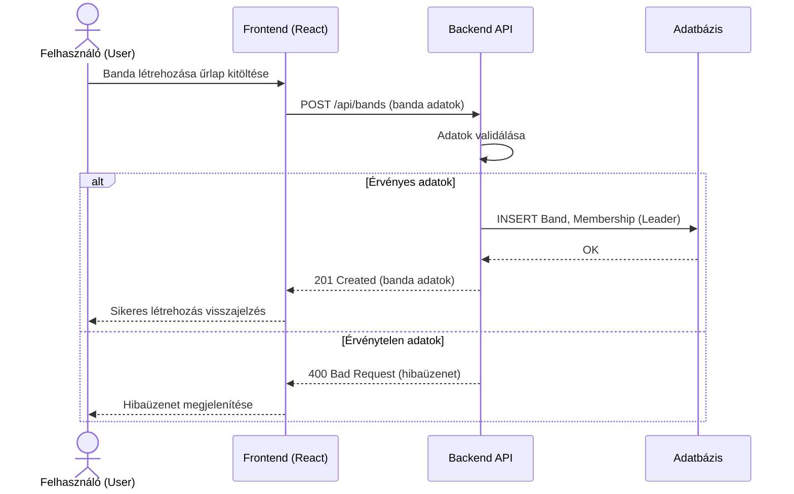

**Próba létrehozása:**

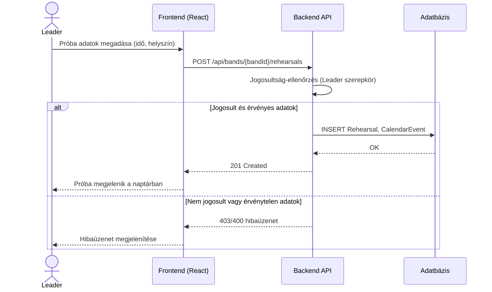

**Üzenet küldése (privát / banda-chat):** mindkét chat-típus ugyanezt a folyamatot követi (ld. [`diagrams/mermaid/UzenetKuldes.md`](../diagrams/mermaid/UzenetKuldes.md)). A REST-alapú folyamatokkal ellentétben itt a kliens egy már megnyitott WebSocket-kapcsolaton küld, és a backend a többi résztvevőnek kérés nélkül (push) kézbesít.

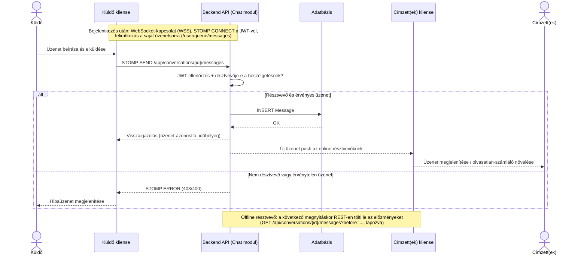

> **HELYŐRZŐ:** további folyamatok (pl. tagfelvétel jóváhagyása, koncert létrehozása, zenei tartalom posztolása) hasonló felépítésű szekvenciadiagramokkal bővítendők, amint a részletes folyamattervek elkészülnek.

---

## 8. Integrációk és külső rendszerek

A jelenlegi diagramok és a `Cont.md` alapján a rendszernek egyetlen külső integrációja indokolt: egy **e-mail szolgáltató** (SMTP relay), a 4.1 Context-diagramon jelölve — csatlakozási kérelemről, meghívóról vagy közelgő próbáról/koncertről szóló értesítéshez (ld. [5.1](#sec-5-1) Értesítő modul). Minden más ismert funkció (banda-, próba-, koncertkezelés, zenei tartalom, naptár) a rendszeren belül, önállóan megvalósítható; a médiafájlok (zene/videó) tárolása is a rendszer saját, konténerizált objektumtárában (MinIO) történik, nem külső szolgáltatónál (ld. [4.2](#sec-4-2)).

> **HELYŐRZŐ:** amennyiben a jövőben külső rendszer (pl. zenei streaming API, naptár-szinkronizáció, fizetési/jegyértékesítési szolgáltató) bevonása tervbe kerül, az itt és a 4.1 Context-diagramon dokumentálandó. Ugyanez vonatkozik a chat offline résztvevőinek mobil push-értesítésére (pl. Firebase Cloud Messaging) — a jelenlegi javaslatban az offline résztvevő a következő megnyitáskor látja az olvasatlan üzeneteit.

---

## 9. Telepítési és üzemeltetési architektúra

### 9.1 Konténerizáció

A [`diagrams/Cont.md`](../diagrams/Cont.md) szerint a rendszer konténerizált háttérrel tervezett. *(Tény.)*

**Ajánlott megoldás:** a szerveroldal — Nginx, Web kliens (SPA build), Backend API, PostgreSQL, MinIO (ld. [4.1](#sec-4-1) Container-diagram) — Docker image-ekként épül, és Docker Compose-szal indítható együtt egy szerveren; ez a jelenlegi (feltételezhetően kis léptékű) projektmérethez a legegyszerűbb, alacsony üzemeltetési többletköltségű megoldás. Az image-eket egy konténer-registry (pl. Docker Hub vagy privát registry) tárolná. Az Asztali (C#/WPF) és Mobil (Kotlin) kliens nem konténerizált szerveroldali komponens, hanem a felhasználó gépére/eszközére telepített alkalmazás, saját (nem konténeres) csomagolási és terjesztési móddal (pl. telepítőcsomag, áruházi disztribúció).

A fenti konténerek éles környezetbeli elhelyezését a C4 modell kiegészítő **Deployment diagramja** mutatja (ld. [`diagrams/mermaid/Deployment.md`](../diagrams/mermaid/Deployment.md)):

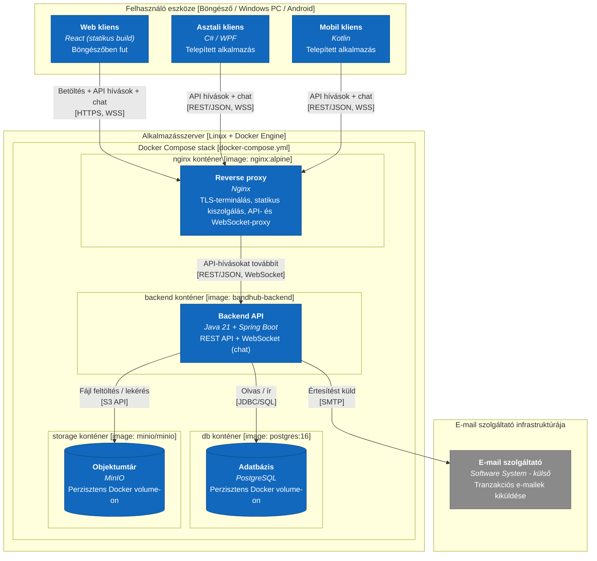

> **Megjegyzés (v0.15):** a diagram — a [`diagrams/mermaid/Deployment.md`](../diagrams/mermaid/Deployment.md)-vel megegyezően — `flowchart`-ra van átírva a korábbi `C4Deployment` helyett, mert a Mermaid C4-diagramtípus keskeny nézetben (pl. VS Code osztott Markdown-előnézet) újraszámolja, nem csak kicsinyíti a belső elrendezést, ami egymásra futó feliratokat okozott (ld. [4.1](#sec-4-1) azonos megjegyzése). A kanonikus [`diagrams/c4.puml`](../diagrams/c4.puml) `C4_Deployment` blokkja változatlan.

> **HELYŐRZŐ:** a konkrét registry, az, hogy indokolt-e Kubernetes-re váltani (pl. skálázási igény esetén), valamint az Asztali/Mobil kliens tényleges terjesztési módja (pl. telepítőcsomag, áruház) — ezek a projekt növekedésével/ütemezésével döntendők el.

### 9.2 Környezetek

**Tervezési javaslat:** legalább két környezet indokolt:

| Környezet | Cél |
|---|---|
| Fejlesztői (dev) | Helyi fejlesztés, Docker Compose-szal indítva |
| Éles (production) | Az üzemeltetett, felhasználók által elért rendszer |

> **HELYŐRZŐ:** külön teszt/staging környezet szükségessége, a környezetek közti konfigurációs eltérések (ld. [11. fejezet](#sec-11)), valamint a promóciós (dev → staging → prod) folyamat — ezek a csapat méretétől és folyamataitól függenek, jelenleg nem ismertek.

### 9.3 Skálázás és rendelkezésre állás

> **HELYŐRZŐ:** a projekt jelenlegi, korai fázisában nincs ismert terhelési/rendelkezésre állási elvárás (SLA/SLO), ezért konkrét skálázási stratégia (horizontális/vertikális) és terheléselosztás megtervezése korai; ezt a felhasználószám és a tényleges terhelés ismeretében érdemes meghatározni.

**Megjegyzés (chat, v0.16):** a WebSocket-kapcsolatok állapottartók — ha a backend több példányban fut, (a) az Nginx-ben sticky session, és (b) külső STOMP broker relay (pl. RabbitMQ) vagy Redis pub/sub szükséges, hogy az egyik példányon küldött üzenet a másik példányhoz kapcsolódó résztvevőkhöz is eljusson (ld. [4.2](#sec-4-2)). Egyetlen példány mellett ez nem kell.

---

## 10. Biztonság és jogosultságkezelés

### 10.1 Hitelesítés (Authentication)

A tevékenységdiagram (7.1) alapján a rendszer bejelentkezési és regisztrációs folyamattal, jelszó-ellenőrzéssel rendelkezik. *(Tény.)*

**Tervezési javaslat:**
- A hitelesítés session nélküli, **JWT-alapú** legyen — a frontend a sikeres bejelentkezés (7.1 folyamat) után egy tokent kap, amelyet minden további API-híváshoz csatol.
- A jelszavakat kizárólag hash formában (bcrypt/Argon2) szabad tárolni (ld. [6.2](#sec-6-2)).
- A chat WebSocket-kapcsolatának hitelesítése a STOMP `CONNECT` keretben átadott JWT-vel történik (a böngészők a WebSocket-kézfogásnál nem engednek egyedi `Authorization` fejlécet); érvénytelen vagy lejárt token esetén a kapcsolat elutasításra kerül.

> **HELYŐRZŐ:** jelszó-komplexitási elvárások, jelszó-visszaállítási folyamat, valamint többfaktoros hitelesítés bevezetése — ezek jelenleg nem szerepelnek a forrásanyagokban.

### 10.2 Jogosultságkezelés (Authorization)

A rendszer négy szerepkört különböztet meg (User, Leader, BandMember, Admin) — lásd a [3.3 szerepkör–funkció mátrixot](#sec-3-3). Az Admin szerepkör a use case diagram szerint az összes többi szerepkör jogosultságát öröklinek tekinthető. *(Tény.)*

**Tervezési javaslat:** a jogosultságkezelés szerepkör-alapú hozzáférés-vezérlésként (RBAC) valósul meg — minden API-végpontnál a backend ellenőrzi a JWT tokenben szereplő szerepkört a 3.3 mátrixnak megfelelően (pl. a `/api/bands/{id}` törlés-jellegű vagy kezelő műveletei csak Leader/Admin számára engedélyezettek). A banda-specifikus jogosultságokat (pl. "az adott banda Leader-e") a `Membership` entitáshoz (ld. [6.1](#sec-6-1)) kötve kell ellenőrizni, nem csak a globális szerepkör alapján.

**Chat-jogosultság (tervezési javaslat, v0.16):** a beszélgetésekhez való hozzáférés nem a globális szerepkörön, hanem a résztvevőségen (`CONVERSATION_PARTICIPANT`) alapul — üzenetet küldeni, olvasni és a beszélgetésre feliratkozni csak annak aktív (`left_at` üres) résztvevője tud; ezt minden STOMP `SEND`/`SUBSCRIBE` keretnél és REST-előzménylekérésnél ellenőrizni kell. A banda-chat résztvevőit a `MEMBERSHIP` határozza meg. Üzenetet a küldője, banda-chatben a Leader is törölhet.

> **HELYŐRZŐ:** az Admin hozzáférése mások privát beszélgetéseihez — a use case diagram szerint az Admin „mindent tud”, de mások privát üzeneteinek olvasása adatvédelmi szempontból nem indokolt; javaslat: az Admin csak bejelentett (moderálási) esetben, naplózottan férjen hozzá. Jóváhagyást igényel.

### 10.3 Adatbiztonság

**Tervezési javaslat:**
- Az API-kommunikáció kizárólag HTTPS-en keresztül történjen (átvitel közbeni titkosítás).
- Titkok (JWT aláíró kulcs, adatbázis-jelszó) ne kerüljenek a forráskódba, hanem környezeti változóként/secret store-ból érkezzenek (ld. [11. fejezet](#sec-11)).

> **HELYŐRZŐ:** nyugalmi állapotú (at-rest) titkosítás szükségessége, valamint a sebezhetőség-kezelési folyamat (pl. függőség-frissítési politika) — ezek üzemeltetési döntést igényelnek.

---

## 11. Konfiguráció és környezeti változók

A projektben jelenleg nincs konfigurációs fájl vagy `.env` sablon. Az alábbi táblázat a 4.2-ben javasolt technológiai stack (Spring Boot backend, PostgreSQL, JWT) alapján **tervezési javaslatként** sorolja fel a várhatóan szükséges környezeti változókat:

| Változó neve | Leírás | Alapérték | Kötelező |
|---|---|---|---|
| `SERVER_PORT` | A backend API HTTP portja | `8080` | Nem |
| `DB_URL` | Adatbázis-kapcsolati URL (PostgreSQL) | — | Igen |
| `DB_USERNAME` | Adatbázis-felhasználó | — | Igen |
| `DB_PASSWORD` | Adatbázis-jelszó (secret) | — | Igen |
| `JWT_SECRET` | A JWT tokenek aláírásához használt titkos kulcs (secret) | — | Igen |
| `JWT_EXPIRATION_MINUTES` | A kiadott JWT token érvényességi ideje percben | HELYŐRZŐ | Nem |
| `FRONTEND_ORIGIN` | Engedélyezett CORS-origin a frontend számára | — | Igen |

> **HELYŐRZŐ:** a fenti lista a tényleges implementáció során pontosítandó/bővítendő (pl. e-mail szolgáltatás hitelesítő adatai, ha a 8. fejezetben jelzett integráció megvalósul); a konkrét alapértékek és a titkok kezelési módja (pl. secret store) üzemeltetési döntést igényel.

---

## 12. Hibakezelés és naplózás

### 12.1 Hibakezelési stratégia

A tevékenységdiagram (7.1) "Hibaüzenet" lépései (sikertelen bejelentkezés/regisztráció) alapján a rendszernek strukturált hibavisszajelzést kell adnia a felhasználó felé. **Tervezési javaslat:**
- A backend egységes, JSON formátumú hibaválaszt ad (pl. `{"error": "...", "message": "..."}`), megfelelő HTTP státuszkóddal (400 érvénytelen adat, 401/403 jogosultsági hiba, 404 nem található, 409 ütközés).
- Globális kivételkezelés (Spring esetén pl. `@ControllerAdvice`) gondoskodik arról, hogy minden hiba egységes formában kerüljön vissza.
- A frontend a kapott hibaüzenetet jeleníti meg a felhasználónak (7.1 folyamat "Hibaüzenet" lépése).

### 12.2 Naplózás (logging) és monitorozás

**Tervezési javaslat:** a backend a Java ökoszisztémában szokásos SLF4J/Logback naplózást használja, legalább az alábbi szintekkel: `ERROR` (kezeletlen kivételek), `WARN` (jogosultsági elutasítás, érvénytelen bemenet), `INFO` (fő üzleti események, pl. banda létrehozása, próba ütemezése). A chat-üzenetek tartalma (`MESSAGE.body`) semmilyen naplószinten nem kerülhet a naplóba — csak metaadatok (beszélgetés- és küldő-azonosító, időbélyeg).

> **HELYŐRZŐ:** központi log-gyűjtés (pl. ELK/Loki) és monitorozó/riasztó rendszer (pl. Prometheus/Grafana) bevezetése — ez az üzemeltetési környezet (9. fejezet) kialakításával összhangban, a projekt méretének növekedésével válik indokolttá.

---

## 13. Tesztelési stratégia

**Tervezési javaslat**, a 4.2-ben javasolt stackhez illeszkedve:

| Tesztszint | Javasolt eszköz | Fókusz |
|---|---|---|
| Unit teszt (backend) | JUnit + Mockito | Service-réteg üzleti logikája (pl. jogosultság-ellenőrzés, validáció) |
| Unit/komponens teszt (frontend) | React Testing Library | Egyes UI-komponensek viselkedése |
| Integrációs teszt (backend) | Spring Boot Test (teszt-adatbázissal) | API-végpontok, adatbázis-műveletek |
| Integrációs teszt (chat) | Spring Boot Test + STOMP teszt-kliens (`WebSocketStompClient`) | Valós idejű kézbesítés, résztvevő-ellenőrzés (nem résztvevő nem küldhet/kaphat üzenetet), banda-chat résztvevő-szinkronizáció tagság-változáskor |
| End-to-end (E2E) teszt | Playwright vagy Cypress | A 7.1 fő folyamat (belépés/regisztráció → szerepkör szerinti funkció) és a use case-ek (3.2) végponttól végpontig |

Minden use case-hez (3.2) legalább egy pozitív és egy negatív (pl. jogosultság hiányában elutasított) teszteset rendelendő.

> **HELYŐRZŐ:** konkrét lefedettségi célszám (pl. %) és a CI-ba illesztés részletei — ezek a csapat gyakorlatától függenek, jelenleg nem ismertek.

---

## 14. Telepítés és kiadáskezelés

**Tervezési javaslat:**
- **CI/CD:** a repó jelenleg GitHub-on van (lásd a git-előzményeket); a build/teszt/deploy lépések GitHub Actions workflow-val automatizálhatók: (1) backend build + unit/integrációs teszt, (2) kliensenkénti build + teszt (Web: React/Vite, Asztali: .NET build, Mobil: Gradle build — ld. [4.2](#sec-4-2)), (3) Docker image-ek építése (Nginx, Backend API), (4) image-ek publikálása egy registrybe, (5) telepítés az adott környezetbe (ld. [9.2](#sec-9-2)); az Asztali/Mobil kliens esetén a "telepítés" helyett a kiadás publikálása/csomagolása értendő (ld. [9.1](#sec-9-1)).
- **Branching stratégia:** `main` ág mindig telepíthető állapotban; funkció-ágak (`feature/...`) pull request-en keresztül kerülnek be.
- **Verziózás:** szemantikus verziózás (SemVer) a kiadásokhoz.
- **Rollback:** mivel a rendszer konténerizált, egy korábbi, ismert jó image-verzióra való visszaállás a legegyszerűbb rollback-mechanizmus.

> **HELYŐRZŐ:** a fenti CI/CD-javaslat tényleges bevezetése és a konkrét eszközválasztás (pl. GitHub Actions vs. más CI) jóváhagyása a csapat részéről.

---

## 15. Ismert problémák és továbbfejlesztési lehetőségek

- **Ismert probléma (jelölt):** az Activity diagram szerint sikertelen bejelentkezés/regisztráció esetén a folyamat a hibaüzenet után nem tér vissza a belépési képernyőhöz, hanem továbblép — ezt érdemes átvizsgálni, hogy a tervezett viselkedésnek megfelel-e (lásd [7.1](#sec-7-1)).
- **Hiányzó tartalom:** a `c4.puml` architektúra-diagram forrása jelenleg üres; a [4.1](#sec-4-1) fejezetben szereplő C4-diagramok tervezési javaslatok, a csapatnak jóvá kell hagynia (vagy módosítania), majd ez alapján érdemes frissíteni a `c4.puml` forrást is.
- **Nyitott döntések:** a dokumentum számos "Tervezési javaslat" jelölésű technológiai/architekturális döntést tartalmaz (pl. Spring Boot, PostgreSQL, JWT, Docker Compose — ld. [4.2](#sec-4-2)), amelyek még nincsenek hivatalosan jóváhagyva.

> **HELYŐRZŐ:** további ismert korlátok, technikai adósság, és a tervezett fejlesztési irányok (roadmap) a projekt előrehaladtával bővítendők.

---

## 16. Mellékletek

### 16.1 Diagramjegyzék

| Diagram | Típus | PlantUML forrás | Mermaid átirat | Állapot |
|---|---|---|---|---|
| Use Case diagram | Use case (→ Mermaid `flowchart`) | [`diagrams/UseCase.puml`](../diagrams/UseCase.puml) | [`diagrams/mermaid/UseCase.md`](../diagrams/mermaid/UseCase.md) | Kész — konverzió |
| Activity diagram | Tevékenységdiagram (→ Mermaid `flowchart`) | [`diagrams/Activity.puml`](../diagrams/Activity.puml) | [`diagrams/mermaid/Activity.md`](../diagrams/mermaid/Activity.md) | Kész — konverzió |
| C4 Context diagram | Architektúra, C4-PlantUML *(kanonikus)* → Mermaid átirat *(`flowchart`, C4-stílusú színezéssel — ld. [4.1](#sec-4-1) megjegyzés)* | [`diagrams/c4.puml`](../diagrams/c4.puml) `@startuml C4_Context` | [`diagrams/mermaid/Context.md`](../diagrams/mermaid/Context.md) | **Tervezési javaslat — jóváhagyást igényel** |
| C4 Container diagram | Architektúra, C4-PlantUML *(kanonikus)* → Mermaid átirat *(`flowchart`, C4-stílusú színezéssel)* | [`diagrams/c4.puml`](../diagrams/c4.puml) `@startuml C4_Container` | [`diagrams/mermaid/Container.md`](../diagrams/mermaid/Container.md) | **Tervezési javaslat — jóváhagyást igényel** |
| C4 Component diagram | Architektúra, C4-PlantUML *(kanonikus, 1 teljes diagram)* → Mermaid átirat *(`flowchart`, 6 résznézetre bontva, olvashatóság miatt — ld. [4.1](#sec-4-1))* | [`diagrams/c4.puml`](../diagrams/c4.puml) `@startuml C4_Component` | [`diagrams/mermaid/Component.md`](../diagrams/mermaid/Component.md) | **Tervezési javaslat — jóváhagyást igényel** |
| C4 Deployment diagram | Architektúra, kiegészítő, C4-PlantUML *(kanonikus)* → Mermaid átirat *(`flowchart`, C4-stílusú színezéssel)* | [`diagrams/c4.puml`](../diagrams/c4.puml) `@startuml C4_Deployment` | [`diagrams/mermaid/Deployment.md`](../diagrams/mermaid/Deployment.md) | **Tervezési javaslat — jóváhagyást igényel** |
| Adatmodell (ER diagram) | `erDiagram` | *nincs PlantUML forrás* | [`diagrams/mermaid/Adatmodell.md`](../diagrams/mermaid/Adatmodell.md) | **Tervezési javaslat — jóváhagyást igényel** |
| Tagság állapotgépe | `stateDiagram-v2` | *nincs PlantUML forrás* | [`diagrams/mermaid/TagsagAllapota.md`](../diagrams/mermaid/TagsagAllapota.md) | **Tervezési javaslat — jóváhagyást igényel** |
| Banda létrehozása (szekvencia) | `sequenceDiagram` | *nincs PlantUML forrás* | [`diagrams/mermaid/BandaLetrehozasa.md`](../diagrams/mermaid/BandaLetrehozasa.md) | **Tervezési javaslat — jóváhagyást igényel** |
| Próba létrehozása (szekvencia) | `sequenceDiagram` | *nincs PlantUML forrás* | [`diagrams/mermaid/ProbaLetrehozasa.md`](../diagrams/mermaid/ProbaLetrehozasa.md) | **Tervezési javaslat — jóváhagyást igényel** |
| Üzenet küldése — chat (szekvencia) | `sequenceDiagram` | *nincs PlantUML forrás* | [`diagrams/mermaid/UzenetKuldes.md`](../diagrams/mermaid/UzenetKuldes.md) | **Tervezési javaslat — jóváhagyást igényel** |
| Activity — Common/Feed/Üzenetküldés (15 use case) | Tevékenységdiagramok (`flowchart`) | *nincs PlantUML forrás* | [`diagrams/mermaid/ActivityCommon.md`](../diagrams/mermaid/ActivityCommon.md) | **Tervezési javaslat — jóváhagyást igényel** |
| Activity — Leader (7 use case) | Tevékenységdiagramok (`flowchart`) | *nincs PlantUML forrás* | [`diagrams/mermaid/ActivityLeader.md`](../diagrams/mermaid/ActivityLeader.md) | **Tervezési javaslat — jóváhagyást igényel** |
| Activity — BandMember (7 use case) | Tevékenységdiagramok (`flowchart`) | *nincs PlantUML forrás* | [`diagrams/mermaid/ActivityMember.md`](../diagrams/mermaid/ActivityMember.md) | **Tervezési javaslat — jóváhagyást igényel** |
| Activity — Admin (2 use case) | Tevékenységdiagramok (`flowchart`) | *nincs PlantUML forrás* | [`diagrams/mermaid/ActivityAdmin.md`](../diagrams/mermaid/ActivityAdmin.md) | **Tervezési javaslat — jóváhagyást igényel** |

### 16.2 Fogalomtár

| Fogalom | Jelentés |
|---|---|
| **Banda (Band)** | Zenekar, amelyet egy Leader hoz létre és kezel, tagjai BandMember szerepkörrel rendelkeznek. |
| **Leader** | A banda vezetője; a bandára és annak próbáira/koncertjeire vonatkozó kezelési jogosultságokkal rendelkezik. |
| **BandMember** | A banda tagja; a bandához és eseményeihez kapcsolódó megtekintési jogosultságokkal rendelkezik. |
| **User** | Regisztrált, banda-tagsággal (még) nem feltétlenül rendelkező alapfelhasználó. |
| **Admin** | Rendszergazda; minden szerepkör jogosultságával rendelkezik, valamint felhasználókezelési joga van. |
| **Próba (Rehearsal)** | A banda által szervezett, naptárban megjelenő esemény. |
| **Koncert (Concert)** | A banda által szervezett nyilvános fellépés/esemény. |
| **Poszt (Post)** | Egy felhasználó (opcionálisan egy banda nevében) által megosztott videó- vagy zenetartalom, amely a Feedben jelenik meg. |
| **Feed** | Instagram-szerű, személyre szabott tartalomfolyam, amely a Posztokat felhasználónként eltérő sorrendben (követett bandák, kedvelések alapján) jeleníti meg — ld. [3.2](#sec-3-2), [6.1](#sec-6-1). |
| **Követés (Follow)** | Egy User és egy Band vagy Előadó közötti kapcsolat; a banda-követés a Feed personalizációjának alapja (a követett bandák posztjai előrébb jelennek meg). |
| **Kedvelés (Like)** | Egy User pozitív visszajelzése egy Poszthoz; a Feedben a rangsorolás másodlagos szempontja. |
| **Előadó (Performer)** | A rendszerben nincs önálló profil-entitása — egy zenészt megjelenítő User, akit más felhasználók (Bandához hasonlóan) követhetnek. |
| **Mentés (Save)** | Bármely szerepkör által elérhető funkció, amellyel egy poszt, banda, előadó vagy esemény a saját, opcionálisan kategóriákba rendezett mentési listába kerülhet — ld. [3.2](#sec-3-2), [6.1](#sec-6-1). |
| **Kategória (mentési)** | A Mentéshez tartozó, felhasználó által szabadon megadott címke (pl. "Kedvencek"), amely a mentett elemek rendszerezésére szolgál; nincs előre rögzített, rendszerszintű kategórialista. |
| **Feliratkozás (Event signup)** | Egy User részvételi szándékának jelzése egy próbára vagy koncertre (CalendarEvent) — ld. [3.2](#sec-3-2), [6.1](#sec-6-1). |
| **Szavazás (Poll)** | Egy Leader által, egy adott bandán belül létrehozott kérdés és opciólista, amelyre a banda tagjai (BandMember, Leader) szavazatot adhatnak le — ld. [3.2](#sec-3-2), [6.1](#sec-6-1). |
| **Beszélgetés (Conversation)** | A chat alapegysége: két vagy több felhasználó közötti üzenetfolyam, típusa privát vagy banda-chat — ld. [6.1](#sec-6-1). |
| **Privát chat** | Két felhasználó közötti 1:1 beszélgetés; felhasználópáronként legfeljebb egy. |
| **Banda-chat** | A rendszer egyetlen csoportos beszélgetés-formája: a bandához automatikusan tartozó beszélgetés, amelynek résztvevői mindig a banda aktív tagjai. |
| **Üzenet (Message)** | Egy beszélgetésben elküldött szöveges üzenet; az online résztvevőknek valós időben (WebSocket) kézbesül. |

> **HELYŐRZŐ:** további, projektspecifikus fogalmak bővítendők.

### 16.3 Verziótörténet

| Verzió | Dátum | Szerző | Változás |
|---|---|---|---|
| 0.1 | 2026-09-13 | HELYŐRZŐ | A dokumentáció-séma első létrehozása a meglévő diagramok (Use Case, Activity) és a `Cont.md` alapján; Mermaid-diagramok elkészítése és beillesztése. |
| 0.2 | 2026-09-13 | HELYŐRZŐ | A helyőrzők nagy részének kiváltása tervezési javaslatokkal (architektúra, adatmodell, biztonság, üzemeltetés stb.), valamint új Mermaid-diagramok (C4 Context/Container, ER, állapotgép, két szekvenciadiagram) hozzáadása. A javaslatok jóváhagyása még hátravan. |
| 0.3 | 2026-09-15 | HELYŐRZŐ | A 3.2 fejezet use case diagramja frissítve a [`diagrams/mermaid/UseCase.md`](../diagrams/mermaid/UseCase.md) aktuális tartalmával: az egyetlen, minden szereplőt és funkciót tartalmazó ábra helyett egy funkciócsoport-katalógus és négy, szereplőnkénti (User/Leader/BandMember/Admin) diagram szerepel az átláthatóság érdekében. A szereplő–funkció kapcsolatok tartalmilag nem változtak. |
| 0.4 | 2026-09-15 | HELYŐRZŐ | Beépítve a csapat által felvetett kliens platform-opciók: Web (JavaScript + React), Asztali (C# / WPF), Mobil (Kotlin) — a backend (Java) marad az egységes, közös REST API minden kliens számára. Érintett fejezetek: 1 (hatókör/célközönség), 4.1 (C4 Context/Container diagramok — kliens-konténerek), 4.2 (technológiai stack — platform-opció táblázat), 4.3 (kliens-szerver szétválasztás), 5.2 ("Frontend komponensek" → "Kliens komponensek"), 5.3, 9.1 (konténerizáció — Asztali/Mobil kliens nem konténerizált), 14 (CI/CD — platformonkénti build). Egyik kliens platform sincs véglegesítve, ezek jelenleg opciók. |
| 0.5 | 2026-09-15 | HELYŐRZŐ | Javítva: a [6.1](#sec-6-1) ER diagramja egyes Markdown-előnézőkben (pl. régebbi mermaid-verziót futtató szerkesztő-bővítményben) nem jelent meg, mert a mezőlistát tartalmazó `erDiagram` szintaxis (entitásonkénti `{ ... }` blokk) újabb mermaid-funkció, amit nem minden renderelő támogat. A diagram mostantól csak a kapcsolatokat mutatja, a mezőket egy külön táblázat sorolja fel — ugyanez a javítás átvezetve a [`diagrams/mermaid/Adatmodell.md`](../diagrams/mermaid/Adatmodell.md) forrásba is. |
| 0.6 | 2026-09-17 | HELYŐRZŐ | Új **Tartalom-feed** funkció (Instagram-szerű, felhasználónként személyre szabott videó-/zenefolyam külön menüben): 4 új use case (Videó posztolása, Tartalom kedvelése, Banda követése, Feed megtekintése) a [3.2](#sec-3-2)/[3.3](#sec-3-3)-ban, 3 új entitás (POST bővítve, FOLLOW, POST_LIKE) a [6.1](#sec-6-1)-ben. Minden use case-hez (24 db) külön **activity diagram** készült, csomagonként 4 fájlba szervezve (ld. [7.2](#sec-7-2)). *(Egy PostgreSQL DDL és egy mocked backend/frontend implementáció is elkészült ebben a körben, de a csapat megerősítette, hogy ez a fázis kizárólag dokumentálásról és tervezésről szól — ezért mindkettő eltávolításra került; a tényleges DDL és implementáció egy későbbi, külön döntött fázis feladata.)* |
| 0.7 | 2026-09-21 | HELYŐRZŐ | **Átfogó, döntéshozott C4 architektúra** a korábbi, nyitott opciókat felsoroló javaslat helyett: mindhárom felvetett kliens platform (Web/React, Asztali/C#-WPF, Mobil/Kotlin) megvalósul, közös Nginx reverse proxyn és Backend API-n keresztül; új **Objektumtár (MinIO)** konténer a zenei/videó tartalom fájljaihoz (jóváhagyásra vár, ld. [4.1](#sec-4-1) HELYŐRZŐ); a Backend API 7 modulja 6-ra egyszerűsítve (Security/Auth, Felhasználókezelő, Bandakezelő, Próba-/koncert-/naptár-, Tartalomkezelő, Értesítő modul — a korábbi Próba-/koncert-/Naptár és Zenei tartalom-/Tartalom-feed modulpárok összevonva). Elkészült a hiányzó **C4 Component (szint 3)** diagram is ([`diagrams/mermaid/Component.md`](../diagrams/mermaid/Component.md)). Érintett fejezetek: 4.1–4.3, 5.1–5.3, 8, 9.1, 14, 16.1. Az architektúra még jóváhagyást igényel. |
| 0.8 | 2026-09-21 | HELYŐRZŐ | **A C4 modell szakszerűsítve**, a [c4model.com](https://c4model.com) hivatalos konvencióihoz igazítva: (1) **konzisztencia-javítás** — a Component diagram korábban a klienseket közvetlenül a Backend API moduljaihoz kötötte, holott a Container diagram szerint minden hívás a Reverse proxyn (Nginx) keresztül megy; ez most javítva ([`diagrams/mermaid/Component.md`](../diagrams/mermaid/Component.md) és [4.1](#sec-4-1)); (2) új, kiegészítő **Deployment diagram** ([`diagrams/mermaid/Deployment.md`](../diagrams/mermaid/Deployment.md), beágyazva [9.1](#sec-9-1)-be is), amely a Container-diagram konténereinek fizikai elhelyezését mutatja éles környezetben (Docker Compose stack, kliens-eszközök, külső e-mail infrastruktúra) — a hivatalos C4 modell a Context/Container/Component hármas mellett ezt ajánlja a telepítési architektúra vizualizálására. Érintett fejezetek: 4.1, 9.1, 16.1. |
| 0.9 | 2026-09-21 | HELYŐRZŐ | **A C4 modell kanonikus forrása mostantól PlantUML**, a hivatalos [C4-PlantUML](https://github.com/plantuml-stdlib/C4-PlantUML) sablonkönyvtárral (PlantUML standard library `<C4/...>` include, `SHOW_LEGEND()`) — ez az iparágban elterjedt, szabványos jelölésmód. Elkészült a korábban üres [`diagrams/c4.puml`](../diagrams/c4.puml), mind a 4 diagrammal (`C4_Context`, `C4_Container`, `C4_Component`, `C4_Deployment`), tartalmilag megegyezve a meglévő Mermaid-átiratokkal; a fájl helyben (plantuml CLI-vel) renderelve, hibamentesen ellenőrizve. A Mermaid fájlok ([`diagrams/mermaid/`](../diagrams/mermaid/)) megmaradtak GitHub/szerkesztő inline-előnézet céljából, de mostantól a `c4.puml`-ből levezetett másolatnak számítanak — eltérés esetén a PlantUML az irányadó. Érintett fejezetek: 4.1, 16.1. |
| 0.10 | 2026-09-23 | HELYŐRZŐ | **4 új, minden szereplőt érintő funkció** dokumentálva és illusztrálva: (1) **Tartalom mentése** — minden szerepkör elmenthet posztot/bandát/előadót/eseményt, opcionálisan kategóriákba rendezve (új `SAVED_ITEM` entitás); (2) **Előadó követése** — a Banda követése mintájára egyéni felhasználók (zenészek) is követhetők (a `FOLLOW` entitás kiterjesztve `target_type`/`target_id` párral); (3) **Eseményre feliratkozás** — részvételi szándék jelzése egy próbára/koncertre (új `EVENT_SIGNUP` entitás); (4) **Banda-belüli szavazás** — a Leader szavazást hozhat létre a banda tagjainak, akik szavazatot adhatnak le (új `POLL`/`POLL_OPTION`/`POLL_VOTE` entitások). 5 új use case a [3.2](#sec-3-2)/[3.3](#sec-3-3)-ban (Tartalom mentése, Eseményre feliratkozás, Előadó követése, Szavazás létrehozása, Szavazásban részvétel), az érintett szereplőnkénti use case diagramok (User/Leader/BandMember/Admin) és a [`diagrams/mermaid/UseCase.md`](../diagrams/mermaid/UseCase.md) frissítve. Az ER diagram ([6.1](#sec-6-1), [`diagrams/mermaid/Adatmodell.md`](../diagrams/mermaid/Adatmodell.md)) 4 új entitással bővült. 5 új activity diagram készült, meglévő csomagfájlokba illesztve ([`ActivityCommon.md`](../diagrams/mermaid/ActivityCommon.md): +3, [`ActivityLeader.md`](../diagrams/mermaid/ActivityLeader.md): +1, [`ActivityMember.md`](../diagrams/mermaid/ActivityMember.md): +1 — összesen 24→29 activity diagram). A C4 Component diagram (Bandakezelő, Próba-/koncert-/naptár-, Tartalomkezelő modul) leírása frissítve az új felelősségi körökkel. Érintett fejezetek: 2.2, 2.3, 3.2, 3.3, 5.1, 6.1, 7.2, 16.1, 16.2. |
| 0.11 | 2026-09-24 | HELYŐRZŐ | **A projekt/termék átnevezve "BegBand"-ről "Bandhub"-ra.** Az elnevezés minden előfordulása cserélve a dokumentációban és a diagramokban: a rendszerdokumentum címe és minden hivatkozása, a `diagrams/Cont.md` projektleírás, a `docs/csapat bemutatkozás.md`, valamint az összes C4-diagram (kanonikus `diagrams/c4.puml` és Mermaid-átiratai: `Context.md`, `Container.md`, `Component.md`, `Deployment.md`, `c4.md`) és a Use Case diagram (`diagrams/UseCase.puml`) — a PlantUML/Mermaid belső elemazonosítók is (`begband` → `bandhub`, `begband-backend` image név → `bandhub-backend`). A `diagrams/mermaid/UseCase.md` és `Rendszerdokumentacio.md` 3.2 fejezete nem tartalmazta a nevet, ezért nem érintett. Tartalmi/funkcionális változás nincs, kizárólag elnevezés. |
| 0.12 | 2026-09-24 | HELYŐRZŐ | **Javítva a Context-diagram (4.1) olvashatatlansága.** A Mermaid-renderelő (VS Code előnézet, GitHub) a hosszú `Rel(user, bandhub, ...)` kapcsolat-feliratot nem tördelte, az ráfolyt/egybemosódott a "Bandhub" dobozzal — ezt helyi `plantuml` és `@mermaid-js/mermaid-cli` renderelésekkel diagnosztizáltam és ellenőriztem a javítást. Megoldás: (1) a felirat lerövidítve ("Regisztrál, bejelentkezik, bandákat/próbákat/koncerteket kezel, tartalmat oszt meg" → "Regisztrál, bejelentkezik, tartalmat kezel"), (2) a Mermaid-változatokban (`diagrams/mermaid/Context.md`, itt a 4.1-ben) egy `UpdateLayoutConfig($c4ShapeInRow="1", $c4BoundaryInRow="1")` sor biztosítja az egyoszlopos, függőleges elrendezést (a kanonikus `diagrams/c4.puml`-ben ez nem kellett, mert a PlantUML-motor alapból helyesen renderelte). Tartalmi/funkcionális változás nincs, kizárólag a diagram olvashatósága javult. Érintett fejezet: 4.1. |
| 0.13 | 2026-09-24 | HELYŐRZŐ | **Javítva a Container-, Component- és Deployment-diagram (4.1, 9.1) olvashatatlansága** — ugyanazzal a helyi `plantuml`/`@mermaid-js/mermaid-cli` diagnosztikával, mint a 0.12-es Context-javításnál. (1) **Container-diagram:** a kapcsolat- és határdoboz-feliratok lerövidítve (pl. "Bandhub rendszer (konténerizált szerveroldal)" → "Bandhub rendszer"), amelyek korábban egymásra futottak. (2) **Component-diagram:** a teljes, 10 elemű/~19 kapcsolatú ábra a Mermaid-renderelőben átláthatatlan volt — a szereplőnkénti Use Case-felbontáshoz hasonló elvvel (ld. [3.2](#sec-3-2)) **4 résznézetre bontva** (Kérés-útvonal, Jogosultság-ellenőrzés, Adatbázis-/objektumtár-elérés, Értesítések kiváltása); a teljes, egyben látható diagram a kanonikus `diagrams/c4.puml`-ben marad (ott a PlantUML-motor jól renderelte, nem kellett bontani). (3) **Deployment-diagram:** a kapcsolat-feliratok rövidítve (pl. "API-hívásokat továbbít [REST/JSON]" → "Továbbítás [REST/JSON]"), amelyek a "backend konténer" dobozra futottak. Mindhárom Mermaid-fájlban ([`Container.md`](../diagrams/mermaid/Container.md), [`Component.md`](../diagrams/mermaid/Component.md), [`Deployment.md`](../diagrams/mermaid/Deployment.md)) és a beágyazott doc-másolatokban egyaránt átvezetve; a kanonikus `c4.puml` csak a Context-javításból örökölt rövidítést tartalmazza, a többi diagramon nem kellett módosítani. Tartalmi/funkcionális változás nincs, kizárólag a diagramok olvashatósága javult. Érintett fejezetek: 4.1, 9.1, 16.1. |
| 0.14 | 2026-09-24 | HELYŐRZŐ | **Tovább finomítva a Container- és Component-diagram (4.1) olvashatósága**, miután a 0.13-as javítás után is maradt kisebb átfedés. (1) **Container-diagram:** a határdoboz felirata "Bandhub rendszer" → "Bandhub" (egy szóra) rövidítve — két szóval még mindig egy sorba esett a "Felhasználó → Mobil kliens" kapcsolat feliratával. (2) **Component-diagram:** helyi `mermaid-cli` teszteléssel megállapítva, hogy a Mermaid C4-motorja legfeljebb 2-3, egy célba (pl. Security modul vagy Adatbázis) futó forrás-nyilat tud átfedés nélkül elrendezni — ennél többnél a kétsoros elrendezés miatt a nyilak/feliratok keresztülfutnak a köztes dobozokon, amit a `UpdateLayoutConfig(...)` irányítás nem korrigál (a Mermaid C4-implementációja figyelmen kívül hagyja, ellentétben a hivatalos C4-PlantUML-lel). Emiatt a korábbi 4 résznézet közül a **Jogosultság-ellenőrzés** (4 forrás) és az **Adatbázis-/objektumtár-elérés** (5 forrás) 2-2, illetve 3+2 forrásos résznézetre bontva — összesen **6 résznézet** lett a korábbi 4 helyett. Mindegyik résznézetet egyenként lerendereltem, átfedés nélkül. A kanonikus `diagrams/c4.puml`-t nem érinti (ott egyben, jól renderelve marad). Tartalmi/funkcionális változás nincs. Érintett fejezetek: 4.1, 16.1. |
| 0.15 | 2026-09-24 | HELYŐRZŐ | **Gyökérokra visszavezetve és véglegesen javítva a C4 Mermaid-diagramok olvashatatlansága.** A 0.12–0.14-es javítások (felirat-rövidítés, résznézetekre bontás) a `mermaid-cli`-vel tesztelve tisztán renderelődtek, de a felhasználó VS Code Markdown Preview Enhanced bővítményében (screenshot alapján) továbbra is egymásra futottak a szövegek — még a legegyszerűbb Context-diagramnál is. Helyi teszteléssel (különböző renderelési szélességeken összehasonlítva) beazonosítva: a Mermaid `C4Context`/`C4Container`/`C4Component`/`C4Deployment` diagramtípus **a megjelenítés szélességétől függően újraszámolja a belső elrendezést** (nem csak egységesen kicsinyíti a képet) — keskeny nézetben (pl. egy osztott szerkesztőpanel) ez szisztematikusan egymásra futó feliratokat eredményez, függetlenül a korábbi felirat-rövidítésektől. A sima `flowchart` diagramtípus (amit a dokumentum összes többi Mermaid-ábrája — Use Case, Activity, ER stb. — is problémamentesen használ) ezzel szemben mindig a tartalom természetes méretében számol, és a megjelenítő csak egységesen kicsinyíti — ez bizonyítottan (`mermaid-cli`-vel 300–1500px széles tartományban tesztelve) szélességtől függetlenül stabil. **Mind a négy Mermaid-diagram (`Context.md`, `Container.md`, `Component.md`, `Deployment.md`) át van írva `flowchart`-ra**, C4-stílusú színezéssel (Person: sötétkék, Container/System: kék, Component: világoskék, External: szürke) és a `System_Boundary`/`Container_Boundary`/`Deployment_Node` helyett `subgraph`-okkal. A `flowchart` jobb fan-in-kezelése miatt a Component-diagram Jogosultság-ellenőrzés résznézete visszavonható volt 1 diagramra (4 forrás átfedés nélkül fér el); az 5 forrású Adatbázis-elérés továbbra is 2 résznézetben marad (ott a `flowchart`-tal is maradt enyhe átfedés). Összesen **5 Component-résznézet** a korábbi 6 helyett. A kanonikus `diagrams/c4.puml` egyik diagramját sem érinti (a PlantUML-motor nem szenved ettől a hibától). Tartalmi/funkcionális változás nincs. Érintett fejezetek: 4.1, 9.1, 16.1. |
| 0.16 | 2026-10-01 | HELYŐRZŐ | **Új funkció: privát és banda-chat.** 2 új use case: **Privát chat** (új „Üzenetküldés (minden felhasználó)” csomag, minden szerepkörnek) és **Banda-chat használata** (BandMember csomag — a rendszer egyetlen csoportos chat-formája, minden bandához automatikusan tartozó, a tagsággal szinkronizált beszélgetés, a Leader moderálhatja). 3 új entitás: `CONVERSATION` (típus: privat/banda), `CONVERSATION_PARTICIPANT`, `MESSAGE`. Architektúra: új **Üzenetkezelő (Chat) modul** (Spring WebSocket + STOMP, beépített simple broker — új konténer nélkül), a kliens–Nginx–Backend kapcsolatok WebSocket-forgalommal bővültek; a C4 Component-diagram új, 6. résznézettel bővült (a kanonikus `diagrams/c4.puml` is frissítve). Új szekvenciadiagram ([`UzenetKuldes.md`](../diagrams/mermaid/UzenetKuldes.md)) és 2 új activity diagram (29→31). Biztonság: résztvevőség-alapú chat-jogosultság, JWT a STOMP `CONNECT` keretben, üzenettartalom nem naplózható; nyitott kérdés az Admin hozzáférése privát üzenetekhez. Érintett fejezetek: 2.1–2.3, 3.1–3.3, 4.1–4.3, 5.1–5.3, 6.1–6.3, 7.2, 7.3, 8, 9.1, 9.3, 10.1, 10.2, 12.2, 13, 16.1–16.3. |
