# BegBand — Rendszerdokumentáció

> **Státusz:** Munkaanyag (v0.6). A dokumentum a projekt jelenlegi, korai fázisú állapotára épül (lásd [`../diagrams/Cont.md`](../diagrams/Cont.md) és a [`../diagrams/`](../diagrams/) mappa tartalma). Mivel a repóban jelenleg nincs implementált backend/frontend kód, a dokumentum kétféle tartalmat különböztet meg:
> - **Tény** — közvetlenül a meglévő diagramokból vagy a `Cont.md`-ből levezethető állítás.
> - **Tervezési javaslat** — a projekt ismert kontextusa (Java backend, konténerizált futtatás, a csapat által felvetett kliens platform-opciók — Web: JavaScript/React, Asztali: C#/WPF, Mobil: Kotlin —, a use case- és tevékenységdiagramok funkciói) és iparági bevált gyakorlat alapján megfogalmazott, jóváhagyást igénylő javaslat. Ezek **nem véglegesített döntések**, és nem tartalmaznak kitalált projektadatot (pl. konkrét cégnevet, valós számadatot) — ahol ilyen adat szükséges lenne, ott továbbra is **HELYŐRZŐ** jelölés szerepel.
>
> **Verzió:** 0.6 (Tartalom-feed funkció, PostgreSQL séma, use case-enkénti activity diagramok) &nbsp;|&nbsp; **Dátum:** 2026-09-17 &nbsp;|&nbsp; **Szerző:** HELYŐRZŐ (dokumentum gazdája)

---

## Tartalomjegyzék

- [1. Dokumentum célja és hatóköre](#sec-1)
- [2. Rendszer áttekintése](#sec-2)
  - [2.1 A rendszer célja](#sec-2-1)
  - [2.2 Célközönség és felhasználói szerepkörök](#sec-2-2)
  - [2.3 Fő jellemzők](#sec-2-3)
- [3. Üzleti és funkcionális leírás](#sec-3)
  - [3.1 Üzleti célok](#sec-3-1)
  - [3.2 Funkcionális követelmények — Use Case diagram](#sec-3-2)
  - [3.3 Szerepkör – funkció mátrix](#sec-3-3)
- [4. Rendszerarchitektúra](#sec-4)
  - [4.1 Architektúra-áttekintés (C4)](#sec-4-1)
  - [4.2 Technológiai stack](#sec-4-2)
  - [4.3 Architekturális elvek és minták](#sec-4-3)
- [5. Komponensek és modulok](#sec-5)
  - [5.1 Backend komponensek](#sec-5-1)
  - [5.2 Kliens komponensek](#sec-5-2)
  - [5.3 Komponensek közötti kapcsolatok](#sec-5-3)
- [6. Adatmodell és adatkezelés](#sec-6)
  - [6.1 Entitások és kapcsolatok (ER diagram)](#sec-6-1)
  - [6.2 Adatkezelési elvek, adatvédelem](#sec-6-2)
  - [6.3 Adatmegőrzés és biztonsági mentés](#sec-6-3)
- [7. Folyamatok és szekvenciák](#sec-7)
  - [7.1 Belépés / regisztráció / szerepkör-alapú főfolyamat](#sec-7-1)
  - [7.2 Use case-enkénti tevékenységdiagramok](#sec-7-2)
  - [7.3 További folyamatok](#sec-7-3)
- [8. Integrációk és külső rendszerek](#sec-8)
- [9. Telepítési és üzemeltetési architektúra](#sec-9)
  - [9.1 Konténerizáció](#sec-9-1)
  - [9.2 Környezetek](#sec-9-2)
  - [9.3 Skálázás és rendelkezésre állás](#sec-9-3)
- [10. Biztonság és jogosultságkezelés](#sec-10)
  - [10.1 Hitelesítés (Authentication)](#sec-10-1)
  - [10.2 Jogosultságkezelés (Authorization)](#sec-10-2)
  - [10.3 Adatbiztonság](#sec-10-3)
- [11. Konfiguráció és környezeti változók](#sec-11)
- [12. Hibakezelés és naplózás](#sec-12)
  - [12.1 Hibakezelési stratégia](#sec-12-1)
  - [12.2 Naplózás (logging) és monitorozás](#sec-12-2)
- [13. Tesztelési stratégia](#sec-13)
- [14. Telepítés és kiadáskezelés](#sec-14)
- [15. Ismert problémák és továbbfejlesztési lehetőségek](#sec-15)
- [16. Mellékletek](#sec-16)
  - [16.1 Diagramjegyzék](#sec-16-1)
  - [16.2 Fogalomtár](#sec-16-2)
  - [16.3 Verziótörténet](#sec-16-3)

---

## 1. Dokumentum célja és hatóköre

Jelen dokumentum célja a **BegBand** alkalmazás rendszerszintű dokumentálása: az üzleti és funkcionális háttér, a rendszerarchitektúra, az adatmodell, a folyamatok, az üzemeltetési és biztonsági szempontok egységes, magyar nyelvű, karbantartható leírása.

A dokumentum hatóköre a teljes BegBand rendszerre terjed ki (backend, kliens(ek) — Web/Asztali/Mobil, mint felvetett opciók, ld. [4.2](#sec-4-2) —, adattárolás, telepítési környezet), a jelenleg rendelkezésre álló tervezési anyagok (use case diagram, tevékenységdiagram, architektúra-diagram helyőrzője, illetve a projekt rövid leírása) alapján.

**Célközönség:** a rendszeren dolgozó backend- és kliensfejlesztők (Web/Asztali/Mobil), az üzemeltetést végzők, valamint a terméktulajdonos/döntéshozó, akiknek a rendszer felépítését és működését át kell látniuk.

**Érvényességi kör:** a dokumentum a v0.2 kiadástól érvényes; a "Tervezési javaslat" jelölésű tartalmakat a tényleges implementáció megkezdése előtt jóvá kell hagyni vagy pontosítani kell, és a dokumentumot a kódbázis elkészültével felül kell vizsgálni.

> **HELYŐRZŐ:** kapcsolódó dokumentumok listája (pl. külön követelményspecifikáció, API-dokumentáció, UI-terv) — jelenleg a repóban ezeken kívül nincs más dokumentáció.

**Kapcsolódó források a repóban:**
- [`diagrams/Cont.md`](../diagrams/Cont.md) — a projekt rövid, kezdeti leírása
- [`diagrams/UseCase.puml`](../diagrams/UseCase.puml) / [`diagrams/mermaid/UseCase.md`](../diagrams/mermaid/UseCase.md)
- [`diagrams/Activity.puml`](../diagrams/Activity.puml) / [`diagrams/mermaid/Activity.md`](../diagrams/mermaid/Activity.md)
- [`diagrams/c4.puml`](../diagrams/c4.puml) *(üres forrás)* / [`diagrams/mermaid/Context.md`](../diagrams/mermaid/Context.md), [`diagrams/mermaid/Container.md`](../diagrams/mermaid/Container.md) *(tervezési javaslatok, index: [`diagrams/mermaid/c4.md`](../diagrams/mermaid/c4.md))*
- [`diagrams/mermaid/Adatmodell.md`](../diagrams/mermaid/Adatmodell.md), [`diagrams/mermaid/TagsagAllapota.md`](../diagrams/mermaid/TagsagAllapota.md), [`diagrams/mermaid/BandaLetrehozasa.md`](../diagrams/mermaid/BandaLetrehozasa.md), [`diagrams/mermaid/ProbaLetrehozasa.md`](../diagrams/mermaid/ProbaLetrehozasa.md) *(új, tervezési javaslat diagramok, nincs PlantUML forrásuk)*
- [`diagrams/mermaid/ActivityCommon.md`](../diagrams/mermaid/ActivityCommon.md), [`diagrams/mermaid/ActivityLeader.md`](../diagrams/mermaid/ActivityLeader.md), [`diagrams/mermaid/ActivityMember.md`](../diagrams/mermaid/ActivityMember.md), [`diagrams/mermaid/ActivityAdmin.md`](../diagrams/mermaid/ActivityAdmin.md) — use case-enkénti tevékenységdiagramok (ld. [7.2](#sec-7-2))

---

## 2. Rendszer áttekintése

### 2.1 A rendszer célja

A BegBand egy zenekarok (bandák) szervezését, működését és a kapcsolódó eseményeket (próbák, koncertek) támogató alkalmazás, amely lehetővé teszi zenészek számára bandák létrehozását/megtalálását, a tagság kezelését, valamint a zenei tartalmak és események megosztását. *(Tény — a use case diagram funkciói alapján.)*

**Tervezési javaslat (a funkciókészletből levezetve):** a rendszer azt a problémát célozza megoldani, hogy egy zenekar szervezése ma jellemzően szét van szórva (üzenetküldő alkalmazások, papíralapú/naptáras egyeztetés, külön zenei megosztó felületek) — a BegBand egy helyen fogja össze a banda tagságát, a próba-/koncertütemezést és a zenei tartalom megosztását, egyetlen szerepkör-alapú platformon.

> **HELYŐRZŐ:** a pontos, terméktulajdonos által megfogalmazott célmeghatározás és piaci kontextus a [`diagrams/Cont.md`](../diagrams/Cont.md) fájlban jelenleg csak vázlatosan szerepel ("oylan alkalmazása") — a fenti javaslatot egyeztetni kell a terméktulajdonossal.

### 2.2 Célközönség és felhasználói szerepkörök

A use case diagram alapján a rendszer négy szerepkört különböztet meg:

| Szerepkör | Leírás |
|---|---|
| **User** | Alapfelhasználó — zenét kereshet, bandákat kereshet/csatlakozhat, bandát hozhat létre, szerkesztheti a profilját, zenét posztolhat, megtekintheti az eseménynaptárat. |
| **Leader** | Banda vezetője — a banda és a tagok kezelése, próbák és koncertek létrehozása/kezelése, eseménynaptár kezelése, valamint a User és BandMember jogosultságok egy részének öröklése. |
| **BandMember** | Banda tagja — a saját banda, a tagok, a próbák és koncertek megtekintése, próba naptár megtekintése. |
| **Admin** | Rendszergazda — felhasználók kezelése/törlése, valamint minden más szerepkör jogosultságával rendelkezik. |

### 2.3 Fő jellemzők

- Banda- és tagságkezelés (létrehozás, csatlakozás, tagok kezelése)
- Próba- és koncertszervezés, eseménynaptár
- Zenei tartalom keresése és posztolása
- **Tartalom-feed** — Instagram-szerű, személyre szabott videó-/zenefolyam külön menüben, ahol a megjelenő tartalom sorrendje felhasználónként eltér (a követett bandák és a kedvelések alapján — ld. [3.2](#sec-3-2), [6.1](#sec-6-1))
- Szerepkör-alapú hozzáférés (User / Leader / BandMember / Admin)

> **HELYŐRZŐ:** további tervezett funkciók (pl. üzenetküldés, fájlmegosztás, push-/e-mail-értesítések, fizetés/jegyértékesítés stb.) — a jelenlegi diagramok ezekről nem tartalmaznak információt, bevezetésük esetén itt és a use case diagramon is dokumentálandó.

---

## 3. Üzleti és funkcionális leírás

### 3.1 Üzleti célok

**Tervezési javaslat (a funkciókészletből levezetve):**
- Egyszerűsíteni a bandák megalakulását és a tagok toborzását (banda keresése/létrehozása/csatlakozás funkciók).
- Csökkenteni a próbák és koncertek szervezésével járó egyeztetési terhet egy közös eseménynaptárral.
- Egy helyre gyűjteni a banda zenei tartalmait (zene posztolása/keresése).
- Egyértelmű, szerepkör szerinti felelősségi köröket biztosítani (User / Leader / BandMember / Admin), hogy a banda vezetője és tagjai csak a rájuk vonatkozó funkciókat lássák.

> **HELYŐRZŐ:** konkrét üzleti KPI-ok és sikerkritériumok (pl. célzott felhasználó-/bandaszám, aktivitási mutatók, bevételi modell) — ezek a jelenlegi forrásanyagokból nem vezethetők le, egyeztetés szükséges az érdekeltekkel/terméktulajdonossal.

### 3.2 Funkcionális követelmények — Use Case diagram

A use case-eket az áttekinthetőség érdekében egy funkciócsoport-katalógus, majd — mivel egyetlen közös ábrán a sok szereplő/funkció kapcsolat átláthatatlan lenne — szereplőnkénti (User / Leader / BandMember / Admin) diagramok mutatják be, a [`diagrams/mermaid/UseCase.md`](../diagrams/mermaid/UseCase.md) forrással megegyezően.

**Use case katalógus (funkcionális csoportok):**

```mermaid
flowchart TB
    subgraph PKG_Common["Alap funkciók (minden felhasználó)"]
        direction TB
        C1(["Zene keresése"])
        C2(["Bandák keresése"])
        C3(["Bandához csatlakozás"])
        C4(["Banda létrehozása"])
        C5(["Profil szerkesztése"])
        C6(["Zene posztolása"])
        C7(["Eseménynaptár megtekintése"])
    end

    subgraph PKG_Feed["Tartalom-feed (minden felhasználó)"]
        direction TB
        F1(["Videó posztolása"])
        F2(["Tartalom kedvelése"])
        F3(["Banda követése"])
        F4(["Feed megtekintése"])
    end

    subgraph PKG_Leader["Banda- és próbakezelés (Leader)"]
        direction TB
        L1(["Banda kezelése"])
        L2(["Tagok kezelése"])
        L3(["Eseménynaptár kezelése"])
        L4(["Próba létrehozása"])
        L5(["Próba kezelése"])
        L6(["Koncert létrehozása"])
    end

    subgraph PKG_Member["Csapat áttekintése (BandMember)"]
        direction TB
        M1(["Banda megtekintése"])
        M2(["Tagok megtekintése"])
        M3(["Próba megtekintése"])
        M4(["Próba naptár megtekintése"])
        M5(["Koncert megtekintése"])
    end

    subgraph PKG_Admin["Adminisztráció (Admin)"]
        direction TB
        A1(["Userek kezelése"])
        A2(["Userek törlése"])
        A3(["Mindent tud amit a többi rang rendelkezik"])
    end

    classDef common fill:#EFF6FF,stroke:#666666,color:#1e3a5f
    classDef leaderUC fill:#FEF3C7,stroke:#666666,color:#7c4a03
    classDef memberUC fill:#DCFCE7,stroke:#666666,color:#14532d
    classDef adminUC fill:#FEE2E2,stroke:#666666,color:#7f1d1d

    class C1,C2,C3,C4,C5,C6,C7,F1,F2,F3,F4 common
    class L1,L2,L3,L4,L5,L6 leaderUC
    class M1,M2,M3,M4,M5 memberUC
    class A1,A2,A3 adminUC
```

**User use case-ei:**

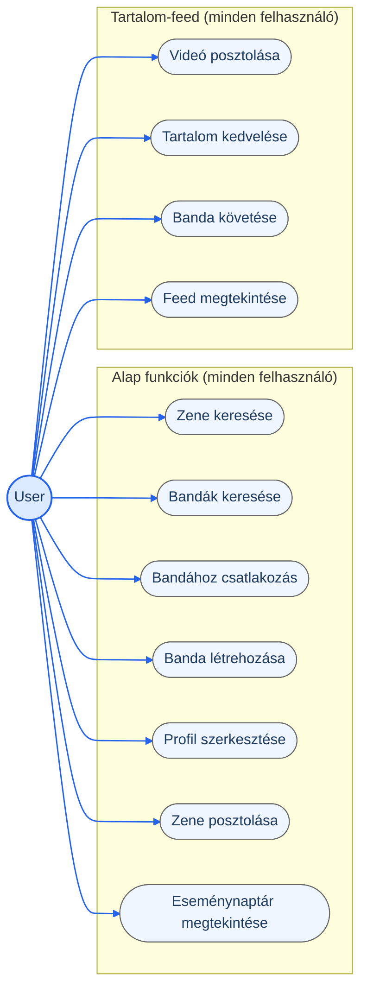

**Leader use case-ei:**

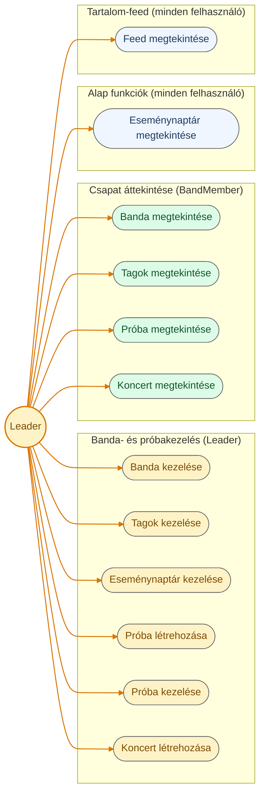

**BandMember use case-ei:**

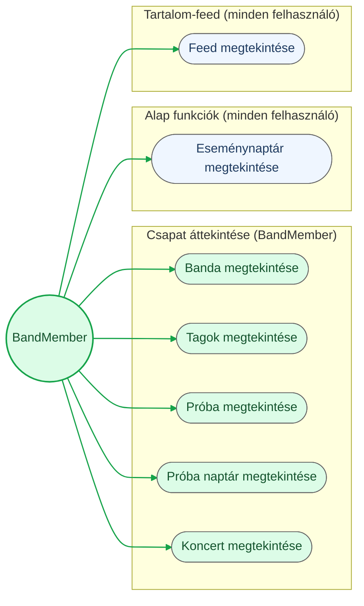

**Admin use case-ei:**

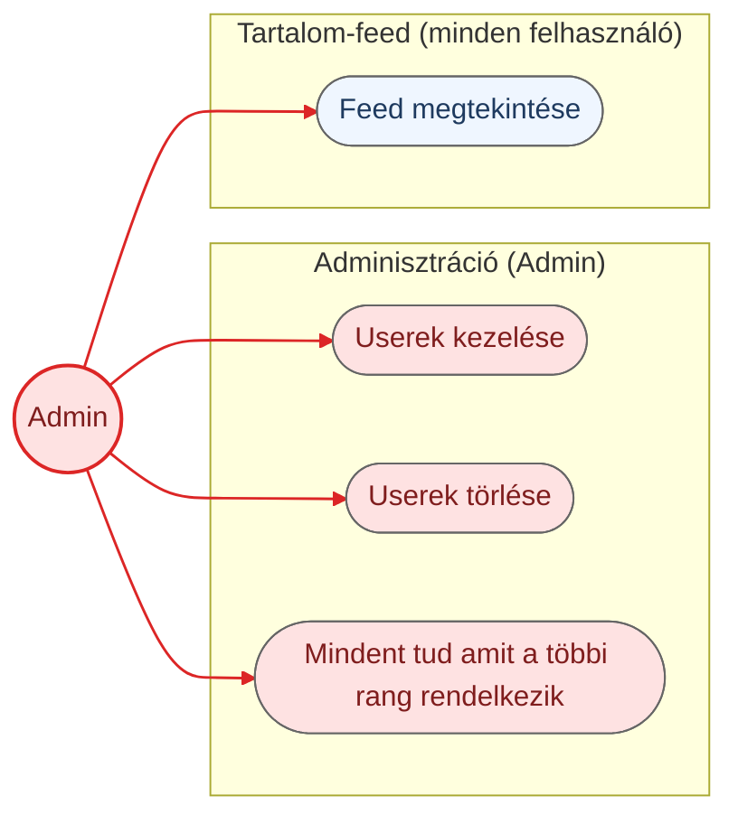

> **Tervezési javaslat — Tartalom-feed:** az Instagram-szerű "Feed megtekintése" funkció a felhasználó által követett bandák videó-/zenetartalmait (és minden más posztot) jeleníti meg, felhasználónként eltérő sorrendben (ld. [`diagrams/mermaid/Adatmodell.md`](../diagrams/mermaid/Adatmodell.md) "Feed-personalizáció" szakasz és [6.1](#sec-6-1)). A tartalom posztolása, kedvelése és a bandák követése egyelőre — a többi tartalom-létrehozó funkcióhoz (pl. Zene posztolása) hasonlóan — User-szintű funkció; a Feed megtekintése ugyanakkor minden szerepkör számára elérhető, az Eseménynaptár megtekintéséhez hasonlóan.

### 3.3 Szerepkör – funkció mátrix

| Funkció | User | Leader | BandMember | Admin |
|---|:---:|:---:|:---:|:---:|
| Zene keresése | ✔ | — | — | ✔ |
| Bandák keresése | ✔ | — | — | ✔ |
| Bandához csatlakozás | ✔ | — | — | ✔ |
| Banda létrehozása | ✔ | — | — | ✔ |
| Profil szerkesztése | ✔ | — | — | ✔ |
| Zene posztolása | ✔ | — | — | ✔ |
| Eseménynaptár megtekintése | ✔ | ✔ | ✔ | ✔ |
| Videó posztolása | ✔ | — | — | ✔ |
| Tartalom kedvelése | ✔ | — | — | ✔ |
| Banda követése | ✔ | — | — | ✔ |
| Feed megtekintése | ✔ | ✔ | ✔ | ✔ |
| Banda kezelése | — | ✔ | — | ✔ |
| Tagok kezelése | — | ✔ | — | ✔ |
| Eseménynaptár kezelése | — | ✔ | — | ✔ |
| Próba létrehozása | — | ✔ | — | ✔ |
| Próba kezelése | — | ✔ | — | ✔ |
| Koncert létrehozása | — | ✔ | — | ✔ |
| Banda megtekintése | — | ✔ | ✔ | ✔ |
| Tagok megtekintése | — | ✔ | ✔ | ✔ |
| Próba megtekintése | — | ✔ | ✔ | ✔ |
| Próba naptár megtekintése | — | — | ✔ | ✔ |
| Koncert megtekintése | — | ✔ | ✔ | ✔ |
| Userek kezelése | — | — | — | ✔ |
| Userek törlése | — | — | — | ✔ |

*A táblázat az eredeti use case diagram kapcsolatait tükrözi 1:1-ben (lásd 3.2).*

---

## 4. Rendszerarchitektúra

### 4.1 Architektúra-áttekintés (C4)

Az eredeti `c4.puml` fájl jelenleg üres. Az alábbi Context- és Container-szintű diagramok ezért **tervezési javaslatok**, a `Cont.md` ismert tényei (Java backend, konténerizált futtatás) és a use case diagram funkciói alapján összeállítva. A kliensoldalra a csapat több lehetséges platformot/technológiát is felvetett (ld. [4.2](#sec-4-2)) — ezeket a Container-diagram külön kliens-konténerekként, egy közös backendre támaszkodva tünteti fel.

**Context szint (javaslat):**

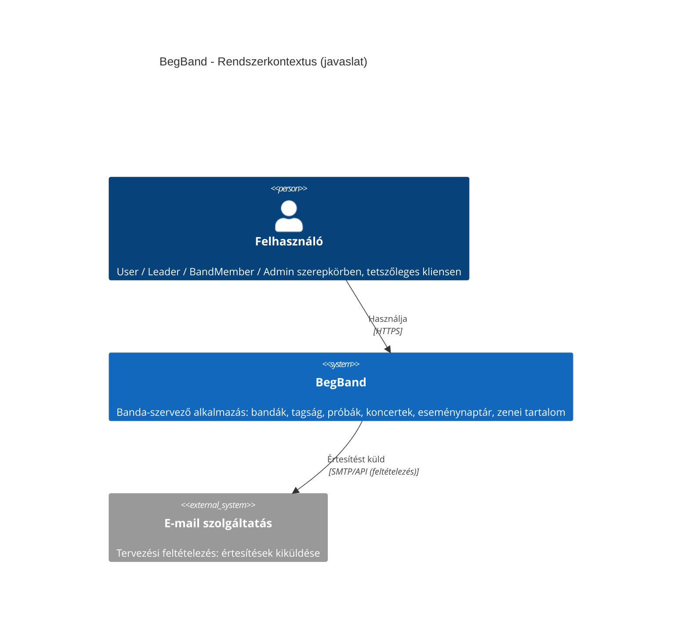

**Container szint (javaslat):**

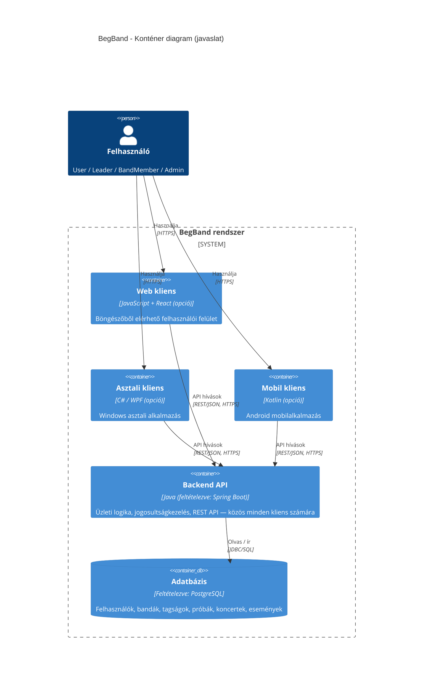

**Component szint:** a backend/kliens(ek) belső moduljai — lásd [5. fejezet](#sec-5).

> **HELYŐRZŐ:** a fenti javaslat jóváhagyása/pontosítása — konkrétan, hogy egy vagy több kliens platform készül-e el ténylegesen (jelenleg mindhárom, Web/Asztali/Mobil, csak felvetett lehetőség, nem eldöntött), valamint esetleges további konténerek (pl. cache, üzenetsor, fájltároló zenei tartalomhoz) — ezek a jelenlegi forrásanyagokból nem vezethetők le.

### 4.2 Technológiai stack

A [`diagrams/Cont.md`](../diagrams/Cont.md) alapján **ténylegesen ismert**: Java backend, konténerizált futtatás. A backend egységesen Java (REST API-t szolgál ki minden kliens felé), a kliensoldalra viszont a csapat **több lehetséges platformot/technológiát is felvetett**, amelyek közül még nincs végleges döntés:

| Platform | Lehetséges technológia | Forrás |
|---|---|---|
| Web kliens | JavaScript + React | Felvetett opció (megbeszélés) |
| Asztali kliens | C# (WPF) | Felvetett opció (megbeszélés) |
| Mobil kliens | Kotlin | Felvetett opció (megbeszélés) |

Az alábbi táblázat a backendre és a futtatási környezetre vonatkozó, ismert/javasolt technológiákat sorolja fel:

| Réteg | Technológia | Forrás |
|---|---|---|
| Backend | Java | Tény (`Cont.md`) |
| Backend keretrendszer | Spring Boot (REST API-hoz, DI-hez, biztonsághoz) | Tervezési javaslat |
| Futtatási/telepítési környezet | Konténerizált | Tény (`Cont.md`) |
| Konténer-orchestráció | Docker Compose (kis léptékű, egy szerveres üzemeltetéshez) | Tervezési javaslat |
| Adatbázis | PostgreSQL (relációs, jól illeszkedik a bandák/tagságok/események kapcsolati modelljéhez — ld. [6.1](#sec-6-1)) | Tervezési javaslat |
| Autentikáció | JWT alapú, session nélküli API-hitelesítés (platformfüggetlen, minden kliens típussal kompatibilis) | Tervezési javaslat |
| Reverse proxy / statikus kiszolgálás | Nginx (Web kliens build kiszolgálása, API proxyzás) | Tervezési javaslat |

> **HELYŐRZŐ:** melyik kliens platform(ok) készülnek el ténylegesen (Web / Asztali / Mobil / ezek kombinációja) — ez terméktulajdonosi/csapatdöntést igényel; a fenti opciók egyelőre nem véglegesítettek. A választott kliens(ek) build-eszközei (pl. Web esetén Vite + TypeScript, Mobil esetén Gradle, Asztali esetén .NET SDK) csak a döntés után részletezhetők. Emellett üzenetkezelés/cache réteg (pl. Redis) csak akkor indokolt, ha a terheléses/valós idejű funkciók (pl. élő értesítések) bekerülnek a tervbe — ennek szükségességét a terméktulajdonossal/architektúra-döntéssel kell megerősíteni.

### 4.3 Architekturális elvek és minták

**Tervezési javaslat:**
- **Architekturális stílus:** rétegezett, moduláris monolit (controller/service/repository rétegek, funkció szerint elkülönített modulokkal — ld. [5.1](#sec-5-1)). Indoklás: a jelenleg ismert funkciókészlet (banda-, próba-, koncertkezelés) mérete nem indokolja a mikroszolgáltatás-architektúra üzemeltetési többletköltségét egy korai fázisú projektnél.
- **API-stílus:** REST/JSON, erőforrás-alapú végpontokkal (pl. `/api/bands`, `/api/bands/{id}/rehearsals`).
- **Kliens-szerver szétválasztás:** a kliens(ek) — jelenleg felvetett opció szerint Web (React), Asztali (C#/WPF) és/vagy Mobil (Kotlin) — kizárólag a közös backend REST API-n keresztül kommunikálnak, önálló build/deploy egységként. Ez a szétválasztás teszi lehetővé, hogy a végleges kliens platform(ok) kiválasztása a backend API-t ne érintse.
- **Szerepkör-alapú hozzáférés-vezérlés (RBAC):** a use case diagramon (3.2) definiált négy szerepkör (User, Leader, BandMember, Admin) a backendben végpont-/műveletszintű jogosultság-ellenőrzésként valósul meg (ld. [10.2](#sec-10-2)).

> **HELYŐRZŐ:** a fenti architekturális döntések formális jóváhagyása a fejlesztőcsapat/architekt részéről, mielőtt az implementáció megkezdődne.

---

## 5. Komponensek és modulok

### 5.1 Backend komponensek

**Tervezési javaslat** — a use case diagram (3.2) funkciói alapján az alábbi domain modulok valószínűsíthetők, mindegyik a 4.3-ban javasolt controller/service/repository rétegződéssel:

| Modul | Felelősség | Kapcsolódó use case-ek |
|---|---|---|
| Felhasználó- és jogosultságkezelő modul | Regisztráció, bejelentkezés, profilszerkesztés, szerepkör-/jogosultság-ellenőrzés | Profil szerkesztése, belépés/regisztráció (7.1) |
| Bandakezelő modul | Banda létrehozása/keresése/kezelése, tagság (csatlakozás, tagok kezelése) | Banda létrehozása, Bandák keresése, Bandához csatlakozás, Banda kezelése, Tagok kezelése |
| Próba-/koncertkezelő modul | Próbák és koncertek létrehozása/kezelése/megtekintése | Próba létrehozása, Próba kezelése, Koncert létrehozása, Próba/Koncert megtekintése |
| Naptár modul | Eseménynaptár (próbák, koncertek) összesített megjelenítése és kezelése | Eseménynaptár megtekintése/kezelése, Próba naptár megtekintése |
| Zenei tartalom modul | Zene posztolása és keresése | Zene posztolása, Zene keresése |
| Adminisztrációs modul | Felhasználók kezelése/törlése | Userek kezelése, Userek törlése |

> **HELYŐRZŐ:** a fenti modulok tényleges kódstruktúrával (csomag-/package-elrendezés) való megfeleltetése az implementáció megkezdésekor válik ellenőrizhetővé.

### 5.2 Kliens komponensek

**Tervezési javaslat** — mivel a kliens platformra több lehetőség is felvetődött (Web/React, Asztali/C#-WPF, Mobil/Kotlin — ld. [4.2](#sec-4-2)), az alábbi fő nézetek/képernyők platformfüggetlenül, a 7.1 fejezet tevékenységdiagramjának képernyőfolyama alapján valószínűsíthetők; a tényleges komponens-/nézetfa csak a választott platform(ok) UI-keretrendszerének megfelelően, platformonként külön dokumentálandó:

- **Belépés/Regisztráció nézet** — a 7.1 folyamatábra "Bejelentkezés" és "Regisztráció" lépéseinek megfelelően, hibaüzenet-megjelenítéssel.
- **Főmenü nézet** — a bejelentkezett felhasználó szerepköre szerint eltérő navigációval (User / Leader / BandMember / Admin).
- **Banda nézetek** — banda keresése, banda létrehozása, banda/tagok megtekintése és kezelése (Leader esetén).
- **Naptár nézet** — próbák/koncertek megtekintése, Leader esetén kezelése.
- **Zenei tartalom nézet** — zene keresése és posztolása.
- **Profil nézet** — profil szerkesztése.
- **Adminisztrációs nézet** — felhasználók kezelése/törlése (Admin).

> **HELYŐRZŐ:** melyik kliens platform(ok) valósulnak meg ténylegesen (ld. [4.2](#sec-4-2) HELYŐRZŐ), és az egyes platformok komponensfa/mappastruktúrája a tényleges implementáció alapján bővítendő (pl. Web: React komponensfa, Asztali: WPF View/ViewModel struktúra, Mobil: Kotlin/Android komponensek).

### 5.3 Komponensek közötti kapcsolatok

A kliens(ek) és a backend a 4.1-ben javasolt Container-diagramnak megfelelően REST/JSON API-n keresztül, HTTPS-en kommunikálnak (ld. [4.3](#sec-4-3)) — a felvetett kliens platformok (Web/Asztali/Mobil) mindegyike ugyanazt a közös backend API-t használná, platformspecifikus különbség nélkül.

> **HELYŐRZŐ:** részletes API-szerződés (végpontlista, kérés-/válaszformátumok) — ez a backend implementáció során, pl. OpenAPI/Swagger specifikációként dokumentálandó.

---

## 6. Adatmodell és adatkezelés

### 6.1 Entitások és kapcsolatok (ER diagram)

A jelenlegi diagramkészletben nincs adatbázis-/ER-diagram; az alábbi **tervezési javaslat** a use case- és tevékenységdiagramok alapján levezetett entitásokat és mezőket mutatja be. A mezőlistát — a kapcsolatokat mutató diagram helyett, mert az egyben, mezőlistával nem minden Markdown-előnézőben (pl. régebbi mermaid-verziót futtató szerkesztő-bővítményben) jelenik meg — az azt követő táblázat sorolja fel; ld. [`diagrams/mermaid/Adatmodell.md`](../diagrams/mermaid/Adatmodell.md).

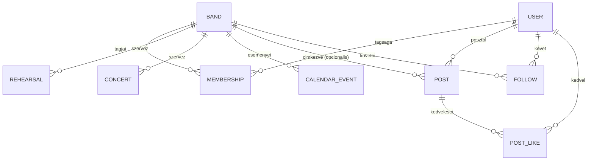

A `POST`, `FOLLOW` és `POST_LIKE` entitások a [3.2](#sec-3-2)-ben bevezetett **Tartalom-feed** funkciót (Instagram-szerű, személyre szabott videó-/zenefolyam) szolgálják ki.

| Entitás | Mező | Típus | Megjegyzés |
|---|---|---|---|
| USER | id | uuid | |
| USER | email | string | |
| USER | password_hash | string | |
| USER | display_name | string | |
| USER | role | string | User / Leader / BandMember / Admin |
| BAND | id | uuid | |
| BAND | name | string | |
| BAND | description | string | |
| BAND | leader_id | uuid | |
| MEMBERSHIP | id | uuid | |
| MEMBERSHIP | user_id | uuid | |
| MEMBERSHIP | band_id | uuid | |
| MEMBERSHIP | status | string | fuggoben / aktiv / elutasitva / eltavolitva |
| REHEARSAL | id | uuid | |
| REHEARSAL | band_id | uuid | |
| REHEARSAL | starts_at | datetime | |
| REHEARSAL | location | string | |
| CONCERT | id | uuid | |
| CONCERT | band_id | uuid | |
| CONCERT | starts_at | datetime | |
| CONCERT | venue | string | |
| CALENDAR_EVENT | id | uuid | |
| CALENDAR_EVENT | band_id | uuid | |
| CALENDAR_EVENT | type | string | proba / koncert / egyeb |
| CALENDAR_EVENT | starts_at | datetime | |
| POST | id | uuid | |
| POST | user_id | uuid | |
| POST | band_id | uuid | opcionális — banda nevében posztolva |
| POST | media_type | string | audio / video |
| POST | title | string | |
| POST | media_url | string | |
| POST | thumbnail_url | string | opcionális |
| FOLLOW | id | uuid | |
| FOLLOW | follower_id | uuid | a követő USER |
| FOLLOW | band_id | uuid | a követett BAND |
| POST_LIKE | id | uuid | |
| POST_LIKE | user_id | uuid | |
| POST_LIKE | post_id | uuid | |

**Feed-personalizáció (tervezési javaslat):** a "Feed megtekintése" mindenkinek ugyanazt a tartalomkészletet (POST) mutatja, de eltérő sorrendben — a `FOLLOW` alapján a követett bandák posztjai kerülnek előre, ezen belül létrehozás szerint csökkenő sorrend, a `POST_LIKE`-ból számított kedvelésszám pedig másodlagos rendezési szempont. A konkrét PostgreSQL DDL az implementációs fázis feladata; a séma tervezési szinten a fenti entitás-/mezőtáblázatban van rögzítve (a tervezés során egy próba-DDL-lel helyi PostgreSQL-en leellenőrizve, hogy a modell futtatható).

A `MEMBERSHIP.status` mező lehetséges átmeneteit az alábbi állapotgép-javaslat mutatja:

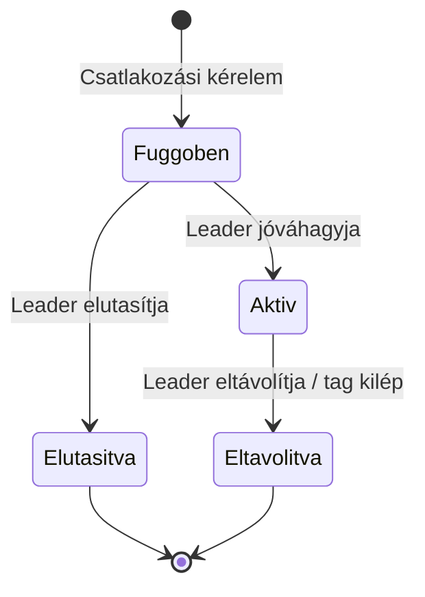

> **HELYŐRZŐ:** a fenti adatmodell és állapotgép jóváhagyása/pontosítása a tényleges adatbázis-tervezéskor; mezőnevek, típusok és megszorítások (pl. egyediségi kényszerek) még nem véglegesek.

### 6.2 Adatkezelési elvek, adatvédelem

A 6.1-ben javasolt adatmodell alapján a rendszer az alábbi személyes adatokat kezelné: e-mail cím, jelszó (hash formában), megjelenítendő név, valamint a felhasználó által posztolt tartalom. **Tervezési javaslat:**
- A jelszavakat kizárólag hash formában (pl. bcrypt/Argon2) szabad tárolni, soha nem plain textben.
- A rendszernek — mivel uniós felhasználók személyes adatait kezelheti — meg kell felelnie a GDPR alapelveinek (adattakarékosság, célhoz kötöttség, hozzáférési/törlési jog biztosítása).

> **HELYŐRZŐ:** a jogalap (pl. szerződés teljesítése vagy hozzájárulás), az adatkezelési tájékoztató szövege és a tényleges GDPR-megfelelőségi audit — ezek jogi/szervezeti döntést igényelnek, a jelenlegi forrásanyagokból nem vezethetők le.

### 6.3 Adatmegőrzés és biztonsági mentés

> **HELYŐRZŐ:** mentési (backup) gyakoriság, megőrzési idő, helyreállítási terv (RPO/RTO) — ezek az üzemeltetési környezet (ld. [9. fejezet](#sec-9)) kialakításakor, az adatbázis-választással (jelenleg tervezési javaslat: PostgreSQL, ld. [4.2](#sec-4-2)) összhangban döntendők el.

---

## 7. Folyamatok és szekvenciák

### 7.1 Belépés / regisztráció / szerepkör-alapú főfolyamat

Az alábbi folyamatábra a felhasználó belépési/regisztrációs folyamatát, majd a szerepkör szerinti főmenü-ciklust mutatja be.

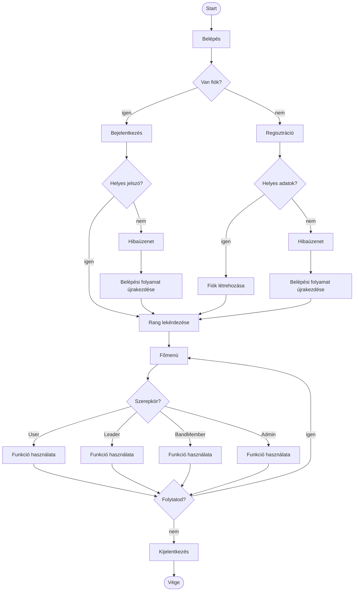

> **Megjegyzés:** az eredeti PlantUML-forrásban hibás bejelentkezés/regisztráció esetén a folyamat nem tér vissza explicit módon a belépési döntési ponthoz, hanem — az `if`-blokk lezárása után — továbblép a rang lekérdezéséhez. Ezt a konverzió szándékosan megtartotta; ha ez a rendszer tervezett viselkedésétől eltér, a forrás `Activity.puml` és a Mermaid-átirat egyaránt javítandó.

### 7.2 Use case-enkénti tevékenységdiagramok

A [3.2](#sec-3-2) fejezetben felsorolt **minden egyes use case-hez** tartozik egy önálló, kompakt activity (tevékenység-) diagram, amely az adott funkció lépéseit mutatja be. Ezeket — a use case diagramhoz hasonlóan — csomagonként (Common/Tartalom-feed, Leader, BandMember, Admin) külön fájlokba szerveztük az áttekinthetőség miatt:

- [`diagrams/mermaid/ActivityCommon.md`](../diagrams/mermaid/ActivityCommon.md) — Alap funkciók és Tartalom-feed (11 diagram: Zene keresése, Bandák keresése, Bandához csatlakozás, Banda létrehozása, Profil szerkesztése, Zene posztolása, Eseménynaptár megtekintése, Videó posztolása, Tartalom kedvelése, Banda követése, Feed megtekintése)
- [`diagrams/mermaid/ActivityLeader.md`](../diagrams/mermaid/ActivityLeader.md) — Banda- és próbakezelés (6 diagram: Banda kezelése, Tagok kezelése, Eseménynaptár kezelése, Próba létrehozása, Próba kezelése, Koncert létrehozása)
- [`diagrams/mermaid/ActivityMember.md`](../diagrams/mermaid/ActivityMember.md) — Csapat áttekintése (5 diagram: Banda megtekintése, Tagok megtekintése, Próba megtekintése, Próba naptár megtekintése, Koncert megtekintése)
- [`diagrams/mermaid/ActivityAdmin.md`](../diagrams/mermaid/ActivityAdmin.md) — Adminisztráció (2 diagram: Userek kezelése, Userek törlése — a "Mindent tud amit a többi rang rendelkezik" use case a másik három csomag diagramjaira hivatkozik, nincs önálló folyamata)

Ez összesen 24 use case-hez tartozó activity diagramot jelent, ami megfelel a [3.2](#sec-3-2) és [3.3](#sec-3-3) fejezetben felsorolt összes egyedi funkciónak. A 7.1-ben bemutatott belépési/regisztrációs főfolyam ezeket megelőzi (a Főmenüből ér el minden ilyen funkciót).

> **HELYŐRZŐ:** a diagramok a use case nevéből és a use case-hez tartozó entitásokból ([6.1](#sec-6-1)) levezetett, tervezési javaslat szintű lépéseket mutatnak; a tényleges UI/API implementáció során pontosítandók.

### 7.3 További folyamatok

A következő szekvenciadiagramok **tervezési javaslatok**, a use case diagram (3.2) megfelelő funkcióiból levezetve, feltételezett REST API-val.

**Banda létrehozása:**

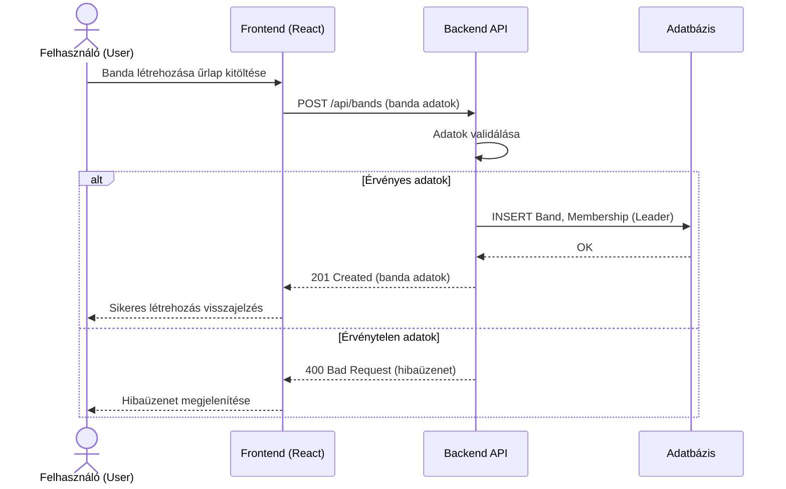

**Próba létrehozása:**

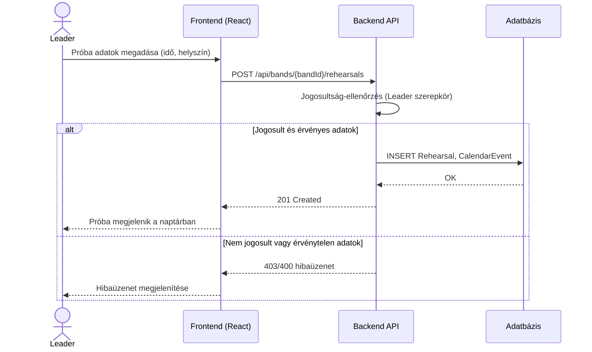

> **HELYŐRZŐ:** további folyamatok (pl. tagfelvétel jóváhagyása, koncert létrehozása, zenei tartalom posztolása) hasonló felépítésű szekvenciadiagramokkal bővítendők, amint a részletes folyamattervek elkészülnek.

---

## 8. Integrációk és külső rendszerek

A jelenlegi diagramok és a `Cont.md` alapján a rendszernek **nincs dokumentált külső integrációja** — minden ismert funkció (banda-, próba-, koncertkezelés, zenei tartalom, naptár) a rendszeren belül, önállóan megvalósíthatónak tűnik.

Az egyetlen valószínűsíthető, a 4.1 Context-diagramban jelölt kapcsolat egy **e-mail szolgáltatás** (pl. csatlakozási kérelemről vagy közelgő próbáról/koncertről szóló értesítéshez) — ez azonban **tervezési feltételezés**, nem megerősített integráció.

> **HELYŐRZŐ:** amennyiben a jövőben külső rendszer (pl. zenei streaming API, naptár-szinkronizáció, fizetési/jegyértékesítési szolgáltató) bevonása tervbe kerül, az itt és a 4.1 Context-diagramon dokumentálandó.

---

## 9. Telepítési és üzemeltetési architektúra

### 9.1 Konténerizáció

A [`diagrams/Cont.md`](../diagrams/Cont.md) szerint a rendszer konténerizált háttérrel tervezett. *(Tény.)*

**Tervezési javaslat:** a szerveroldal — backend és adatbázis, illetve a Web kliens buildje, ha az készül el (ld. [4.2](#sec-4-2)) — Docker image-ekként épül, és Docker Compose-szal indítható együtt; ez a jelenlegi (feltételezhetően kis léptékű) projektmérethez a legegyszerűbb, alacsony üzemeltetési többletköltségű megoldás. Az image-eket egy konténer-registry (pl. Docker Hub vagy privát registry) tárolná. Az Asztali (C#/WPF) és Mobil (Kotlin) kliens — ha ezek is elkészülnek — nem konténerizált szerveroldali komponensek, hanem a felhasználó gépére/eszközére telepített alkalmazások, saját (nem konténeres) csomagolási és terjesztési móddal (pl. telepítőcsomag, áruházi disztribúció).

> **HELYŐRZŐ:** a konkrét registry, valamint az, hogy indokolt-e Kubernetes-re váltani (pl. skálázási igény esetén) — ez a projekt növekedésével döntendő el. Az Asztali/Mobil kliens tényleges terjesztési módja (pl. telepítőcsomag, áruház) szintén a kliens platform(ok) kiválasztása után döntendő el.

### 9.2 Környezetek

**Tervezési javaslat:** legalább két környezet indokolt:

| Környezet | Cél |
|---|---|
| Fejlesztői (dev) | Helyi fejlesztés, Docker Compose-szal indítva |
| Éles (production) | Az üzemeltetett, felhasználók által elért rendszer |

> **HELYŐRZŐ:** külön teszt/staging környezet szükségessége, a környezetek közti konfigurációs eltérések (ld. [11. fejezet](#sec-11)), valamint a promóciós (dev → staging → prod) folyamat — ezek a csapat méretétől és folyamataitól függenek, jelenleg nem ismertek.

### 9.3 Skálázás és rendelkezésre állás

> **HELYŐRZŐ:** a projekt jelenlegi, korai fázisában nincs ismert terhelési/rendelkezésre állási elvárás (SLA/SLO), ezért konkrét skálázási stratégia (horizontális/vertikális) és terheléselosztás megtervezése korai; ezt a felhasználószám és a tényleges terhelés ismeretében érdemes meghatározni.

---

## 10. Biztonság és jogosultságkezelés

### 10.1 Hitelesítés (Authentication)

A tevékenységdiagram (7.1) alapján a rendszer bejelentkezési és regisztrációs folyamattal, jelszó-ellenőrzéssel rendelkezik. *(Tény.)*

**Tervezési javaslat:**
- A hitelesítés session nélküli, **JWT-alapú** legyen — a frontend a sikeres bejelentkezés (7.1 folyamat) után egy tokent kap, amelyet minden további API-híváshoz csatol.
- A jelszavakat kizárólag hash formában (bcrypt/Argon2) szabad tárolni (ld. [6.2](#sec-6-2)).

> **HELYŐRZŐ:** jelszó-komplexitási elvárások, jelszó-visszaállítási folyamat, valamint többfaktoros hitelesítés bevezetése — ezek jelenleg nem szerepelnek a forrásanyagokban.

### 10.2 Jogosultságkezelés (Authorization)

A rendszer négy szerepkört különböztet meg (User, Leader, BandMember, Admin) — lásd a [3.3 szerepkör–funkció mátrixot](#sec-3-3). Az Admin szerepkör a use case diagram szerint az összes többi szerepkör jogosultságát öröklinek tekinthető. *(Tény.)*

**Tervezési javaslat:** a jogosultságkezelés szerepkör-alapú hozzáférés-vezérlésként (RBAC) valósul meg — minden API-végpontnál a backend ellenőrzi a JWT tokenben szereplő szerepkört a 3.3 mátrixnak megfelelően (pl. a `/api/bands/{id}` törlés-jellegű vagy kezelő műveletei csak Leader/Admin számára engedélyezettek). A banda-specifikus jogosultságokat (pl. "az adott banda Leader-e") a `Membership` entitáshoz (ld. [6.1](#sec-6-1)) kötve kell ellenőrizni, nem csak a globális szerepkör alapján.

### 10.3 Adatbiztonság

**Tervezési javaslat:**
- Az API-kommunikáció kizárólag HTTPS-en keresztül történjen (átvitel közbeni titkosítás).
- Titkok (JWT aláíró kulcs, adatbázis-jelszó) ne kerüljenek a forráskódba, hanem környezeti változóként/secret store-ból érkezzenek (ld. [11. fejezet](#sec-11)).

> **HELYŐRZŐ:** nyugalmi állapotú (at-rest) titkosítás szükségessége, valamint a sebezhetőség-kezelési folyamat (pl. függőség-frissítési politika) — ezek üzemeltetési döntést igényelnek.

---

## 11. Konfiguráció és környezeti változók

A projektben jelenleg nincs konfigurációs fájl vagy `.env` sablon. Az alábbi táblázat a 4.2-ben javasolt technológiai stack (Spring Boot backend, PostgreSQL, JWT) alapján **tervezési javaslatként** sorolja fel a várhatóan szükséges környezeti változókat:

| Változó neve | Leírás | Alapérték | Kötelező |
|---|---|---|---|
| `SERVER_PORT` | A backend API HTTP portja | `8080` | Nem |
| `DB_URL` | Adatbázis-kapcsolati URL (PostgreSQL) | — | Igen |
| `DB_USERNAME` | Adatbázis-felhasználó | — | Igen |
| `DB_PASSWORD` | Adatbázis-jelszó (secret) | — | Igen |
| `JWT_SECRET` | A JWT tokenek aláírásához használt titkos kulcs (secret) | — | Igen |
| `JWT_EXPIRATION_MINUTES` | A kiadott JWT token érvényességi ideje percben | HELYŐRZŐ | Nem |
| `FRONTEND_ORIGIN` | Engedélyezett CORS-origin a frontend számára | — | Igen |

> **HELYŐRZŐ:** a fenti lista a tényleges implementáció során pontosítandó/bővítendő (pl. e-mail szolgáltatás hitelesítő adatai, ha a 8. fejezetben jelzett integráció megvalósul); a konkrét alapértékek és a titkok kezelési módja (pl. secret store) üzemeltetési döntést igényel.

---

## 12. Hibakezelés és naplózás

### 12.1 Hibakezelési stratégia

A tevékenységdiagram (7.1) "Hibaüzenet" lépései (sikertelen bejelentkezés/regisztráció) alapján a rendszernek strukturált hibavisszajelzést kell adnia a felhasználó felé. **Tervezési javaslat:**
- A backend egységes, JSON formátumú hibaválaszt ad (pl. `{"error": "...", "message": "..."}`), megfelelő HTTP státuszkóddal (400 érvénytelen adat, 401/403 jogosultsági hiba, 404 nem található, 409 ütközés).
- Globális kivételkezelés (Spring esetén pl. `@ControllerAdvice`) gondoskodik arról, hogy minden hiba egységes formában kerüljön vissza.
- A frontend a kapott hibaüzenetet jeleníti meg a felhasználónak (7.1 folyamat "Hibaüzenet" lépése).

### 12.2 Naplózás (logging) és monitorozás

**Tervezési javaslat:** a backend a Java ökoszisztémában szokásos SLF4J/Logback naplózást használja, legalább az alábbi szintekkel: `ERROR` (kezeletlen kivételek), `WARN` (jogosultsági elutasítás, érvénytelen bemenet), `INFO` (fő üzleti események, pl. banda létrehozása, próba ütemezése).

> **HELYŐRZŐ:** központi log-gyűjtés (pl. ELK/Loki) és monitorozó/riasztó rendszer (pl. Prometheus/Grafana) bevezetése — ez az üzemeltetési környezet (9. fejezet) kialakításával összhangban, a projekt méretének növekedésével válik indokolttá.

---

## 13. Tesztelési stratégia

**Tervezési javaslat**, a 4.2-ben javasolt stackhez illeszkedve:

| Tesztszint | Javasolt eszköz | Fókusz |
|---|---|---|
| Unit teszt (backend) | JUnit + Mockito | Service-réteg üzleti logikája (pl. jogosultság-ellenőrzés, validáció) |
| Unit/komponens teszt (frontend) | React Testing Library | Egyes UI-komponensek viselkedése |
| Integrációs teszt (backend) | Spring Boot Test (teszt-adatbázissal) | API-végpontok, adatbázis-műveletek |
| End-to-end (E2E) teszt | Playwright vagy Cypress | A 7.1 fő folyamat (belépés/regisztráció → szerepkör szerinti funkció) és a use case-ek (3.2) végponttól végpontig |

Minden use case-hez (3.2) legalább egy pozitív és egy negatív (pl. jogosultság hiányában elutasított) teszteset rendelendő.

> **HELYŐRZŐ:** konkrét lefedettségi célszám (pl. %) és a CI-ba illesztés részletei — ezek a csapat gyakorlatától függenek, jelenleg nem ismertek.

---

## 14. Telepítés és kiadáskezelés

**Tervezési javaslat:**
- **CI/CD:** a repó jelenleg GitHub-on van (lásd a git-előzményeket); a build/teszt/deploy lépések GitHub Actions workflow-val automatizálhatók: (1) backend build + unit/integrációs teszt, (2) a választott kliens platform(ok) build + teszt (pl. Web: React build, Asztali: .NET build, Mobil: Gradle build — ld. [4.2](#sec-4-2)), (3) a szerveroldali Docker image-ek építése, (4) image-ek publikálása egy registrybe, (5) telepítés az adott környezetbe (ld. [9.2](#sec-9-2)); az Asztali/Mobil kliens esetén a "telepítés" helyett a kiadás publikálása/csomagolása értendő (ld. [9.1](#sec-9-1)).
- **Branching stratégia:** `main` ág mindig telepíthető állapotban; funkció-ágak (`feature/...`) pull request-en keresztül kerülnek be.
- **Verziózás:** szemantikus verziózás (SemVer) a kiadásokhoz.
- **Rollback:** mivel a rendszer konténerizált, egy korábbi, ismert jó image-verzióra való visszaállás a legegyszerűbb rollback-mechanizmus.

> **HELYŐRZŐ:** a fenti CI/CD-javaslat tényleges bevezetése és a konkrét eszközválasztás (pl. GitHub Actions vs. más CI) jóváhagyása a csapat részéről.

---

## 15. Ismert problémák és továbbfejlesztési lehetőségek

- **Ismert probléma (jelölt):** az Activity diagram szerint sikertelen bejelentkezés/regisztráció esetén a folyamat a hibaüzenet után nem tér vissza a belépési képernyőhöz, hanem továbblép — ezt érdemes átvizsgálni, hogy a tervezett viselkedésnek megfelel-e (lásd [7.1](#sec-7-1)).
- **Hiányzó tartalom:** a `c4.puml` architektúra-diagram forrása jelenleg üres; a [4.1](#sec-4-1) fejezetben szereplő C4-diagramok tervezési javaslatok, a csapatnak jóvá kell hagynia (vagy módosítania), majd ez alapján érdemes frissíteni a `c4.puml` forrást is.
- **Nyitott döntések:** a dokumentum számos "Tervezési javaslat" jelölésű technológiai/architekturális döntést tartalmaz (pl. Spring Boot, PostgreSQL, JWT, Docker Compose — ld. [4.2](#sec-4-2)), amelyek még nincsenek hivatalosan jóváhagyva.

> **HELYŐRZŐ:** további ismert korlátok, technikai adósság, és a tervezett fejlesztési irányok (roadmap) a projekt előrehaladtával bővítendők.

---

## 16. Mellékletek

### 16.1 Diagramjegyzék

| Diagram | Típus | PlantUML forrás | Mermaid átirat | Állapot |
|---|---|---|---|---|
| Use Case diagram | Use case (→ Mermaid `flowchart`) | [`diagrams/UseCase.puml`](../diagrams/UseCase.puml) | [`diagrams/mermaid/UseCase.md`](../diagrams/mermaid/UseCase.md) | Kész — konverzió |
| Activity diagram | Tevékenységdiagram (→ Mermaid `flowchart`) | [`diagrams/Activity.puml`](../diagrams/Activity.puml) | [`diagrams/mermaid/Activity.md`](../diagrams/mermaid/Activity.md) | Kész — konverzió |
| C4 Context diagram | Architektúra (→ Mermaid `C4Context`) | [`diagrams/c4.puml`](../diagrams/c4.puml) *(üres)* | [`diagrams/mermaid/Context.md`](../diagrams/mermaid/Context.md) | **Tervezési javaslat — jóváhagyást igényel** |
| C4 Container diagram | Architektúra (→ Mermaid `C4Container`) | [`diagrams/c4.puml`](../diagrams/c4.puml) *(üres)* | [`diagrams/mermaid/Container.md`](../diagrams/mermaid/Container.md) | **Tervezési javaslat — jóváhagyást igényel** |
| Adatmodell (ER diagram) | `erDiagram` | *nincs PlantUML forrás* | [`diagrams/mermaid/Adatmodell.md`](../diagrams/mermaid/Adatmodell.md) | **Tervezési javaslat — jóváhagyást igényel** |
| Tagság állapotgépe | `stateDiagram-v2` | *nincs PlantUML forrás* | [`diagrams/mermaid/TagsagAllapota.md`](../diagrams/mermaid/TagsagAllapota.md) | **Tervezési javaslat — jóváhagyást igényel** |
| Banda létrehozása (szekvencia) | `sequenceDiagram` | *nincs PlantUML forrás* | [`diagrams/mermaid/BandaLetrehozasa.md`](../diagrams/mermaid/BandaLetrehozasa.md) | **Tervezési javaslat — jóváhagyást igényel** |
| Próba létrehozása (szekvencia) | `sequenceDiagram` | *nincs PlantUML forrás* | [`diagrams/mermaid/ProbaLetrehozasa.md`](../diagrams/mermaid/ProbaLetrehozasa.md) | **Tervezési javaslat — jóváhagyást igényel** |
| Activity — Common/Feed (11 use case) | Tevékenységdiagramok (`flowchart`) | *nincs PlantUML forrás* | [`diagrams/mermaid/ActivityCommon.md`](../diagrams/mermaid/ActivityCommon.md) | **Tervezési javaslat — jóváhagyást igényel** |
| Activity — Leader (6 use case) | Tevékenységdiagramok (`flowchart`) | *nincs PlantUML forrás* | [`diagrams/mermaid/ActivityLeader.md`](../diagrams/mermaid/ActivityLeader.md) | **Tervezési javaslat — jóváhagyást igényel** |
| Activity — BandMember (5 use case) | Tevékenységdiagramok (`flowchart`) | *nincs PlantUML forrás* | [`diagrams/mermaid/ActivityMember.md`](../diagrams/mermaid/ActivityMember.md) | **Tervezési javaslat — jóváhagyást igényel** |
| Activity — Admin (2 use case) | Tevékenységdiagramok (`flowchart`) | *nincs PlantUML forrás* | [`diagrams/mermaid/ActivityAdmin.md`](../diagrams/mermaid/ActivityAdmin.md) | **Tervezési javaslat — jóváhagyást igényel** |

### 16.2 Fogalomtár

| Fogalom | Jelentés |
|---|---|
| **Banda (Band)** | Zenekar, amelyet egy Leader hoz létre és kezel, tagjai BandMember szerepkörrel rendelkeznek. |
| **Leader** | A banda vezetője; a bandára és annak próbáira/koncertjeire vonatkozó kezelési jogosultságokkal rendelkezik. |
| **BandMember** | A banda tagja; a bandához és eseményeihez kapcsolódó megtekintési jogosultságokkal rendelkezik. |
| **User** | Regisztrált, banda-tagsággal (még) nem feltétlenül rendelkező alapfelhasználó. |
| **Admin** | Rendszergazda; minden szerepkör jogosultságával rendelkezik, valamint felhasználókezelési joga van. |
| **Próba (Rehearsal)** | A banda által szervezett, naptárban megjelenő esemény. |
| **Koncert (Concert)** | A banda által szervezett nyilvános fellépés/esemény. |
| **Poszt (Post)** | Egy felhasználó (opcionálisan egy banda nevében) által megosztott videó- vagy zenetartalom, amely a Feedben jelenik meg. |
| **Feed** | Instagram-szerű, személyre szabott tartalomfolyam, amely a Posztokat felhasználónként eltérő sorrendben (követett bandák, kedvelések alapján) jeleníti meg — ld. [3.2](#sec-3-2), [6.1](#sec-6-1). |
| **Követés (Follow)** | Egy User és egy Band közötti kapcsolat, amely a Feed personalizációjának alapja: a követett bandák posztjai előrébb jelennek meg. |
| **Kedvelés (Like)** | Egy User pozitív visszajelzése egy Poszthoz; a Feedben a rangsorolás másodlagos szempontja. |

> **HELYŐRZŐ:** további, projektspecifikus fogalmak bővítendők.

### 16.3 Verziótörténet

| Verzió | Dátum | Szerző | Változás |
|---|---|---|---|
| 0.1 | 2026-09-13 | HELYŐRZŐ | A dokumentáció-séma első létrehozása a meglévő diagramok (Use Case, Activity) és a `Cont.md` alapján; Mermaid-diagramok elkészítése és beillesztése. |
| 0.2 | 2026-09-13 | HELYŐRZŐ | A helyőrzők nagy részének kiváltása tervezési javaslatokkal (architektúra, adatmodell, biztonság, üzemeltetés stb.), valamint új Mermaid-diagramok (C4 Context/Container, ER, állapotgép, két szekvenciadiagram) hozzáadása. A javaslatok jóváhagyása még hátravan. |
| 0.3 | 2026-09-15 | HELYŐRZŐ | A 3.2 fejezet use case diagramja frissítve a [`diagrams/mermaid/UseCase.md`](../diagrams/mermaid/UseCase.md) aktuális tartalmával: az egyetlen, minden szereplőt és funkciót tartalmazó ábra helyett egy funkciócsoport-katalógus és négy, szereplőnkénti (User/Leader/BandMember/Admin) diagram szerepel az átláthatóság érdekében. A szereplő–funkció kapcsolatok tartalmilag nem változtak. |
| 0.4 | 2026-09-15 | HELYŐRZŐ | Beépítve a csapat által felvetett kliens platform-opciók: Web (JavaScript + React), Asztali (C# / WPF), Mobil (Kotlin) — a backend (Java) marad az egységes, közös REST API minden kliens számára. Érintett fejezetek: 1 (hatókör/célközönség), 4.1 (C4 Context/Container diagramok — kliens-konténerek), 4.2 (technológiai stack — platform-opció táblázat), 4.3 (kliens-szerver szétválasztás), 5.2 ("Frontend komponensek" → "Kliens komponensek"), 5.3, 9.1 (konténerizáció — Asztali/Mobil kliens nem konténerizált), 14 (CI/CD — platformonkénti build). Egyik kliens platform sincs véglegesítve, ezek jelenleg opciók. |
| 0.5 | 2026-09-15 | HELYŐRZŐ | Javítva: a [6.1](#sec-6-1) ER diagramja egyes Markdown-előnézőkben (pl. régebbi mermaid-verziót futtató szerkesztő-bővítményben) nem jelent meg, mert a mezőlistát tartalmazó `erDiagram` szintaxis (entitásonkénti `{ ... }` blokk) újabb mermaid-funkció, amit nem minden renderelő támogat. A diagram mostantól csak a kapcsolatokat mutatja, a mezőket egy külön táblázat sorolja fel — ugyanez a javítás átvezetve a [`diagrams/mermaid/Adatmodell.md`](../diagrams/mermaid/Adatmodell.md) forrásba is. |
| 0.6 | 2026-09-17 | HELYŐRZŐ | Új **Tartalom-feed** funkció (Instagram-szerű, felhasználónként személyre szabott videó-/zenefolyam külön menüben): 4 új use case (Videó posztolása, Tartalom kedvelése, Banda követése, Feed megtekintése) a [3.2](#sec-3-2)/[3.3](#sec-3-3)-ban, 3 új entitás (POST bővítve, FOLLOW, POST_LIKE) a [6.1](#sec-6-1)-ben. Minden use case-hez (24 db) külön **activity diagram** készült, csomagonként 4 fájlba szervezve (ld. [7.2](#sec-7-2)). *(Egy PostgreSQL DDL és egy mocked backend/frontend implementáció is elkészült ebben a körben, de a csapat megerősítette, hogy ez a fázis kizárólag dokumentálásról és tervezésről szól — ezért mindkettő eltávolításra került; a tényleges DDL és implementáció egy későbbi, külön döntött fázis feladata.)* |
